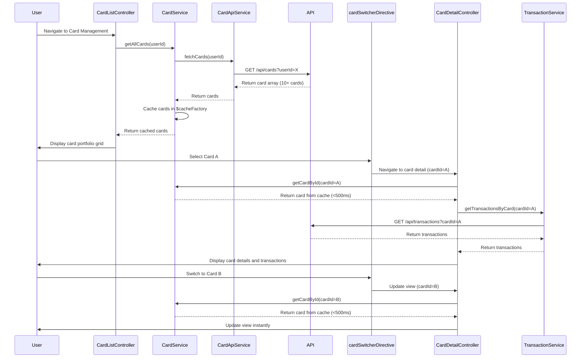

# Low-Level Design: QE-7569 - Multiple Credit Card Management

## a. Architecture Mapping

**AngularJS Artifacts:**
- **cardManagementModule** - Main module for multi-card management features
- **CardListController** - Manages card portfolio view and card selection state
- **CardDetailController** - Manages individual card detail view and transaction display
- **CardService** - Handles card data retrieval, filtering, and card-specific metrics computation
- **TransactionService** - Manages transaction history retrieval and filtering by card
- **CardApiService** - REST API integration for card data operations
- **TransactionApiService** - REST API integration for transaction data operations
- **cardListDirective** - Directive for rendering card portfolio grid/list
- **cardSwitcherDirective** - Directive for fast card switching UI component

**Folder Structure:**
```
app/
├── modules/card-management/
│   ├── card-management.module.js
│   ├── controllers/card-list.controller.js
│   ├── controllers/card-detail.controller.js
│   ├── services/card.service.js
│   ├── services/transaction.service.js
│   ├── services/card-api.service.js
│   ├── services/transaction-api.service.js
│   ├── directives/card-list.directive.js
│   ├── directives/card-switcher.directive.js
│   ├── views/card-list.html
│   ├── views/card-detail.html
│   └── styles/card-management.css
```

## b. Component Specifications

| Component Name | Artifact Type | Responsibility | Key Dependencies |
|----------------|---------------|----------------|------------------|
| cardManagementModule | Module | Registers all card management components and configures routing | ngRoute, ui.bootstrap |
| CardListController | Controller | Manages card portfolio view, handles card selection and filtering | CardService, $scope, $state |
| CardDetailController | Controller | Manages single card detail view, displays card-specific metrics and transactions | CardService, TransactionService, $scope, $stateParams |
| CardService | Service | Retrieves and caches card data, computes card-specific spend analysis | CardApiService, $q, $cacheFactory |
| TransactionService | Service | Fetches and filters transaction history by cardId with pagination support | TransactionApiService, $q |
| CardApiService | Service | REST API calls for card CRUD operations with user ownership validation | $http, $q |
| TransactionApiService | Service | REST API calls for transaction retrieval with cardId filtering | $http, $q |
| cardListDirective | Directive | Renders responsive card grid with card metadata and quick actions | None |
| cardSwitcherDirective | Directive | Provides dropdown/tabs for sub-500ms card switching with cached data | CardService |

## c. Data Model

**CreditCard Model:**
```javascript
{
  cardId: String,
  userId: String,
  cardNumber: String, // Masked (e.g., '**** **** **** 1234')
  cardHolderName: String,
  cardType: String, // 'Visa', 'Mastercard', 'Amex'
  creditLimit: Number,
  currentBalance: Number,
  availableCredit: Number,
  outstandingAmount: Number,
  expiryDate: String, // 'MM/YY'
  status: String, // 'Active', 'Blocked', 'Expired'
  lastUpdated: Date
}
```

**Transaction Model:**
```javascript
{
  transactionId: String,
  cardId: String,
  amount: Number,
  category: String,
  date: Date,
  description: String,
  merchantName: String,
  status: String // 'Posted', 'Pending'
}
```

**CardSpendAnalysis Model:**
```javascript
{
  cardId: String,
  currentMonthSpend: Number,
  lastMonthSpend: Number,
  yearToDateSpend: Number,
  topCategory: String,
  transactionCount: Number
}
```

## d. Data Flow

User navigates to card management view → CardListController calls CardService.getAllCards(userId) → CardService invokes CardApiService with user ownership validation → API returns array of up to 10+ cards → CardService caches card data and computes aggregated metrics → cardListDirective renders card grid with Bootstrap responsive layout → User selects card via cardSwitcherDirective → Controller updates $state with cardId parameter within 500ms using cached data → CardDetailController initializes with cardId from $stateParams → Calls CardService.getCardById(cardId) from cache and TransactionService.getTransactionsByCard(cardId) → TransactionApiService fetches card-specific transaction history → Card details and transactions displayed in view → User switches to another card via switcher, triggering instant view update from cache.

## e. Primary Sequence Diagram



## f. Implementation Notes

- Use AngularJS $cacheFactory in CardService to cache all user cards for sub-500ms switching performance
- Implement card ownership validation in CardApiService by passing userId token in API headers
- Leverage ui-router for nested views (card list → card detail) with $stateParams for cardId passing
- Use ES6 Map for efficient cardId-based lookups in CardService cache
- Apply lazy loading for transaction history to optimize initial card detail view load time

## g. Error Handling

HTTP interceptor captures API errors; CardService falls back to cached data with user notification via toast on sync failure.

## h. Security Notes

Requires token-based auth via existing SSO; card numbers masked in UI; API validates user ownership before returning card data.