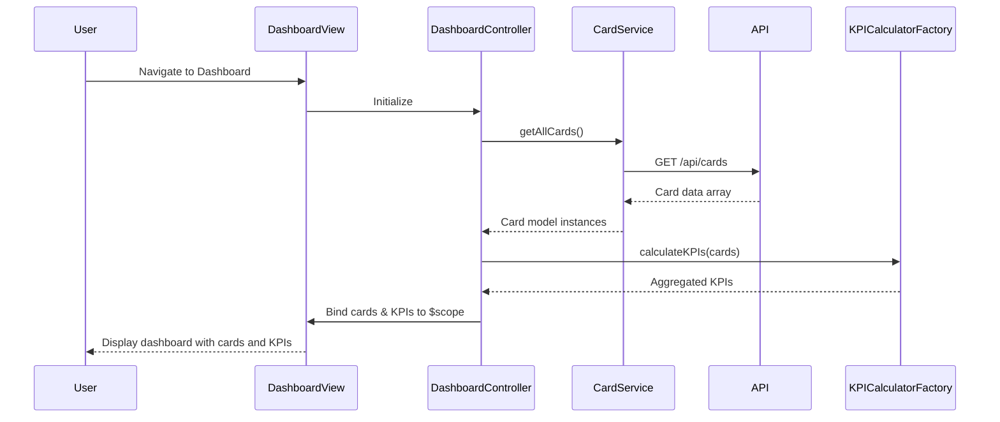

# Low-Level Design: Credit Card Portfolio Management and Dashboard KPIs
**Epic ID:** QE-7582

---

## a. Architecture Mapping

- **Dashboard Module** → AngularJS Module (`creditCard.dashboard`)
- **Dashboard Controller** → AngularJS Controller (`DashboardController`)
- **Card Service** → AngularJS Service (`CardService`)
- **KPI Calculator** → AngularJS Factory (`KPICalculatorFactory`)
- **Card List Directive** → AngularJS Directive (`ccCardList`)

**Recommended Folder Structure:**
```
app/
├── modules/
│   └── dashboard/
│       ├── dashboard.module.js
│       ├── dashboard.controller.js
│       ├── dashboard.html
│       └── components/
│           └── card-list.directive.js
├── services/
│   ├── card.service.js
│   └── kpi-calculator.factory.js
├── models/
│   └── card.model.js
└── assets/
    └── css/
        └── dashboard.css
```

---

## b. Component Specifications

| Component Name | Artifact Type | Responsibility | Key Dependencies |
|---|---|---|---|
| `creditCard.dashboard` | Module | Root module for dashboard functionality | `ngRoute`, `ui.bootstrap` |
| `DashboardController` | Controller | Orchestrates dashboard view, fetches cards, displays KPIs | `CardService`, `KPICalculatorFactory`, `$scope` |
| `CardService` | Service | Fetches card data from REST API, manages card state | `$http`, `$q` |
| `KPICalculatorFactory` | Factory | Computes aggregated KPIs (total limit, available credit, outstanding, monthly spend) | None |
| `ccCardList` | Directive | Renders list of credit cards with individual card details | `CardService` |
| `Card` | Model | Represents credit card entity with properties | None |

---

## c. Data Model

**Card Model (JavaScript ES6 Class or Object):**
```javascript
class Card {
  constructor(data) {
    this.id = data.id;                    // String
    this.cardNumber = data.cardNumber;    // String (masked)
    this.issuer = data.issuer;            // String
    this.cardType = data.cardType;        // String (e.g., 'Visa', 'MasterCard')
    this.creditLimit = data.creditLimit;  // Number
    this.currentBalance = data.currentBalance; // Number
    this.outstandingAmount = data.outstandingAmount; // Number
    this.monthlySpend = data.monthlySpend; // Number
    this.availableCredit = data.creditLimit - data.currentBalance; // Number (computed)
  }
}
```

**KPI Aggregates (Object):**
```javascript
{
  totalCreditLimit: Number,
  totalAvailableCredit: Number,
  totalOutstanding: Number,
  totalMonthlySpend: Number,
  cardCount: Number
}
```

---

## d. Data Flow

User navigates to dashboard → `DashboardController` initializes and calls `CardService.getAllCards()` → `CardService` sends GET request to `/api/cards` REST endpoint → API returns array of card objects → `CardService` transforms response into `Card` model instances → `DashboardController` receives cards and invokes `KPICalculatorFactory.calculateKPIs(cards)` → Factory computes aggregated metrics → Controller binds cards and KPIs to `$scope` → View renders card list via `ccCardList` directive and displays KPI summary → User sees consolidated dashboard with all cards and metrics.

---

## e. Primary Sequence Diagram



---

## f. Implementation Notes

- Use AngularJS Dependency Injection for `CardService`, `KPICalculatorFactory` in `DashboardController`.
- Implement `CardService` as singleton service using `$http` for REST API calls; return promises for async handling.
- Use Bootstrap grid (`col-md-*`, `col-sm-*`, `col-xs-*`) for responsive layout across desktop, tablet, mobile.
- Apply `ng-repeat` in `ccCardList` directive template to iterate over cards; use `track by card.id` for performance.
- Optimize dashboard load time by lazy-loading non-critical components and caching card data in `CardService` using `$cacheFactory`.

---

## g. Error Handling

HTTP interceptor captures API errors; display user-friendly notifications via Bootstrap alerts or toast service.

---

## h. Security Notes

Standard input validation and secure API calls assumed; mask sensitive card numbers in UI.

---

**End of LLD for QE-7582**