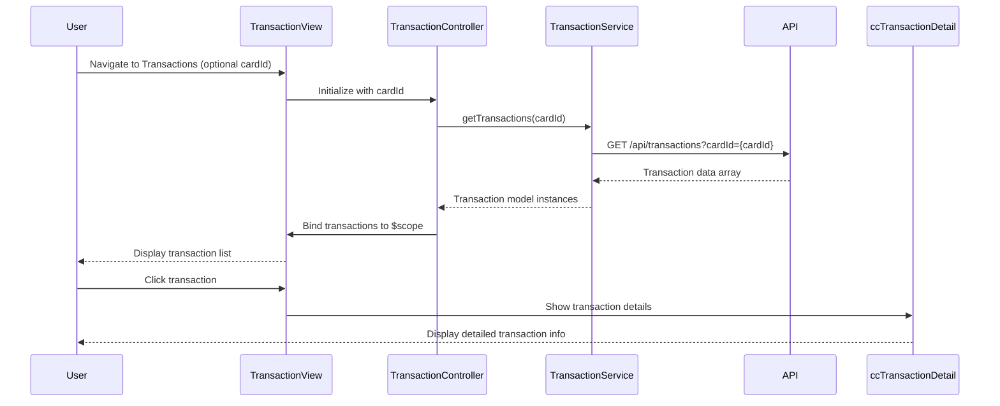

# Low-Level Design: Transaction Management and Monitoring
**Epic ID:** QE-7583

---

## a. Architecture Mapping

- **Transaction Module** → AngularJS Module (`creditCard.transactions`)
- **Transaction Controller** → AngularJS Controller (`TransactionController`)
- **Transaction Service** → AngularJS Service (`TransactionService`)
- **Transaction List Directive** → AngularJS Directive (`ccTransactionList`)
- **Transaction Detail Component** → AngularJS Component (`ccTransactionDetail`)

**Recommended Folder Structure:**
```
app/
├── modules/
│   └── transactions/
│       ├── transactions.module.js
│       ├── transactions.controller.js
│       ├── transactions.html
│       └── components/
│           ├── transaction-list.directive.js
│           └── transaction-detail.component.js
├── services/
│   └── transaction.service.js
├── models/
│   └── transaction.model.js
└── assets/
    └── css/
        └── transactions.css
```

---

## b. Component Specifications

| Component Name | Artifact Type | Responsibility | Key Dependencies |
|---|---|---|---|
| `creditCard.transactions` | Module | Root module for transaction functionality | `ngRoute`, `creditCard.dashboard` |
| `TransactionController` | Controller | Manages transaction view, fetches and filters transactions by card | `TransactionService`, `$scope`, `$routeParams` |
| `TransactionService` | Service | Fetches transaction data from REST API, filters by card ID | `$http`, `$q` |
| `ccTransactionList` | Directive | Renders list of transactions with date, merchant, amount | `TransactionService` |
| `ccTransactionDetail` | Component | Displays detailed view of a single transaction | None |
| `Transaction` | Model | Represents transaction entity with properties | None |

---

## c. Data Model

**Transaction Model (JavaScript ES6 Class or Object):**
```javascript
class Transaction {
  constructor(data) {
    this.id = data.id;                  // String
    this.cardId = data.cardId;          // String
    this.date = new Date(data.date);    // Date
    this.merchant = data.merchant;      // String
    this.amount = data.amount;          // Number
    this.category = data.category;      // String (e.g., 'Food & Dining', 'Fuel')
    this.status = data.status;          // String (e.g., 'Posted', 'Pending')
    this.description = data.description; // String
  }
}
```

---

## d. Data Flow

User navigates to transaction view (optionally with card ID filter) → `TransactionController` initializes and calls `TransactionService.getTransactions(cardId)` → `TransactionService` sends GET request to `/api/transactions?cardId={cardId}` REST endpoint → API returns array of transaction objects → `TransactionService` transforms response into `Transaction` model instances → `TransactionController` binds transactions to `$scope` → View renders transaction list via `ccTransactionList` directive → User clicks transaction to view details → `ccTransactionDetail` component displays full transaction information.

---

## e. Primary Sequence Diagram



---

## f. Implementation Notes

- Use AngularJS Dependency Injection for `TransactionService` in `TransactionController`.
- Implement `TransactionService` using `$http` with query parameters for card filtering; return promises.
- Use `ng-repeat` with `track by transaction.id` in `ccTransactionList` directive for efficient rendering.
- Apply Bootstrap table (`table-responsive`) for transaction list; ensure mobile responsiveness.
- Use `$routeParams` or `$stateParams` (if using UI-Router) to capture card ID from route for filtering.

---

## g. Error Handling

HTTP interceptor-based error handling with try/catch in service methods; display user notifications for API failures.

---

## h. Security Notes

Standard input validation and secure API calls assumed.

---

**End of LLD for QE-7583**