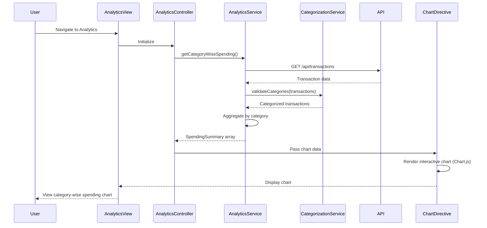

# Low-Level Design: Spending Analytics and Insights
**Epic ID:** QE-7584

---

## a. Architecture Mapping

- **Analytics Module** → AngularJS Module (`creditCard.analytics`)
- **Analytics Controller** → AngularJS Controller (`AnalyticsController`)
- **Analytics Service** → AngularJS Service (`AnalyticsService`)
- **Categorization Service** → AngularJS Service (`CategorizationService`)
- **Chart Directive** → AngularJS Directive (`ccSpendingChart`)

**Recommended Folder Structure:**
```
app/
├── modules/
│   └── analytics/
│       ├── analytics.module.js
│       ├── analytics.controller.js
│       ├── analytics.html
│       └── components/
│           └── spending-chart.directive.js
├── services/
│   ├── analytics.service.js
│   └── categorization.service.js
├── models/
│   └── spending-summary.model.js
└── assets/
    ├── css/
    │   └── analytics.css
    └── libs/
        └── chart.js (or D3.js)
```

---

## b. Component Specifications

| Component Name | Artifact Type | Responsibility | Key Dependencies |
|---|---|---|---|
| `creditCard.analytics` | Module | Root module for analytics functionality | `ngRoute`, `creditCard.transactions`, `chart.js` |
| `AnalyticsController` | Controller | Orchestrates analytics view, fetches spending data, prepares chart data | `AnalyticsService`, `CategorizationService`, `$scope` |
| `AnalyticsService` | Service | Aggregates transaction data by category, month, and card; fetches from API | `$http`, `$q`, `TransactionService` |
| `CategorizationService` | Service | Assigns or validates spending categories for transactions | None |
| `ccSpendingChart` | Directive | Renders interactive charts (pie, bar, line) using Chart.js or D3.js | `AnalyticsService` |
| `SpendingSummary` | Model | Represents aggregated spending data by category/month/card | None |

---

## c. Data Model

**SpendingSummary Model (JavaScript ES6 Class or Object):**
```javascript
class SpendingSummary {
  constructor(data) {
    this.categoryName = data.categoryName;  // String (e.g., 'Food & Dining')
    this.totalAmount = data.totalAmount;    // Number
    this.transactionCount = data.transactionCount; // Number
    this.percentage = data.percentage;      // Number (optional, computed)
  }
}
```

**Monthly Trend (Object):**
```javascript
{
  month: String,        // e.g., '2024-01'
  totalSpend: Number,
  categories: Array<SpendingSummary>
}
```

**Card-wise Spend (Object):**
```javascript
{
  cardId: String,
  cardName: String,
  totalSpend: Number,
  categories: Array<SpendingSummary>
}
```

**Spending Categories (Enum/Array):**
```javascript
const SPENDING_CATEGORIES = [
  'Food & Dining', 'Fuel', 'Shopping', 'Travel', 
  'Entertainment', 'Utilities', 'Healthcare', 'Education', 'Miscellaneous'
];
```

---

## d. Data Flow

User navigates to analytics dashboard → `AnalyticsController` initializes and calls `AnalyticsService.getCategoryWiseSpending()`, `getMonthlyTrends()`, `getCardWiseSpending()` → `AnalyticsService` fetches transaction data from API or `TransactionService` → `CategorizationService` validates/assigns categories → `AnalyticsService` aggregates data by category, month, and card → Controller receives aggregated data and prepares chart datasets → `ccSpendingChart` directive renders interactive charts (category pie chart, monthly trend line chart, card-wise bar chart) using Chart.js → User interacts with charts to view detailed spending insights.

---

## e. Primary Sequence Diagram



---

## f. Implementation Notes

- Use AngularJS Dependency Injection for `AnalyticsService`, `CategorizationService` in `AnalyticsController`.
- Integrate Chart.js library via `angular-chart.js` wrapper or custom directive; use `$watch` to update charts on data changes.
- Implement `AnalyticsService` to aggregate transactions using ES6 `Array.reduce()` and `Map` for efficient grouping.
- Use `CategorizationService` to map transaction merchants/descriptions to predefined categories using keyword matching or API-based categorization.
- Ensure charts are responsive using Chart.js responsive options; render within 1.5 seconds by optimizing data aggregation and limiting initial dataset size.

---

## g. Error Handling

HTTP interceptor captures API errors; display user-friendly error messages and fallback to cached data if available.

---

## h. Security Notes

Standard input validation and secure API calls assumed.

---

**End of LLD for QE-7584**