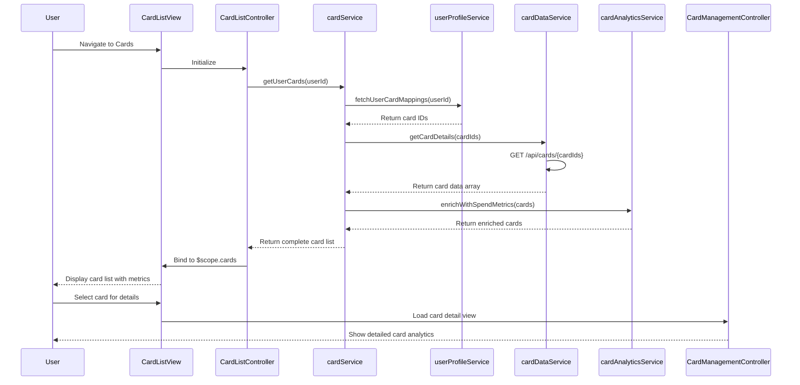

# Low-Level Design: QE-7585 - Multiple Credit Card Management

## a. Architecture Mapping

**HLD Component → AngularJS Artifact:**
- User Interface → `creditCardModule` (Module) + `CardListController` (Controller) + card list view template
- Card Management Module → `CardManagementController` (Controller) + `cardService` (Service/Factory)
- Card Data Service → `cardDataService` (Factory) for REST API integration
- User Profile Service → `userProfileService` (Factory) for user-card mapping
- Analytics Engine → `cardAnalyticsService` (Service) for card-wise spend calculations

**Recommended Folder Structure:**
```
app/
├── modules/
│   └── creditCard/
│       ├── controllers/
│       │   ├── CardListController.js
│       │   └── CardManagementController.js
│       ├── services/
│       │   ├── cardService.js
│       │   ├── cardDataService.js
│       │   ├── userProfileService.js
│       │   └── cardAnalyticsService.js
│       ├── directives/
│       │   └── cardItem.directive.js
│       └── views/
│           ├── card-list.html
│           └── card-detail.html
```

## b. Component Specifications

| Name | Artifact Type | Responsibility | Key Dependencies |
|------|--------------|----------------|------------------|
| creditCardModule | Module | Root module for credit card management features | angular, ngRoute, ngResource |
| CardListController | Controller | Manages card list display, selection, and filtering | $scope, cardService, cardAnalyticsService |
| CardManagementController | Controller | Handles individual card detail views and comparison | $scope, $routeParams, cardService |
| cardService | Service | Orchestrates card operations and business logic | cardDataService, userProfileService |
| cardDataService | Factory | REST API calls for card data retrieval | $http, $q |
| userProfileService | Factory | Fetches user-card mappings and ownership validation | $http, $q |
| cardAnalyticsService | Service | Calculates card-wise spend analysis and metrics | - |
| cardItem | Directive | Reusable card display component with metrics | cardService |

## c. Data Model

**CreditCard Object:**
```javascript
{
  cardId: String,
  userId: String,
  cardNumber: String (masked),
  cardType: String,
  bankName: String,
  creditLimit: Number,
  availableCredit: Number,
  outstandingAmount: Number,
  expiryDate: String (YYYY-MM),
  cardholderName: String,
  isActive: Boolean
}
```

**CardSpendAnalysis Object:**
```javascript
{
  cardId: String,
  monthlySpend: Number,
  utilizationPercentage: Number,
  categoryBreakdown: Array<{category: String, amount: Number}>,
  lastUpdated: Date
}
```

## d. Data Flow

User navigates to the card management view → CardListController initializes and calls cardService.getUserCards() → cardService requests user-card mappings from userProfileService, then fetches card details via cardDataService REST API → cardDataService returns card array → cardAnalyticsService enriches each card with spend metrics → Controller binds enriched card data to $scope → View renders card list with ng-repeat, displaying card-specific metrics and enabling selection/filtering → User selects a card → CardManagementController loads detailed view with full card analytics and comparison data.

## e. Primary Sequence Diagram



## f. Implementation Notes

- Use AngularJS 1.x module pattern with dependency injection for all services and controllers
- Implement cardDataService as a Factory using $http for RESTful API calls with promise-based error handling
- Apply ES6 arrow functions and const/let for cleaner service implementations
- Use ng-repeat with track by cardId for efficient card list rendering and updates
- Implement card filtering with AngularJS filters (e.g., filter by card type, bank, or status)

## g. Error Handling

HTTP interceptor-based error handling with user-friendly notifications via toast/alert service for API failures.

## h. Security Notes

Requires token-based authentication via existing SSO; card data transmission encrypted using HTTPS/TLS.