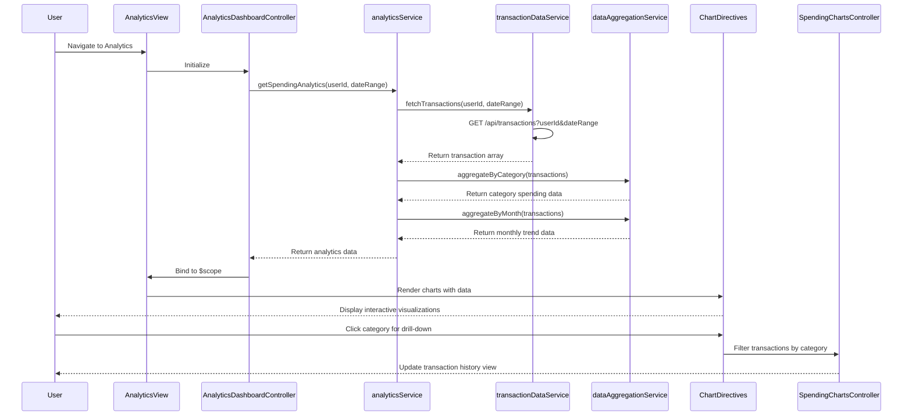

# Low-Level Design: QE-7586 - Spending Analytics and Transaction Insights

## a. Architecture Mapping

**HLD Component → AngularJS Artifact:**
- User Dashboard → `analyticsModule` (Module) + `AnalyticsDashboardController` (Controller) + analytics view template
- Analytics UI Component → `SpendingChartsController` (Controller) + chart directives (spendingChart, trendChart)
- Analytics Engine → `analyticsService` (Service) for data aggregation and pattern analysis
- Transaction Data Service → `transactionDataService` (Factory) for REST API integration
- Data Aggregation Module → `dataAggregationService` (Service) for category and time-based grouping
- Visualization Library → Chart.js or D3.js integrated via AngularJS directives

**Recommended Folder Structure:**
```
app/
├── modules/
│   └── analytics/
│       ├── controllers/
│       │   ├── AnalyticsDashboardController.js
│       │   └── SpendingChartsController.js
│       ├── services/
│       │   ├── analyticsService.js
│       │   ├── transactionDataService.js
│       │   └── dataAggregationService.js
│       ├── directives/
│       │   ├── spendingChart.directive.js
│       │   └── trendChart.directive.js
│       └── views/
│           ├── analytics-dashboard.html
│           └── transaction-history.html
```

## b. Component Specifications

| Name | Artifact Type | Responsibility | Key Dependencies |
|------|--------------|----------------|------------------|
| analyticsModule | Module | Root module for spending analytics features | angular, ngRoute, chart.js |
| AnalyticsDashboardController | Controller | Manages analytics dashboard state and data loading | $scope, analyticsService, dataAggregationService |
| SpendingChartsController | Controller | Handles chart interactions and drill-down logic | $scope, analyticsService |
| analyticsService | Service | Orchestrates analytics operations and pattern identification | transactionDataService, dataAggregationService |
| transactionDataService | Factory | REST API calls for transaction history retrieval | $http, $q |
| dataAggregationService | Service | Aggregates transactions by category, month, and time period | - |
| spendingChart | Directive | Renders category-wise spending pie/bar chart | Chart.js |
| trendChart | Directive | Renders monthly spend trend line chart | Chart.js |

## c. Data Model

**Transaction Object:**
```javascript
{
  transactionId: String,
  cardId: String,
  amount: Number,
  category: String,
  merchantName: String,
  transactionDate: Date,
  description: String,
  status: String
}
```

**CategorySpending Object:**
```javascript
{
  category: String,
  totalAmount: Number,
  transactionCount: Number,
  percentage: Number
}
```

**MonthlyTrend Object:**
```javascript
{
  month: String (YYYY-MM),
  totalSpend: Number,
  categoryBreakdown: Array<CategorySpending>
}
```

## d. Data Flow

User accesses analytics dashboard → AnalyticsDashboardController initializes and calls analyticsService.getSpendingAnalytics(userId, dateRange) → analyticsService requests transaction history from transactionDataService REST API → transactionDataService returns raw transaction array → dataAggregationService processes transactions into category-wise and monthly aggregations → analyticsService identifies spending patterns and returns structured analytics data → Controller binds data to $scope → spendingChart and trendChart directives render interactive visualizations → User interacts with charts (e.g., clicks category) → SpendingChartsController filters and updates transaction history view accordingly.

## e. Primary Sequence Diagram



## f. Implementation Notes

- Use AngularJS 1.x with Chart.js wrapped in custom directives for reusable chart components
- Implement transactionDataService with $http for REST API calls, supporting query parameters for date range filtering
- Use ES6 array methods (filter, reduce, map) in dataAggregationService for efficient category and time-based aggregation
- Apply AngularJS $watch on date range filters to trigger automatic chart updates
- Implement lazy loading for transaction history using ng-infinite-scroll for performance with large datasets

## g. Error Handling

HTTP interceptor captures API errors; try/catch blocks in aggregation service with fallback to empty datasets and user notification via toast.

## h. Security Notes

Standard input validation and secure API calls assumed; transaction data encrypted in transit via HTTPS.