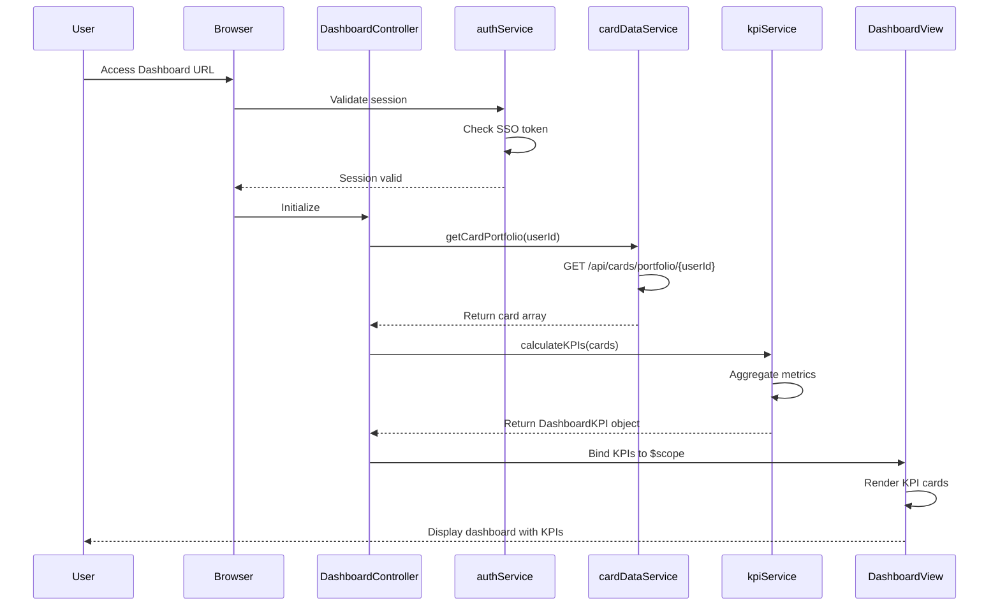

# Low-Level Design: QE-7587 - Credit Card Dashboard and KPI Monitoring

## a. Architecture Mapping

**HLD Component → AngularJS Artifact:**
- User Browser → AngularJS SPA entry point with routing configuration
- Authentication Service → `authService` (Factory) integrated with existing SSO
- Dashboard UI Layer → `dashboardModule` (Module) + `DashboardController` (Controller) + dashboard view template
- KPI Aggregation Service → `kpiService` (Service) for calculating aggregated metrics
- Credit Card Data Source → `cardDataService` (Factory) for REST API calls
- Dashboard Display → HTML5/CSS3/Bootstrap responsive layout with AngularJS data binding

**Recommended Folder Structure:**
```
app/
├── modules/
│   └── dashboard/
│       ├── controllers/
│       │   └── DashboardController.js
│       ├── services/
│       │   ├── kpiService.js
│       │   ├── cardDataService.js
│       │   └── authService.js
│       ├── directives/
│       │   └── kpiCard.directive.js
│       └── views/
│           └── dashboard.html
```

## b. Component Specifications

| Name | Artifact Type | Responsibility | Key Dependencies |
|------|--------------|----------------|------------------|
| dashboardModule | Module | Root module for dashboard functionality | angular, ngRoute, ui.bootstrap |
| DashboardController | Controller | Manages dashboard state, loads KPI data, handles user interactions | $scope, kpiService, cardDataService |
| kpiService | Service | Aggregates card data into KPIs (monthly spend, credit limit, available credit, outstanding) | - |
| cardDataService | Factory | Fetches credit card portfolio data via REST API | $http, $q |
| authService | Factory | Handles user authentication and session management with SSO | $http, $window |
| kpiCard | Directive | Reusable component to display individual KPI metrics with responsive styling | - |

## c. Data Model

**DashboardKPI Object:**
```javascript
{
  monthlySpend: Number,
  totalCreditLimit: Number,
  availableCredit: Number,
  outstandingAmount: Number,
  lastUpdated: Date
}
```

**CreditCardSummary Object:**
```javascript
{
  cardId: String,
  cardNumber: String (masked),
  creditLimit: Number,
  availableCredit: Number,
  outstandingAmount: Number,
  currentMonthSpend: Number
}
```

## d. Data Flow

User accesses dashboard URL → authService validates session with SSO → DashboardController initializes and calls cardDataService.getCardPortfolio(userId) → cardDataService makes REST API call to fetch all user credit cards → API returns array of CreditCardSummary objects → kpiService.calculateKPIs(cards) aggregates data across all cards to compute monthly spend, total credit limit, available credit, and outstanding amount → Controller binds DashboardKPI object to $scope → View renders KPIs using kpiCard directives with responsive Bootstrap grid layout → Dashboard displays consolidated financial health metrics to user.

## e. Primary Sequence Diagram



## f. Implementation Notes

- Use AngularJS 1.x module pattern with strict DI annotation for minification safety
- Implement cardDataService as Factory using $http with promise chaining for API calls
- Apply ES6 const/let and arrow functions in kpiService for cleaner aggregation logic
- Use Bootstrap grid system (col-xs/sm/md/lg) for responsive KPI card layout across devices
- Implement $scope.$watch on card data to auto-refresh KPIs when underlying data changes

## g. Error Handling

HTTP interceptor-based error handling with user-friendly error messages displayed via AngularJS toast notifications for API failures.

## h. Security Notes

Requires token-based auth via existing SSO; all API calls secured with HTTPS and session tokens validated on each request.