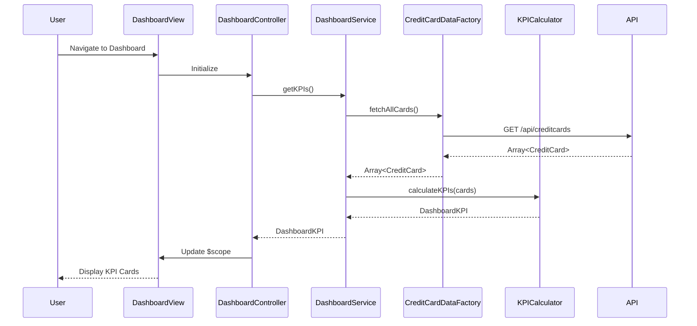

# Low-Level Design: Dashboard KPIs and Credit Card Overview
**Epic ID:** QE-7588  
**Technology Stack:** AngularJS 1.x, JavaScript ES6, HTML5, CSS3, Bootstrap, REST APIs, MVC Architecture

---

## a. Architecture Mapping

- **Dashboard Module** → AngularJS Module (`creditcard.dashboard`)
- **Dashboard Controller** → AngularJS Controller (`DashboardController`) - manages KPI display logic
- **Dashboard Service** → AngularJS Service (`DashboardService`) - orchestrates data retrieval and KPI calculations
- **Credit Card Data Service** → AngularJS Factory (`CreditCardDataFactory`) - handles REST API calls to backend
- **KPI Calculation Engine** → JavaScript ES6 Class (`KPICalculator`) - performs aggregation and computation logic
- **Dashboard View** → HTML5 template with Bootstrap grid layout for responsive KPI cards

**Folder Structure:**
```
/app
  /modules
    /dashboard
      dashboard.module.js
      dashboard.controller.js
      dashboard.service.js
      dashboard.html
  /shared
    /factories
      creditcard-data.factory.js
    /utils
      kpi-calculator.js
  /assets
    /css
      dashboard.css
```

---

## b. Component Specifications

| Component Name | Artifact Type | Responsibility | Key Dependencies |
|----------------|---------------|----------------|------------------|
| creditcard.dashboard | Module | Root module for dashboard feature | angular, ui.router |
| DashboardController | Controller | Manages dashboard view state and user interactions | DashboardService, $scope |
| DashboardService | Service | Orchestrates data flow between controller and data factory | CreditCardDataFactory, KPICalculator |
| CreditCardDataFactory | Factory | Executes REST API calls to fetch card data | $http, $q |
| KPICalculator | ES6 Class | Computes monthly spend, available credit, outstanding amount, total limit | None (pure JS utility) |
| dashboard.html | View Template | Renders KPI cards with Bootstrap responsive grid | Bootstrap CSS, AngularJS directives |

---

## c. Data Model

**CreditCard Object:**
```javascript
{
  cardId: String,
  cardNumber: String,
  cardType: String,
  creditLimit: Number,
  availableCredit: Number,
  outstandingAmount: Number,
  monthlySpend: Number,
  lastUpdated: Date
}
```

**DashboardKPI Object:**
```javascript
{
  totalCreditLimit: Number,
  totalAvailableCredit: Number,
  totalOutstandingAmount: Number,
  totalMonthlySpend: Number,
  cards: Array<CreditCard>
}
```

---

## d. Data Flow

User navigates to dashboard → DashboardController initializes and calls DashboardService.getKPIs() → DashboardService invokes CreditCardDataFactory.fetchAllCards() which makes REST API call to `/api/creditcards` → Response containing array of credit card objects is returned → KPICalculator aggregates data across all cards to compute portfolio-level KPIs → DashboardService returns DashboardKPI object to controller → Controller binds data to $scope → View renders KPI cards with real-time values using Bootstrap responsive layout.

---

## e. Primary Sequence Diagram



---

## f. Implementation Notes

- Use AngularJS Dependency Injection to inject DashboardService into DashboardController and CreditCardDataFactory into DashboardService
- Implement KPICalculator as ES6 class with static methods for reusability and testability
- Use $http service with promise-based API calls; handle responses with `.then()` and `.catch()` for error handling
- Apply Bootstrap grid system (col-md-3, col-sm-6, col-xs-12) for responsive KPI card layout across devices
- Implement auto-refresh using $interval service to poll API every 30 seconds for near real-time data updates

---

## g. Error Handling

HTTP interceptor captures API errors; user-friendly notifications displayed via toast/alert service on data fetch failures.

---

## h. Security Notes

Requires token-based auth via existing SSO; API endpoints secured with JWT validation on backend.

---