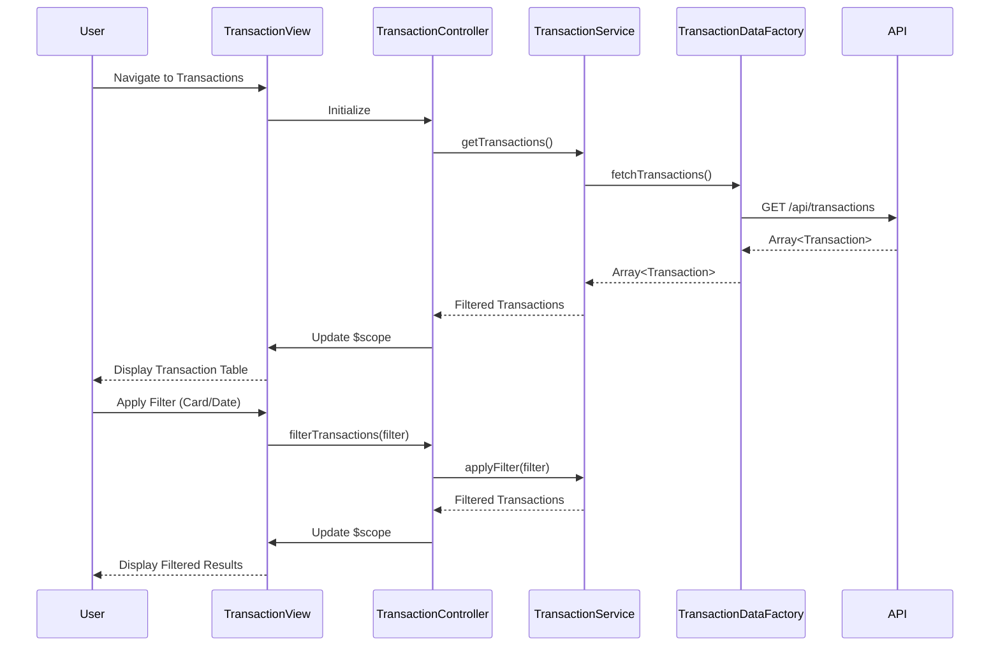

# Low-Level Design: Transaction Management and Viewing
**Epic ID:** QE-7589  
**Technology Stack:** AngularJS 1.x, JavaScript ES6, HTML5, CSS3, Bootstrap, REST APIs, MVC Architecture

---

## a. Architecture Mapping

- **Transaction Module** → AngularJS Module (`creditcard.transactions`)
- **Transaction Controller** → AngularJS Controller (`TransactionController`) - manages transaction list view and filtering
- **Transaction Service** → AngularJS Service (`TransactionService`) - handles business logic for transaction retrieval
- **Transaction Data Factory** → AngularJS Factory (`TransactionDataFactory`) - executes REST API calls for transaction data
- **Transaction Filter Directive** → AngularJS Directive (`ccTransactionFilter`) - provides UI controls for filtering by card/date
- **Transaction List View** → HTML5 template with Bootstrap table for responsive transaction display

**Folder Structure:**
```
/app
  /modules
    /transactions
      transactions.module.js
      transaction.controller.js
      transaction.service.js
      transactions.html
      /directives
        transaction-filter.directive.js
  /shared
    /factories
      transaction-data.factory.js
  /assets
    /css
      transactions.css
```

---

## b. Component Specifications

| Component Name | Artifact Type | Responsibility | Key Dependencies |
|----------------|---------------|----------------|------------------|
| creditcard.transactions | Module | Root module for transaction management feature | angular, ui.router |
| TransactionController | Controller | Manages transaction list state, pagination, and filter application | TransactionService, $scope, $filter |
| TransactionService | Service | Orchestrates transaction data retrieval and client-side filtering/sorting | TransactionDataFactory |
| TransactionDataFactory | Factory | Executes REST API calls to fetch transaction records | $http, $q |
| ccTransactionFilter | Directive | Renders filter controls for card selection and date range | None |
| transactions.html | View Template | Displays transaction table with Bootstrap responsive design | Bootstrap CSS, AngularJS ng-repeat |

---

## c. Data Model

**Transaction Object:**
```javascript
{
  transactionId: String,
  cardId: String,
  date: Date,
  merchant: String,
  amount: Number,
  category: String,
  description: String,
  status: String
}
```

**TransactionFilter Object:**
```javascript
{
  cardId: String,
  startDate: Date,
  endDate: Date,
  category: String
}
```

---

## d. Data Flow

User navigates to transaction view → TransactionController initializes and calls TransactionService.getTransactions() → TransactionService invokes TransactionDataFactory.fetchTransactions() which makes REST API call to `/api/transactions` → Response containing array of transaction objects is returned → TransactionService applies any active filters (card, date range) using AngularJS $filter → Filtered transaction list is returned to controller → Controller binds data to $scope → View renders transaction table using ng-repeat with Bootstrap responsive table classes → User applies filter via ccTransactionFilter directive → Controller re-applies filter and updates view.

---

## e. Primary Sequence Diagram



---

## f. Implementation Notes

- Use AngularJS Dependency Injection to inject TransactionService into TransactionController and TransactionDataFactory into TransactionService
- Implement client-side filtering using AngularJS $filter service for responsive filtering without additional API calls
- Use Bootstrap table-responsive class for mobile-friendly transaction table display
- Implement pagination using AngularJS dirPagination or custom pagination directive to handle large transaction volumes efficiently
- Cache transaction data in TransactionService to minimize redundant API calls; refresh on user-initiated action only

---

## g. Error Handling

HTTP interceptor captures API errors; display user-friendly error message via alert directive when transaction fetch fails.

---

## h. Security Notes

Standard input validation and secure API calls assumed; JWT token passed in Authorization header for authenticated requests.

---