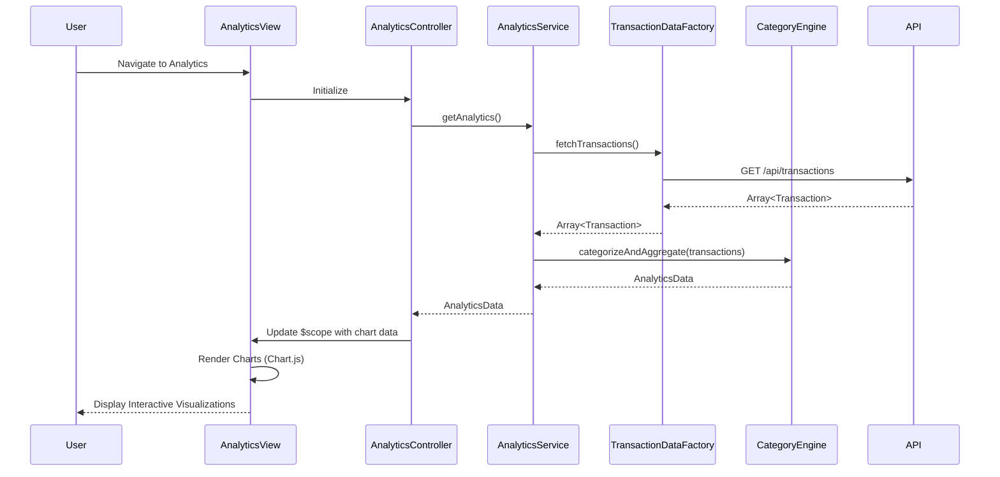

# Low-Level Design: Spending Analytics and Insights
**Epic ID:** QE-7590  
**Technology Stack:** AngularJS 1.x, JavaScript ES6, HTML5, CSS3, Bootstrap, REST APIs, MVC Architecture

---

## a. Architecture Mapping

- **Analytics Module** → AngularJS Module (`creditcard.analytics`)
- **Analytics Controller** → AngularJS Controller (`AnalyticsController`) - manages analytics view and chart interactions
- **Analytics Service** → AngularJS Service (`AnalyticsService`) - orchestrates data aggregation and categorization
- **Transaction Data Factory** → AngularJS Factory (`TransactionDataFactory`) - fetches transaction data via REST API
- **Categorization Engine** → JavaScript ES6 Class (`CategoryEngine`) - groups transactions by category and card
- **Chart Directive** → AngularJS Directive (`ccSpendingChart`) - wraps Chart.js for rendering interactive visualizations
- **Analytics View** → HTML5 template with Bootstrap grid for chart layout

**Folder Structure:**
```
/app
  /modules
    /analytics
      analytics.module.js
      analytics.controller.js
      analytics.service.js
      analytics.html
      /directives
        spending-chart.directive.js
  /shared
    /factories
      transaction-data.factory.js
    /utils
      category-engine.js
  /assets
    /css
      analytics.css
```

---

## b. Component Specifications

| Component Name | Artifact Type | Responsibility | Key Dependencies |
|----------------|---------------|----------------|------------------|
| creditcard.analytics | Module | Root module for analytics feature | angular, ui.router, chart.js |
| AnalyticsController | Controller | Manages analytics view state and chart data binding | AnalyticsService, $scope |
| AnalyticsService | Service | Orchestrates transaction data retrieval and aggregation | TransactionDataFactory, CategoryEngine |
| TransactionDataFactory | Factory | Executes REST API calls to fetch transaction records | $http, $q |
| CategoryEngine | ES6 Class | Groups transactions by predefined categories and calculates totals | None (pure JS utility) |
| ccSpendingChart | Directive | Renders interactive charts using Chart.js library | Chart.js, $timeout |
| analytics.html | View Template | Displays category-wise and monthly trend charts with Bootstrap layout | Bootstrap CSS, AngularJS directives |

---

## c. Data Model

**CategorySpend Object:**
```javascript
{
  category: String, // Food & Dining, Fuel, Shopping, Travel, Entertainment, Utilities, Healthcare, Education, Miscellaneous
  totalAmount: Number,
  transactionCount: Number
}
```

**MonthlySpend Object:**
```javascript
{
  month: String, // YYYY-MM format
  totalAmount: Number,
  categoryBreakdown: Array<CategorySpend>
}
```

**CardSpend Object:**
```javascript
{
  cardId: String,
  cardName: String,
  totalSpend: Number,
  categoryBreakdown: Array<CategorySpend>
}
```

**AnalyticsData Object:**
```javascript
{
  categorySpends: Array<CategorySpend>,
  monthlyTrends: Array<MonthlySpend>,
  cardSpends: Array<CardSpend>
}
```

---

## d. Data Flow

User navigates to analytics dashboard → AnalyticsController initializes and calls AnalyticsService.getAnalytics() → AnalyticsService invokes TransactionDataFactory.fetchTransactions() which makes REST API call to `/api/transactions` → Response containing array of transaction objects is returned → CategoryEngine processes transactions and groups by category, month, and card using predefined categorization rules → Aggregated AnalyticsData object is returned to AnalyticsService → AnalyticsService passes data to controller → Controller binds data to $scope → ccSpendingChart directive renders interactive pie chart for category-wise spend, line chart for monthly trends, and bar chart for card-wise analysis using Chart.js → User interacts with charts to explore spending insights.

---

## e. Primary Sequence Diagram



---

## f. Implementation Notes

- Use AngularJS Dependency Injection to inject AnalyticsService into AnalyticsController and TransactionDataFactory into AnalyticsService
- Implement CategoryEngine as ES6 class with methods for grouping by category, month, and card; use Array.reduce() for efficient aggregation
- Integrate Chart.js library via ccSpendingChart directive; use isolated scope with two-way binding for chart data and configuration
- Apply Bootstrap grid system (col-md-6 for side-by-side charts) for responsive layout across devices
- Cache aggregated analytics data in AnalyticsService to avoid redundant calculations; refresh only when new transaction data is fetched

---

## g. Error Handling

HTTP interceptor captures API errors; display fallback message in analytics view when data fetch fails or charts cannot render.

---

## h. Security Notes

Standard input validation and secure API calls assumed; JWT token passed in Authorization header for authenticated requests.

---