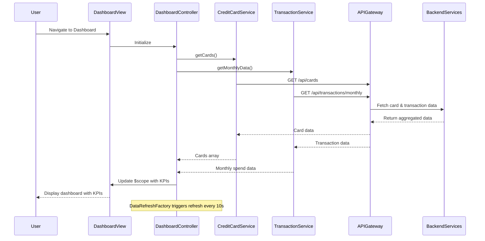

# Low-Level Design: Credit Card Dashboard and KPI Monitoring
**Epic ID:** QE-7591

---

## a. Architecture Mapping

- **Dashboard Module** → AngularJS Module (`app.dashboard`)
- **Dashboard Controller** → AngularJS Controller (`DashboardController`)
- **Credit Card Service** → AngularJS Service (`CreditCardService`)
- **Transaction Processing Service** → AngularJS Service (`TransactionService`)
- **KPI Display Component** → AngularJS Directive (`kpiCard`)
- **Data Refresh Manager** → AngularJS Factory (`DataRefreshFactory`)

**Recommended Folder Structure:**
```
/app
  /dashboard
    dashboard.module.js
    dashboard.controller.js
    dashboard.html
    /directives
      kpi-card.directive.js
      kpi-card.template.html
  /services
    credit-card.service.js
    transaction.service.js
  /factories
    data-refresh.factory.js
  /models
    credit-card.model.js
```

---

## b. Component Specifications

| Component Name | Artifact Type | Responsibility | Key Dependencies |
|---|---|---|---|
| `app.dashboard` | Module | Root module for dashboard feature | `ngRoute`, `app.services` |
| `DashboardController` | Controller | Orchestrates KPI data retrieval and UI binding | `CreditCardService`, `TransactionService`, `DataRefreshFactory` |
| `CreditCardService` | Service | Fetches credit card details, limits, and balances via REST API | `$http`, `API_CONFIG` |
| `TransactionService` | Service | Retrieves monthly spend and outstanding amounts via REST API | `$http`, `API_CONFIG` |
| `kpiCard` | Directive | Reusable UI component for displaying individual KPI metrics | None |
| `DataRefreshFactory` | Factory | Manages periodic data refresh using `$interval` | `$interval`, `CreditCardService`, `TransactionService` |

---

## c. Data Model

**CreditCard Model:**
```javascript
{
  cardId: String,
  cardNumber: String (masked),
  cardType: String,
  creditLimit: Number,
  availableCredit: Number,
  outstandingAmount: Number,
  monthlySpend: Number,
  lastUpdated: Date
}
```

**DashboardKPI Model:**
```javascript
{
  totalCreditLimit: Number,
  totalAvailableCredit: Number,
  totalOutstanding: Number,
  totalMonthlySpend: Number,
  cards: Array<CreditCard>
}
```

---

## d. Data Flow

User authenticates and navigates to dashboard → `DashboardController` initializes and calls `CreditCardService.getCards()` and `TransactionService.getMonthlyData()` → Services make parallel REST API calls to backend via `$http` → API Gateway routes requests to Dashboard Service, which orchestrates calls to Credit Card Data Service and Transaction Processing Service → Aggregated response returned to controller → Controller updates `$scope.dashboardData` with KPI metrics → View binds data using `ng-repeat` and `kpiCard` directives → `DataRefreshFactory` triggers periodic refresh every 10 seconds → UI updates reactively via two-way data binding.

---

## e. Primary Sequence Diagram



---

## f. Implementation Notes

- Use AngularJS Dependency Injection for all services and factories; register via module config.
- Implement responsive layout using Bootstrap grid system (col-xs/sm/md/lg classes) for mobile-first design.
- Use `$http` interceptors for centralized error handling and loading state management.
- Leverage `$q.all()` for parallel API calls to minimize page load time.
- Apply ES6 arrow functions and `const`/`let` for cleaner, modern JavaScript code.

---

## g. Error Handling

HTTP interceptor-based error handling with user-friendly notifications via Bootstrap alerts and retry logic for transient failures.

---

## h. Security Notes

Requires token-based authentication via existing SSO; all API calls include JWT in Authorization header.