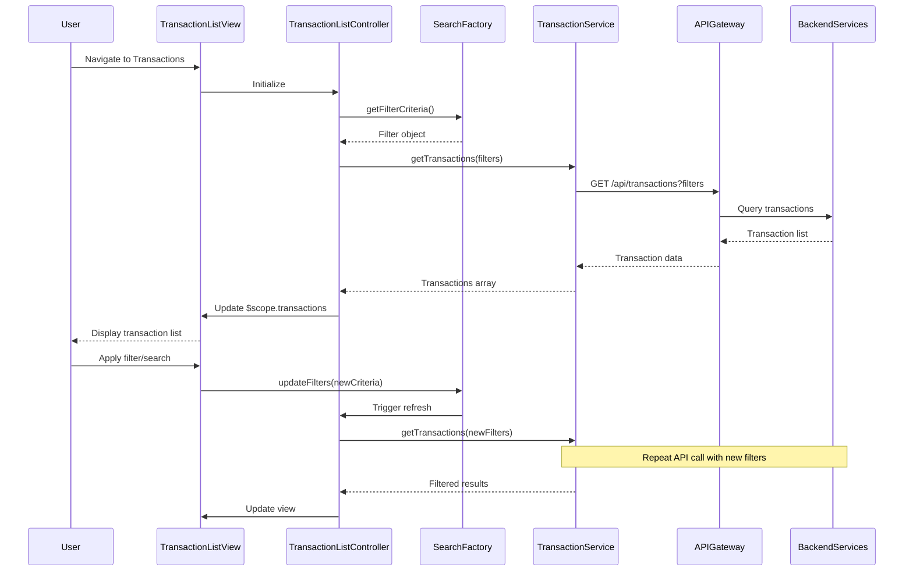

# Low-Level Design: Transaction Management and Monitoring
**Epic ID:** QE-7592

---

## a. Architecture Mapping

- **Transaction Module** → AngularJS Module (`app.transactions`)
- **Transaction List Controller** → AngularJS Controller (`TransactionListController`)
- **Transaction Detail Controller** → AngularJS Controller (`TransactionDetailController`)
- **Transaction Service** → AngularJS Service (`TransactionService`)
- **Transaction Filter Component** → AngularJS Directive (`transactionFilter`)
- **Search Factory** → AngularJS Factory (`SearchFactory`)

**Recommended Folder Structure:**
```
/app
  /transactions
    transactions.module.js
    transaction-list.controller.js
    transaction-detail.controller.js
    transaction-list.html
    transaction-detail.html
    /directives
      transaction-filter.directive.js
      transaction-filter.template.html
  /services
    transaction.service.js
  /factories
    search.factory.js
  /models
    transaction.model.js
```

---

## b. Component Specifications

| Component Name | Artifact Type | Responsibility | Key Dependencies |
|---|---|---|---|
| `app.transactions` | Module | Root module for transaction management feature | `ngRoute`, `app.services` |
| `TransactionListController` | Controller | Manages transaction list display, search, and filtering | `TransactionService`, `SearchFactory` |
| `TransactionDetailController` | Controller | Displays detailed view of a single transaction | `TransactionService`, `$routeParams` |
| `TransactionService` | Service | Fetches transaction data, history, and details via REST API | `$http`, `API_CONFIG` |
| `transactionFilter` | Directive | Reusable filter UI component with date range, card, and search inputs | `SearchFactory` |
| `SearchFactory` | Factory | Manages search state and filter criteria across views | None |

---

## c. Data Model

**Transaction Model:**
```javascript
{
  transactionId: String,
  cardId: String,
  merchantName: String,
  transactionDate: Date,
  amount: Number,
  currency: String,
  category: String,
  status: String,
  description: String
}
```

**TransactionFilter Model:**
```javascript
{
  cardId: String,
  startDate: Date,
  endDate: Date,
  searchTerm: String,
  category: String
}
```

---

## d. Data Flow

User navigates to transaction list view → `TransactionListController` initializes and calls `TransactionService.getTransactions(filterCriteria)` → Service makes REST API call to `/api/transactions` with query parameters → API Gateway routes to Transaction Management Service → Service queries Transaction Data Service with filters and associates results with Credit Card Service → Paginated transaction list returned → Controller updates `$scope.transactions` → View renders list using `ng-repeat` with `transactionFilter` directive → User applies filters or searches → `SearchFactory` updates filter state → Controller re-fetches data → User clicks transaction → Routes to detail view → `TransactionDetailController` fetches full transaction details and displays.

---

## e. Primary Sequence Diagram



---

## f. Implementation Notes

- Use `ui-router` for nested views if transaction detail is shown in modal or side panel.
- Implement client-side pagination using AngularJS filters or `ng-table` directive for performance.
- Apply debouncing on search input using `ng-model-options="{ debounce: 300 }"` to reduce API calls.
- Use `$cacheFactory` to cache recent transaction queries for faster navigation.
- Leverage Bootstrap date picker directive for date range selection in filter component.

---

## g. Error Handling

HTTP interceptor captures errors; display user-friendly messages via Bootstrap modals or inline alerts with retry option.

---

## h. Security Notes

Standard input validation and secure API calls assumed; JWT token required for all transaction endpoints.