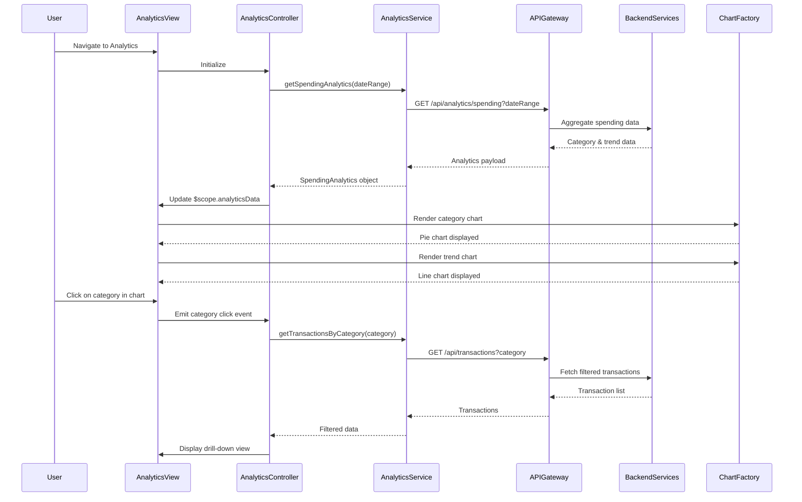

# Low-Level Design: Spending Analytics and Category Insights
**Epic ID:** QE-7593

---

## a. Architecture Mapping

- **Analytics Module** → AngularJS Module (`app.analytics`)
- **Analytics Controller** → AngularJS Controller (`AnalyticsController`)
- **Analytics Service** → AngularJS Service (`AnalyticsService`)
- **Category Chart Directive** → AngularJS Directive (`categoryChart`)
- **Trend Chart Directive** → AngularJS Directive (`trendChart`)
- **Chart Factory** → AngularJS Factory (`ChartFactory`)

**Recommended Folder Structure:**
```
/app
  /analytics
    analytics.module.js
    analytics.controller.js
    analytics.html
    /directives
      category-chart.directive.js
      trend-chart.directive.js
  /services
    analytics.service.js
  /factories
    chart.factory.js
  /models
    spending-analytics.model.js
```

---

## b. Component Specifications

| Component Name | Artifact Type | Responsibility | Key Dependencies |
|---|---|---|---|
| `app.analytics` | Module | Root module for analytics and insights feature | `ngRoute`, `app.services`, `chart.js` |
| `AnalyticsController` | Controller | Orchestrates analytics data retrieval and chart rendering | `AnalyticsService`, `ChartFactory` |
| `AnalyticsService` | Service | Fetches aggregated spending data and category breakdowns via REST API | `$http`, `API_CONFIG` |
| `categoryChart` | Directive | Renders pie/donut chart for category-wise spending using Chart.js | `ChartFactory` |
| `trendChart` | Directive | Renders line/bar chart for monthly spending trends using Chart.js | `ChartFactory` |
| `ChartFactory` | Factory | Wraps Chart.js library for reusable chart configuration and rendering | `Chart.js` |

---

## c. Data Model

**CategorySpending Model:**
```javascript
{
  category: String,
  amount: Number,
  percentage: Number,
  transactionCount: Number
}
```

**MonthlyTrend Model:**
```javascript
{
  month: String,
  totalSpend: Number,
  cardWiseSpend: Array<{cardId: String, amount: Number}>
}
```

**SpendingAnalytics Model:**
```javascript
{
  categories: Array<CategorySpending>,
  monthlyTrends: Array<MonthlyTrend>,
  totalSpend: Number,
  period: {startDate: Date, endDate: Date}
}
```

---

## d. Data Flow

User navigates to analytics view → `AnalyticsController` initializes and calls `AnalyticsService.getSpendingAnalytics(dateRange)` → Service makes REST API call to `/api/analytics/spending` → API Gateway routes to Analytics Service → Backend retrieves transactions from Transaction Service, applies Category Classification Service to categorize, and uses Data Aggregation Service to compute totals and trends → Aggregated analytics data returned → Controller updates `$scope.analyticsData` → `categoryChart` directive receives category data and renders pie chart using `ChartFactory` → `trendChart` directive receives monthly trend data and renders line chart → User interacts with chart (click category or month) → Directive emits event to controller → Controller fetches filtered transaction details and updates view dynamically.

---

## e. Primary Sequence Diagram



---

## f. Implementation Notes

- Integrate Chart.js library via CDN or npm; wrap in `ChartFactory` for consistent configuration.
- Use AngularJS `$watch` to detect data changes and trigger chart re-rendering in directives.
- Implement responsive chart sizing using Chart.js `maintainAspectRatio` and Bootstrap container classes.
- Apply ES6 template literals for dynamic chart labels and tooltips.
- Use `$scope.$on` for event-driven communication between controller and chart directives for drill-down interactions.

---

## g. Error Handling

HTTP interceptor handles API errors; display fallback message in chart area with retry button if data fetch fails.

---

## h. Security Notes

Standard input validation and secure API calls assumed; requires authenticated session with valid JWT token.