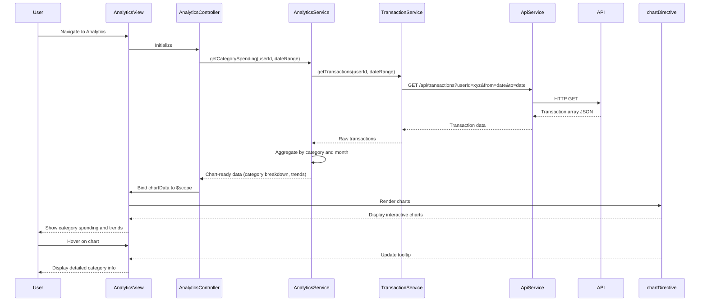

# Low-Level Design: Spending Analytics and Category Insights
**Epic ID:** QE-7594  
**Application Stack:** AngularJS 1.x, JavaScript ES6, HTML5, CSS3, Bootstrap, REST APIs, MVC Architecture

---

## a. Architecture Mapping

- **Analytics Visualization Module** → AngularJS Module (`app.analytics`) with Controller (`AnalyticsController`) and View (`analytics.html`)
- **Transaction Service** → AngularJS Service (`TransactionService`) for transaction data and categorization via REST API
- **Analytics Engine** → AngularJS Service (`AnalyticsService`) for data aggregation, trend calculations, and category breakdowns via REST API
- **Charting Library** → Third-party library (Chart.js or D3.js) integrated as AngularJS Directive (`chartDirective`)
- **API Gateway** → Base service (`ApiService`) for REST API communication with authentication

**Recommended Folder Structure:**
```
app/
├── modules/
│   └── analytics/
│       ├── analytics.module.js
│       ├── analytics.controller.js
│       ├── analytics.html
│       └── analytics.css
├── services/
│   ├── transaction.service.js
│   ├── analytics.service.js
│   └── api.service.js
├── directives/
│   └── chart.directive.js
├── models/
│   └── spending.model.js
└── app.js
```

---

## b. Component Specifications

| Component Name | Artifact Type | Responsibility | Key Dependencies |
|----------------|---------------|----------------|------------------|
| `app.analytics` | Module | Root module for spending analytics feature | `ngRoute`, `app.services`, `app.directives` |
| `AnalyticsController` | Controller | Fetches transaction data, computes category-wise spend, binds chart data to view | `TransactionService`, `AnalyticsService`, `$scope`, `$filter` |
| `TransactionService` | Service | Retrieves transaction data with category tags from API | `ApiService`, `$http`, `$q` |
| `AnalyticsService` | Service | Aggregates transactions by category, calculates monthly trends, returns chart-ready data | `ApiService`, `$http`, `$q` |
| `ApiService` | Factory | Base service for REST API calls with interceptor and auth support | `$http`, `$q` |
| `chartDirective` | Directive | Wraps Chart.js/D3.js for rendering interactive charts (pie, bar, line) | Chart.js or D3.js library |
| `analytics.html` | View | Displays category breakdown, monthly trends, and interactive charts | Bootstrap layout, AngularJS directives |

---

## c. Data Model

**Spending Model (`SpendingModel`):**
```javascript
{
  userId: String,
  month: String,               // "YYYY-MM"
  totalSpend: Number,
  categoryBreakdown: Array<CategorySpend>
}
```

**Category Spend Model (`CategorySpend`):**
```javascript
{
  category: String,            // "Food & Dining", "Fuel", "Shopping", etc.
  amount: Number,
  transactionCount: Number,
  percentage: Number           // Percentage of total spend
}
```

**Transaction Model (`Transaction`):**
```javascript
{
  transactionId: String,
  cardId: String,
  amount: Number,
  category: String,
  date: Date,
  merchantName: String
}
```

---

## d. Data Flow

User navigates to analytics page → `AnalyticsController` initializes → Calls `AnalyticsService.getCategorySpending(userId, startDate, endDate)` → Service calls `TransactionService.getTransactions()` to fetch raw transaction data → Transaction data is aggregated by category and month → `AnalyticsService` returns chart-ready data (category breakdown, monthly trends) → Controller binds data to `$scope.chartData` → `chartDirective` renders interactive pie chart (category breakdown) and line chart (monthly trends) using Chart.js → User interacts with chart (hover, click) → Directive updates tooltip and highlights selected category → View displays updated insights.

---

## e. Primary Sequence Diagram



---

## f. Implementation Notes

- Use AngularJS DI to inject `AnalyticsService` and `TransactionService` into `AnalyticsController` for modular, testable code.
- Implement `chartDirective` as a reusable AngularJS directive wrapping Chart.js; pass chart type and data via directive attributes.
- Use ES6 array methods (`map`, `reduce`, `filter`) in `AnalyticsService` for efficient category aggregation and trend calculation.
- Leverage Bootstrap grid (`col-md-6`) for responsive layout of multiple charts side-by-side on desktop, stacked on mobile.
- Optimize API queries with indexed date range and userId; cache results in service using `$cacheFactory` for sub-1 second response.

---

## g. Error Handling

HTTP interceptor in `ApiService` catches API errors, logs to console, and displays user notification via toast or modal using `$rootScope.$broadcast('error', errorMessage)`.

---

## h. Security Notes

Requires token-based auth via existing SSO; transaction data filtered by userId server-side; API calls include JWT in Authorization header; standard input validation applied.