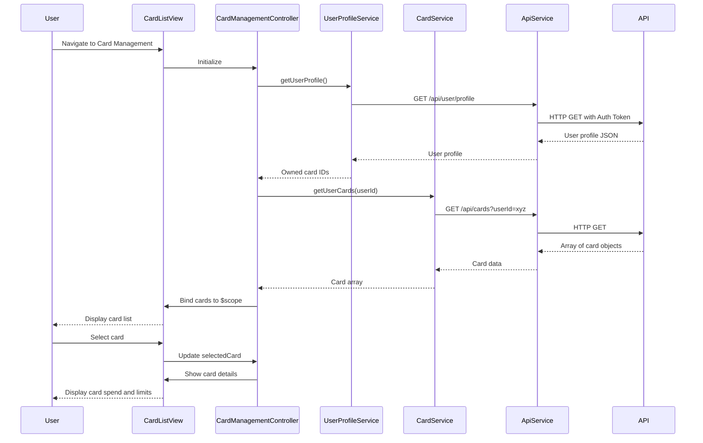

# Low-Level Design: Multiple Credit Card Management
**Epic ID:** QE-7595  
**Application Stack:** AngularJS 1.x, JavaScript ES6, HTML5, CSS3, Bootstrap, REST APIs, MVC Architecture

---

## a. Architecture Mapping

- **Card Management Module** → AngularJS Module (`app.cardManagement`) with Controller (`CardManagementController`) and View (`card-list.html`)
- **User Profile Service** → AngularJS Service (`UserProfileService`) for card ownership validation via REST API
- **Card Management Service** → AngularJS Service (`CardService`) for fetching card details, metadata, and spend analysis via REST API
- **API Gateway** → Base service (`ApiService`) for centralized REST communication with authentication
- **Card Selection/Filtering** → AngularJS Filter (`cardFilter`) and UI controls for card switching and filtering

**Recommended Folder Structure:**
```
app/
├── modules/
│   └── card-management/
│       ├── card-management.module.js
│       ├── card-management.controller.js
│       ├── card-list.html
│       ├── card-detail.html
│       └── card-management.css
├── services/
│   ├── card.service.js
│   ├── user-profile.service.js
│   └── api.service.js
├── filters/
│   └── card.filter.js
├── models/
│   └── card.model.js
└── app.js
```

---

## b. Component Specifications

| Component Name | Artifact Type | Responsibility | Key Dependencies |
|----------------|---------------|----------------|------------------|
| `app.cardManagement` | Module | Root module for multi-card management feature | `ngRoute`, `app.services`, `app.filters` |
| `CardManagementController` | Controller | Fetches user cards, manages card selection, filters, and card-wise spend display | `CardService`, `UserProfileService`, `$scope`, `$filter` |
| `CardService` | Service | Retrieves all user cards, individual card details, and card-wise spend data | `ApiService`, `$http`, `$q` |
| `UserProfileService` | Service | Validates card ownership and retrieves user profile for authentication | `ApiService`, `$http`, `$q` |
| `ApiService` | Factory | Base service for REST API calls with authentication headers | `$http`, `$q` |
| `cardFilter` | Filter | Filters card list by status, card type, or search query | None |
| `card-list.html` | View | Displays grid/list of all user cards with key details and action buttons | Bootstrap cards, AngularJS directives |
| `card-detail.html` | View | Shows detailed view of selected card including spend analysis and limits | Bootstrap layout, AngularJS bindings |

---

## c. Data Model

**Card Model (`CardModel`):**
```javascript
{
  cardId: String,
  cardNumber: String,          // Masked (e.g., "**** **** **** 1234")
  cardType: String,            // "Visa", "MasterCard", "Amex"
  cardHolderName: String,
  creditLimit: Number,
  availableCredit: Number,
  outstandingBalance: Number,
  status: String,              // "Active", "Blocked", "Expired"
  expiryDate: String,          // "MM/YY"
  monthlySpend: Number,
  lastTransactionDate: Date
}
```

**User Profile Model (`UserProfile`):**
```javascript
{
  userId: String,
  ownedCardIds: Array<String>, // List of card IDs owned by user
  userName: String
}
```

---

## d. Data Flow

User navigates to card management page → `CardManagementController` initializes → Calls `UserProfileService.getUserProfile()` to validate user and retrieve owned card IDs → Calls `CardService.getUserCards()` with user ID → Service makes REST API call via `ApiService` → API returns array of card objects → Controller stores cards in `$scope.cards` → View renders card list using Bootstrap card grid → User selects a card → Controller updates `$scope.selectedCard` → Detailed card view displays spend analysis and limits → User applies filter → `cardFilter` filters `$scope.cards` array → View updates to show filtered cards.

---

## e. Primary Sequence Diagram



---

## f. Implementation Notes

- Use AngularJS DI to inject `CardService` and `UserProfileService` into `CardManagementController` for clean separation of concerns.
- Implement batch API call in `CardService.getUserCards()` to fetch all cards in a single request for sub-500ms performance.
- Use ES6 Promises with `$q.all()` if parallel API calls are needed for card details and spend data.
- Leverage Bootstrap card component (`card`, `card-body`, `card-title`) for responsive card grid layout.
- Implement custom AngularJS filter (`cardFilter`) to filter cards by status or search term; apply using `ng-repeat` with filter pipe.

---

## g. Error Handling

HTTP interceptor in `ApiService` handles API failures with try/catch, logs errors, and displays toast notifications to user via `$rootScope.$broadcast('error', message)`.

---

## h. Security Notes

Requires token-based auth via existing SSO; card ownership validated server-side; sensitive card data masked on client; API calls include JWT in Authorization header.