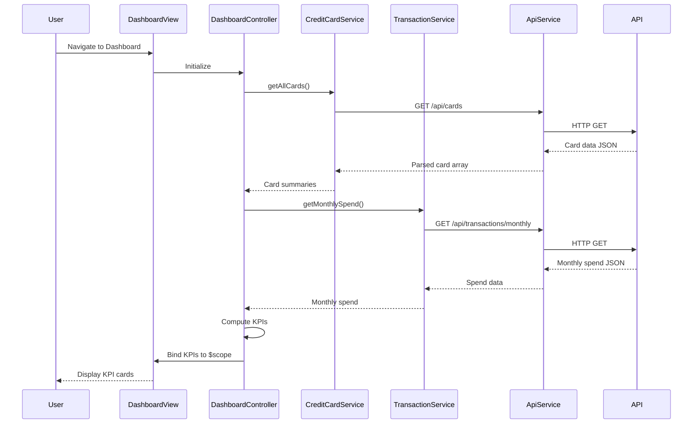

# Low-Level Design: Credit Card Dashboard and KPI Overview
**Epic ID:** QE-7596  
**Application Stack:** AngularJS 1.x, JavaScript ES6, HTML5, CSS3, Bootstrap, REST APIs, MVC Architecture

---

## a. Architecture Mapping

- **Dashboard UI Layer** → AngularJS Module (`app.dashboard`) with Controller (`DashboardController`) and View template (`dashboard.html`)
- **Credit Card Data Service** → AngularJS Service (`CreditCardService`) for card details and balances via REST API
- **Transaction Service** → AngularJS Service (`TransactionService`) for monthly spend calculations via REST API
- **API Gateway** → HTTP interceptor and base service (`ApiService`) for centralized API communication
- **Real-time Refresh** → AngularJS `$interval` or WebSocket service (`RealtimeService`) for polling/push updates

**Recommended Folder Structure:**
```
app/
├── modules/
│   └── dashboard/
│       ├── dashboard.module.js
│       ├── dashboard.controller.js
│       ├── dashboard.html
│       └── dashboard.css
├── services/
│   ├── credit-card.service.js
│   ├── transaction.service.js
│   ├── api.service.js
│   └── realtime.service.js
├── models/
│   └── kpi.model.js
└── app.js
```

---

## b. Component Specifications

| Component Name | Artifact Type | Responsibility | Key Dependencies |
|----------------|---------------|----------------|------------------|
| `app.dashboard` | Module | Root module for dashboard feature | `ngRoute`, `app.services` |
| `DashboardController` | Controller | Orchestrates KPI data fetching, binding to view, handles refresh logic | `CreditCardService`, `TransactionService`, `$scope`, `$interval` |
| `CreditCardService` | Service | Fetches card details, balances, credit limits from API | `ApiService`, `$http`, `$q` |
| `TransactionService` | Service | Retrieves monthly spend data and outstanding amounts | `ApiService`, `$http`, `$q` |
| `ApiService` | Factory | Base service for REST API calls with interceptor support | `$http`, `$q` |
| `RealtimeService` | Service | Manages polling or WebSocket connections for real-time updates | `$interval`, `$rootScope` |
| `dashboard.html` | View | Displays KPI cards (monthly spend, credit limit, available credit, outstanding) | Bootstrap grid, AngularJS directives |

---

## c. Data Model

**KPI Model (`KpiModel`):**
```javascript
{
  monthlySpend: Number,        // Total spend for current month
  totalCreditLimit: Number,    // Sum of all card credit limits
  availableCredit: Number,     // Total available credit across cards
  outstandingAmount: Number,   // Total outstanding balance
  lastUpdated: Date            // Timestamp of last data refresh
}
```

**Card Summary Model (`CardSummary`):**
```javascript
{
  cardId: String,
  cardNumber: String,          // Masked card number
  creditLimit: Number,
  availableCredit: Number,
  outstandingBalance: Number
}
```

---

## d. Data Flow

User navigates to the dashboard → `DashboardController` initializes and calls `CreditCardService.getAllCards()` and `TransactionService.getMonthlySpend()` → Services make parallel REST API calls via `ApiService` → API Gateway returns aggregated JSON data → Controller computes KPIs (total credit limit, available credit, outstanding amount) → Data is bound to `$scope` → View renders KPI cards using Bootstrap layout → `RealtimeService` polls API at intervals or listens to WebSocket for updates → On data change, `$scope` updates trigger view refresh.

---

## e. Primary Sequence Diagram



---

## f. Implementation Notes

- Use AngularJS Dependency Injection to inject services into `DashboardController` for testability and modularity.
- Implement ES6 classes for services and controllers; transpile using Babel if needed for browser compatibility.
- Use `$http` service with Promises (`$q`) for asynchronous API calls; handle success/error callbacks.
- Leverage Bootstrap grid system (`col-md-3`, `col-sm-6`) for responsive KPI card layout across devices.
- Implement `$interval` service for polling API every 30 seconds; clear interval on controller destroy (`$scope.$on('$destroy')`).

---

## g. Error Handling

HTTP interceptor in `ApiService` catches API errors, logs to console, and displays user-friendly notifications via `$rootScope.$broadcast('apiError', errorMessage)`.

---

## h. Security Notes

Requires token-based authentication via existing SSO; API calls include Authorization header with JWT token managed by `ApiService`.