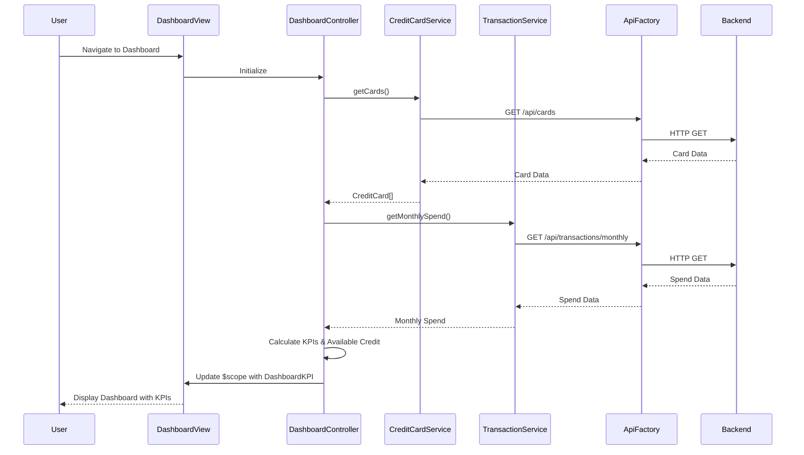

# Low-Level Design: Dashboard KPIs and Credit Card Overview
**Epic ID:** QE-7621  
**Application Stack:** AngularJS 1.x, JavaScript ES6, HTML5, CSS3, Bootstrap, REST APIs, MVC Architecture

---

## a. Architecture Mapping

- **Dashboard UI Component** → AngularJS Module (`app.dashboard`) with Controller (`DashboardController`) and View template
- **Credit Card Data Service** → AngularJS Service (`CreditCardService`) for API integration
- **Transaction Processing Service** → AngularJS Service (`TransactionService`) for spend/outstanding calculations
- **KPI Display Components** → AngularJS Directives (`kpiCard`, `creditCardSummary`) for reusable UI widgets
- **API Gateway Integration** → AngularJS Factory (`ApiFactory`) for HTTP communication with REST endpoints

**Recommended Folder Structure:**
```
/app
  /modules
    /dashboard
      dashboard.module.js
      dashboard.controller.js
      dashboard.html
  /services
    creditcard.service.js
    transaction.service.js
  /directives
    kpi-card.directive.js
    credit-card-summary.directive.js
  /factories
    api.factory.js
```

---

## b. Component Specifications

| Component Name | Artifact Type | Responsibility | Key Dependencies |
|----------------|---------------|----------------|------------------|
| DashboardModule | Module | Bootstrap dashboard feature module and register all dashboard components | angular, ui.router |
| DashboardController | Controller | Manage dashboard state, fetch KPI data, handle user interactions | CreditCardService, TransactionService, $scope |
| CreditCardService | Service | Fetch credit card details, balances, and limits from REST API | ApiFactory, $http, $q |
| TransactionService | Service | Calculate monthly spend and outstanding amounts via API calls | ApiFactory, $http, $q |
| ApiFactory | Factory | Centralized HTTP request handler with base URL and error interceptor | $http, $q |
| kpiCard | Directive | Render individual KPI metric card (monthly spend, credit limit, etc.) | None |
| creditCardSummary | Directive | Display multi-card summary view with available credit calculation | None |

---

## c. Data Model

**CreditCard Object:**
```javascript
{
  cardId: String,
  cardNumber: String,
  cardType: String,
  totalCreditLimit: Number,
  outstandingAmount: Number,
  availableCredit: Number,  // Calculated: totalCreditLimit - outstandingAmount
  cardHolderName: String,
  expiryDate: String
}
```

**DashboardKPI Object:**
```javascript
{
  monthlySpend: Number,
  totalCreditLimit: Number,
  totalAvailableCredit: Number,
  totalOutstanding: Number,
  cards: Array<CreditCard>
}
```

---

## d. Data Flow

User accesses the dashboard view, triggering `DashboardController` initialization. The controller invokes `CreditCardService.getCards()` and `TransactionService.getMonthlySpend()` concurrently. Both services use `ApiFactory` to make REST API calls to backend endpoints (`/api/cards` and `/api/transactions/monthly`). Upon receiving responses, the controller aggregates data into the `DashboardKPI` model, calculates available credit for each card, and binds the model to `$scope`. The view renders KPI cards using the `kpiCard` directive and displays the multi-card summary via `creditCardSummary` directive. Real-time updates are achieved through periodic polling using `$interval` or WebSocket integration.

---

## e. Primary Sequence Diagram



---

## f. Implementation Notes

- Use AngularJS Dependency Injection to inject services into controllers and directives for testability and modularity.
- Implement ES6 classes for services and controllers; transpile using Babel if needed for browser compatibility.
- Use `$http` service with promise-based API calls; handle responses with `.then()` and errors with `.catch()`.
- Apply Bootstrap grid system (col-md-*, col-sm-*) for responsive layout; use media queries for mobile optimization.
- Implement `$interval` service for periodic data refresh (every 30 seconds) to achieve near real-time updates; clear interval on scope destruction.

---

## g. Error Handling

HTTP interceptor in `ApiFactory` catches API errors, logs them, and displays user-friendly notifications using a toast service or modal.

---

## h. Security Notes

Requires token-based authentication via existing SSO; API calls include Authorization header with JWT token.

---