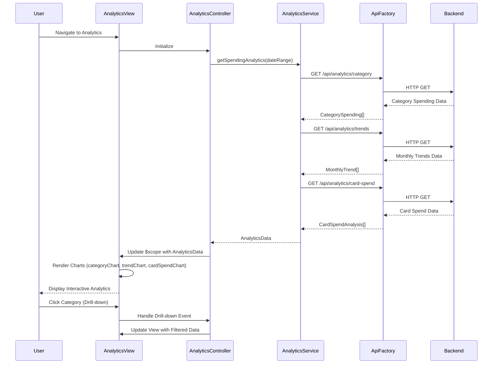

# Low-Level Design: Spending Analytics and Insights
**Epic ID:** QE-7622  
**Application Stack:** AngularJS 1.x, JavaScript ES6, HTML5, CSS3, Bootstrap, REST APIs, MVC Architecture

---

## a. Architecture Mapping

- **Analytics Visualization Module** → AngularJS Module (`app.analytics`) with Controller (`AnalyticsController`) and View template
- **Analytics Engine** → AngularJS Service (`AnalyticsService`) for data aggregation and API integration
- **Category Classification Service** → Backend REST API consumed via AngularJS Service (`CategoryService`)
- **Chart Components** → AngularJS Directives (`categoryChart`, `trendChart`, `cardSpendChart`) using Chart.js or D3.js
- **Transaction Processing Service** → AngularJS Service (`TransactionService`) for raw transaction data retrieval

**Recommended Folder Structure:**
```
/app
  /modules
    /analytics
      analytics.module.js
      analytics.controller.js
      analytics.html
  /services
    analytics.service.js
    category.service.js
    transaction.service.js
  /directives
    category-chart.directive.js
    trend-chart.directive.js
    card-spend-chart.directive.js
```

---

## b. Component Specifications

| Component Name | Artifact Type | Responsibility | Key Dependencies |
|----------------|---------------|----------------|------------------|
| AnalyticsModule | Module | Bootstrap analytics feature module and register chart components | angular, ui.router, chart.js |
| AnalyticsController | Controller | Fetch analytics data, manage chart state, handle user drill-down interactions | AnalyticsService, CategoryService, $scope |
| AnalyticsService | Service | Aggregate spending data, calculate trends, and fetch analytics from REST API | ApiFactory, $http, $q |
| CategoryService | Service | Retrieve category-wise spending breakdown from backend API | ApiFactory, $http |
| categoryChart | Directive | Render interactive pie/bar chart for category-wise spending | Chart.js |
| trendChart | Directive | Display monthly spend trends as line chart with drill-down capability | Chart.js |
| cardSpendChart | Directive | Visualize card-wise spend comparison as bar chart | Chart.js |

---

## c. Data Model

**CategorySpending Object:**
```javascript
{
  category: String,  // e.g., "Food & Dining", "Fuel"
  amount: Number,
  percentage: Number,
  transactionCount: Number
}
```

**MonthlyTrend Object:**
```javascript
{
  month: String,  // e.g., "2024-01"
  totalSpend: Number,
  categoryBreakdown: Array<CategorySpending>
}
```

**CardSpendAnalysis Object:**
```javascript
{
  cardId: String,
  cardName: String,
  totalSpend: Number,
  categorySpending: Array<CategorySpending>
}
```

**AnalyticsData Object:**
```javascript
{
  categorySpending: Array<CategorySpending>,
  monthlyTrends: Array<MonthlyTrend>,
  cardSpendAnalysis: Array<CardSpendAnalysis>,
  dateRange: { startDate: String, endDate: String }
}
```

---

## d. Data Flow

User navigates to the analytics view, triggering `AnalyticsController` initialization. The controller calls `AnalyticsService.getSpendingAnalytics()` with a date range parameter (default: last 12 months). The service makes REST API calls to `/api/analytics/category`, `/api/analytics/trends`, and `/api/analytics/card-spend` via `ApiFactory`. Backend services aggregate transaction data, classify transactions into nine categories, and return aggregated results. The controller receives the `AnalyticsData` model, binds it to `$scope`, and passes data to chart directives (`categoryChart`, `trendChart`, `cardSpendChart`). Directives use Chart.js to render interactive visualizations. User interactions (e.g., clicking a category) trigger drill-down events handled by the controller, which updates the view with filtered data.

---

## e. Primary Sequence Diagram



---

## f. Implementation Notes

- Integrate Chart.js library via Bower or npm; use angular-chart.js wrapper for AngularJS compatibility.
- Implement chart directives with isolated scope and two-way data binding for dynamic updates.
- Use `$http` service with caching enabled (`cache: true`) for analytics API calls to improve performance.
- Apply responsive chart options in Chart.js configuration to ensure charts adapt to screen size.
- Implement date range picker using Bootstrap Datepicker for user-selectable analytics periods.

---

## g. Error Handling

API errors are caught by HTTP interceptor in `ApiFactory`; display fallback message in analytics view if data fails to load.

---

## h. Security Notes

Standard input validation and secure API calls assumed; analytics endpoints require authenticated user session.

---