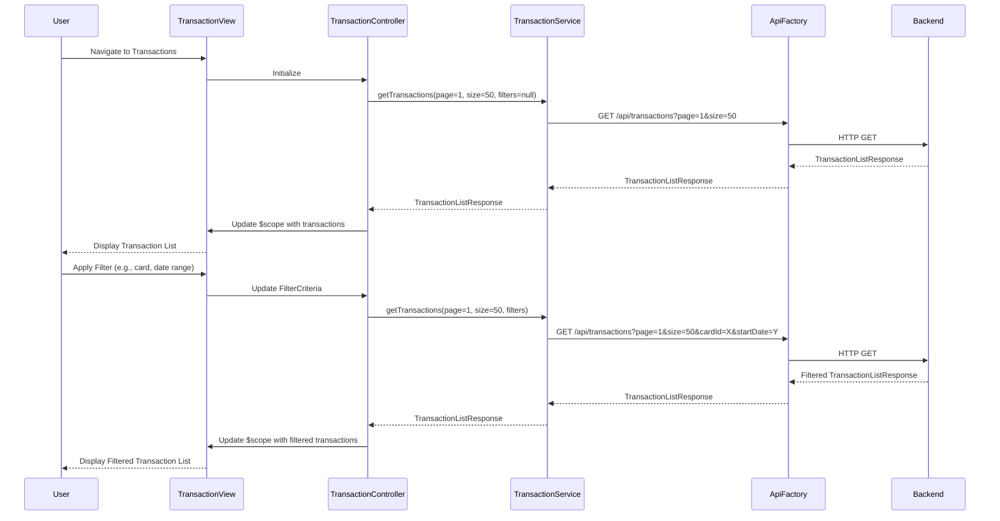

# Low-Level Design: Transaction Management and Monitoring
**Epic ID:** QE-7623  
**Application Stack:** AngularJS 1.x, JavaScript ES6, HTML5, CSS3, Bootstrap, REST APIs, MVC Architecture

---

## a. Architecture Mapping

- **Transaction Management Module** → AngularJS Module (`app.transactions`) with Controller (`TransactionController`) and View template
- **Transaction Processing Service** → AngularJS Service (`TransactionService`) for fetching transaction data from REST API
- **Credit Card Data Service** → AngularJS Service (`CreditCardService`) for mapping transactions to cards
- **Transaction List Component** → AngularJS Directive (`transactionList`) with pagination and filtering
- **Transaction Detail Component** → AngularJS Directive (`transactionDetail`) for displaying individual transaction details
- **Search & Filter Component** → AngularJS Directive (`transactionFilter`) for search and filter UI

**Recommended Folder Structure:**
```
/app
  /modules
    /transactions
      transactions.module.js
      transactions.controller.js
      transactions.html
  /services
    transaction.service.js
    creditcard.service.js
  /directives
    transaction-list.directive.js
    transaction-detail.directive.js
    transaction-filter.directive.js
```

---

## b. Component Specifications

| Component Name | Artifact Type | Responsibility | Key Dependencies |
|----------------|---------------|----------------|------------------|
| TransactionsModule | Module | Bootstrap transaction management feature module | angular, ui.router |
| TransactionController | Controller | Manage transaction list state, handle pagination, search, and filter logic | TransactionService, CreditCardService, $scope |
| TransactionService | Service | Fetch transaction data from REST API with pagination and filtering support | ApiFactory, $http, $q |
| CreditCardService | Service | Retrieve credit card details to map transactions to specific cards | ApiFactory, $http |
| transactionList | Directive | Render paginated transaction list with chronological order | None |
| transactionDetail | Directive | Display detailed view of a selected transaction (modal or inline) | None |
| transactionFilter | Directive | Provide search input and filter dropdowns (card, date range, amount) | None |

---

## c. Data Model

**Transaction Object:**
```javascript
{
  transactionId: String,
  cardId: String,
  cardName: String,
  merchantName: String,
  category: String,
  amount: Number,
  transactionDate: String,  // ISO 8601 format
  description: String,
  status: String  // e.g., "Completed", "Pending"
}
```

**TransactionListResponse Object:**
```javascript
{
  transactions: Array<Transaction>,
  totalCount: Number,
  pageNumber: Number,
  pageSize: Number,
  hasNextPage: Boolean
}
```

**FilterCriteria Object:**
```javascript
{
  cardId: String,
  searchQuery: String,
  startDate: String,
  endDate: String,
  minAmount: Number,
  maxAmount: Number
}
```

---

## d. Data Flow

User navigates to the transaction management view, triggering `TransactionController` initialization. The controller calls `TransactionService.getTransactions()` with default pagination parameters (page 1, size 50) and no filters. The service makes a REST API call to `/api/transactions?page=1&size=50` via `ApiFactory`. Backend returns a `TransactionListResponse` with paginated transactions in chronological order. The controller binds the response to `$scope`, and the `transactionList` directive renders the transactions. User applies filters via the `transactionFilter` directive, which updates `FilterCriteria` in the controller. The controller re-invokes `TransactionService.getTransactions()` with updated filter parameters, and the view refreshes with filtered results. User clicks on a transaction to view details, triggering the `transactionDetail` directive to display a modal with full transaction information.

---

## e. Primary Sequence Diagram



---

## f. Implementation Notes

- Implement pagination using AngularJS `ng-repeat` with `limitTo` filter or integrate angular-ui-bootstrap pagination component.
- Use `$http` service with query parameters for filtering and pagination; build query string dynamically based on `FilterCriteria`.
- Apply Bootstrap table styling for transaction list; use responsive table classes for mobile compatibility.
- Implement search functionality with debouncing using `$timeout` to avoid excessive API calls on every keystroke.
- Use AngularJS `orderBy` filter to ensure transactions are displayed in chronological order (descending by default).

---

## g. Error Handling

HTTP interceptor in `ApiFactory` catches API errors and displays user-friendly error messages using toast notifications or inline alerts.

---

## h. Security Notes

Requires token-based auth via existing SSO; transaction API endpoints validate user authorization to access only their own transactions.

---