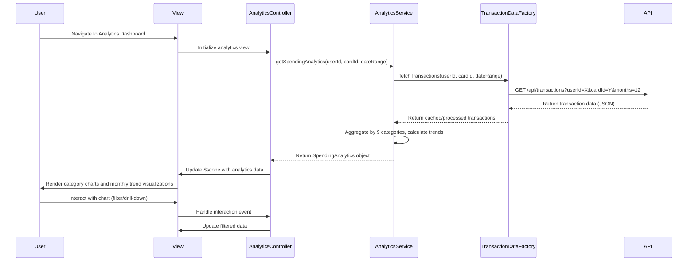

# Low-Level Design: QE-7624 - Spending Analytics and Trend Visualization

## a. Architecture Mapping

- **User Analytics Dashboard (View)** → HTML5 template with AngularJS directives and Bootstrap grid
- **Analytics UI Component** → AngularJS Controller (`AnalyticsController`) managing view state and user interactions
- **Analytics Engine** → AngularJS Service (`AnalyticsService`) for data aggregation and calculations
- **Transaction Data Service Integration** → AngularJS Factory (`TransactionDataFactory`) for REST API calls
- **Visualization Library** → AngularJS Directive (`chartDirective`) wrapping Chart.js or D3.js

**Recommended Folder Structure:**
```
/app
  /modules
    /analytics
      /controllers
      /services
      /directives
      /views
      /models
```

## b. Component Specifications

| Component Name | Artifact Type | Responsibility | Key Dependencies |
|----------------|---------------|----------------|------------------|
| AnalyticsController | Controller | Manages analytics view state, handles user interactions, orchestrates data flow between service and view | AnalyticsService, $scope, $filter |
| AnalyticsService | Service | Aggregates transaction data, calculates category-wise spending, computes monthly trends | TransactionDataFactory, $q |
| TransactionDataFactory | Factory | Handles REST API calls to Transaction Data Service, caches historical data | $http, $cacheFactory |
| chartDirective | Directive | Renders interactive charts for spending visualization, handles chart interactions | Chart.js/D3.js library |
| SpendingCategoryFilter | Filter | Filters transactions by category (Food & Dining, Fuel, Shopping, etc.) | None |

## c. Data Model

**SpendingAnalytics Model:**
```javascript
{
  userId: String,
  cardId: String,
  categories: Array<CategorySpending>,
  monthlyTrends: Array<MonthlyTrend>,
  totalSpend: Number,
  dateRange: Object
}
```

**CategorySpending Model:**
```javascript
{
  categoryName: String,
  categoryType: String,
  amount: Number,
  percentage: Number,
  transactionCount: Number
}
```

**MonthlyTrend Model:**
```javascript
{
  month: String,
  year: Number,
  totalSpend: Number,
  categoryBreakdown: Array<Object>
}
```

## d. Data Flow

User selects analytics view → AnalyticsController initializes and requests data → AnalyticsService calls TransactionDataFactory to fetch transaction data via REST API → Factory retrieves and caches 12 months of historical data → Service aggregates data by nine categories and calculates monthly trends → Controller updates $scope with processed data → chartDirective renders interactive visualizations → User interactions trigger controller methods that filter/update data → View updates reactively via two-way binding.

## e. Primary Sequence Diagram



## f. Implementation Notes

- Use AngularJS Dependency Injection to inject AnalyticsService and TransactionDataFactory into AnalyticsController
- Implement ES6 classes for service layer with arrow functions for lexical scoping
- Use $http interceptors for API authentication and error handling
- Leverage $cacheFactory for client-side caching of 12-month historical data to meet sub-second interaction NFR
- Implement lazy-loading for chart library to optimize initial page load time under 3 seconds

## g. Error Handling

HTTP interceptor captures API errors; controller displays user-friendly notifications via Bootstrap alerts; failed requests retry once with exponential backoff.

## h. Security Notes

Requires token-based auth via existing SSO; all API calls include authorization headers; input validation on date range parameters.