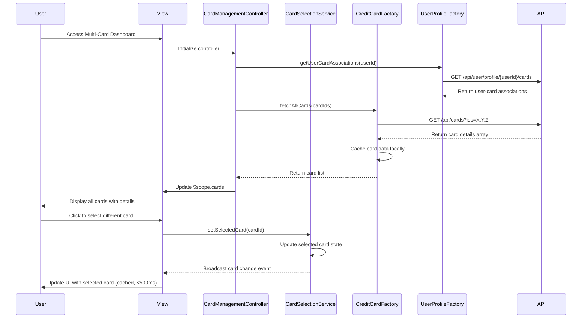

# Low-Level Design: QE-7625 - Multi-Card Management and Visualization

## a. Architecture Mapping

- **User Interface (View)** → HTML5 template with AngularJS ng-repeat and Bootstrap card components
- **Card Management Component** → AngularJS Controller (`CardManagementController`) managing card list and selection state
- **Card Selection Handler** → AngularJS Service (`CardSelectionService`) maintaining selected card state across views
- **Credit Card Data Service Integration** → AngularJS Factory (`CreditCardFactory`) for REST API calls
- **User Profile Service Integration** → AngularJS Factory (`UserProfileFactory`) for user-card associations

**Recommended Folder Structure:**
```
/app
  /modules
    /cards
      /controllers
      /services
      /factories
      /views
      /models
```

## b. Component Specifications

| Component Name | Artifact Type | Responsibility | Key Dependencies |
|----------------|---------------|----------------|------------------|
| CardManagementController | Controller | Manages card list display, handles card selection events, coordinates view updates | CardSelectionService, CreditCardFactory, $scope |
| CardSelectionService | Service | Maintains currently selected card state, broadcasts card change events | $rootScope |
| CreditCardFactory | Factory | Fetches card data from Credit Card Data Service REST API, caches card list | $http, $cacheFactory |
| UserProfileFactory | Factory | Retrieves user-card associations from User Profile Service | $http |
| cardListDirective | Directive | Renders card list with details, handles card switching UI interactions | CardSelectionService |

## c. Data Model

**CreditCard Model:**
```javascript
{
  cardId: String,
  userId: String,
  cardNumber: String,
  cardType: String,
  bankName: String,
  creditLimit: Number,
  availableCredit: Number,
  outstandingAmount: Number,
  expiryDate: String,
  isActive: Boolean
}
```

**UserCardProfile Model:**
```javascript
{
  userId: String,
  cards: Array<CreditCard>,
  selectedCardId: String,
  totalCards: Number
}
```

## d. Data Flow

User accesses card management view → CardManagementController initializes → UserProfileFactory fetches user-card associations via REST API → CreditCardFactory retrieves detailed card data for all associated cards → Factory caches card list locally → Controller populates $scope with card array → View renders cards using ng-repeat and Bootstrap → User clicks to switch card → cardListDirective triggers CardSelectionService to update selected card → Service broadcasts card change event → Dependent controllers/components react to selection change → View updates with sub-500ms response via cached data.

## e. Primary Sequence Diagram



## f. Implementation Notes

- Use AngularJS $cacheFactory with LRU strategy to cache up to 50 cards per user for sub-500ms switching
- Implement CardSelectionService as singleton service using AngularJS service() method
- Use $rootScope.$broadcast for card change events and $scope.$on in dependent controllers
- Leverage ng-repeat with track by cardId for optimal rendering performance
- Implement ES6 Promises via $q for asynchronous API calls with proper error handling

## g. Error Handling

$http interceptor handles API failures; controller displays error messages via Bootstrap modals; retry logic for transient failures.

## h. Security Notes

Token-based authentication required; card numbers masked in UI (show last 4 digits); secure HTTPS API calls with authorization headers.