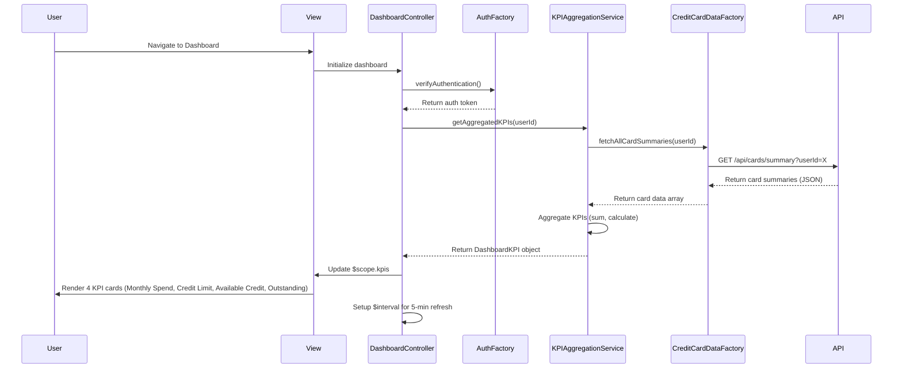

# Low-Level Design: QE-7626 - Credit Card Overview and KPI Dashboard

## a. Architecture Mapping

- **User Web Client (View)** → HTML5 template with AngularJS expressions and Bootstrap responsive grid
- **Dashboard UI Component** → AngularJS Controller (`DashboardController`) managing KPI display and refresh logic
- **KPI Aggregation Service** → AngularJS Service (`KPIAggregationService`) calculating aggregated metrics across cards
- **Credit Card Data Service Integration** → AngularJS Factory (`CreditCardDataFactory`) for REST API calls
- **User Authentication Service Integration** → AngularJS Factory (`AuthFactory`) for session management

**Recommended Folder Structure:**
```
/app
  /modules
    /dashboard
      /controllers
      /services
      /factories
      /views
      /models
```

## b. Component Specifications

| Component Name | Artifact Type | Responsibility | Key Dependencies |
|----------------|---------------|----------------|------------------|
| DashboardController | Controller | Manages dashboard view, orchestrates KPI data loading, handles refresh events | KPIAggregationService, AuthFactory, $scope, $interval |
| KPIAggregationService | Service | Aggregates KPI metrics (monthly spend, total credit limit, available credit, outstanding) across all cards | CreditCardDataFactory, $q |
| CreditCardDataFactory | Factory | Fetches card and transaction data from Credit Card Data Service REST API | $http |
| AuthFactory | Factory | Manages user authentication state, provides auth tokens for API calls | $http, $window |
| kpiCardDirective | Directive | Renders individual KPI card with icon, label, value, and responsive styling | None |

## c. Data Model

**DashboardKPI Model:**
```javascript
{
  userId: String,
  monthlySpend: Number,
  totalCreditLimit: Number,
  availableCredit: Number,
  outstandingAmount: Number,
  cardCount: Number,
  lastUpdated: Date
}
```

**CreditCardSummary Model:**
```javascript
{
  cardId: String,
  currentBalance: Number,
  creditLimit: Number,
  availableCredit: Number,
  monthlySpend: Number
}
```

## d. Data Flow

User navigates to dashboard → DashboardController initializes and verifies authentication via AuthFactory → Controller requests KPI data from KPIAggregationService → Service calls CreditCardDataFactory to fetch all card summaries via REST API → Factory retrieves standardized JSON data → Service aggregates metrics across all cards (sum monthly spend, total limits, calculate available credit) → Service returns DashboardKPI object → Controller updates $scope → View renders four KPI cards using kpiCardDirective with Bootstrap responsive grid → $interval triggers periodic refresh every 5 minutes → Updated KPIs reflect in UI via two-way binding.

## e. Primary Sequence Diagram



## f. Implementation Notes

- Use AngularJS $interval service for periodic KPI refresh every 5 minutes with automatic cleanup on $destroy
- Implement KPIAggregationService using ES6 class syntax with reduce() for aggregation logic
- Use Bootstrap grid system (col-xs, col-sm, col-md, col-lg) for responsive KPI card layout
- Leverage AngularJS $q.all() to parallelize multiple API calls if card data requires separate endpoints
- Implement loading indicators using ng-show/ng-hide to meet 2-second load time NFR

## g. Error Handling

$http interceptor with global error handler; user-friendly error messages displayed via Bootstrap alerts; automatic retry on network failures.

## h. Security Notes

Requires token-based auth via existing SSO; all API requests include JWT in Authorization header; session timeout handled by AuthFactory.