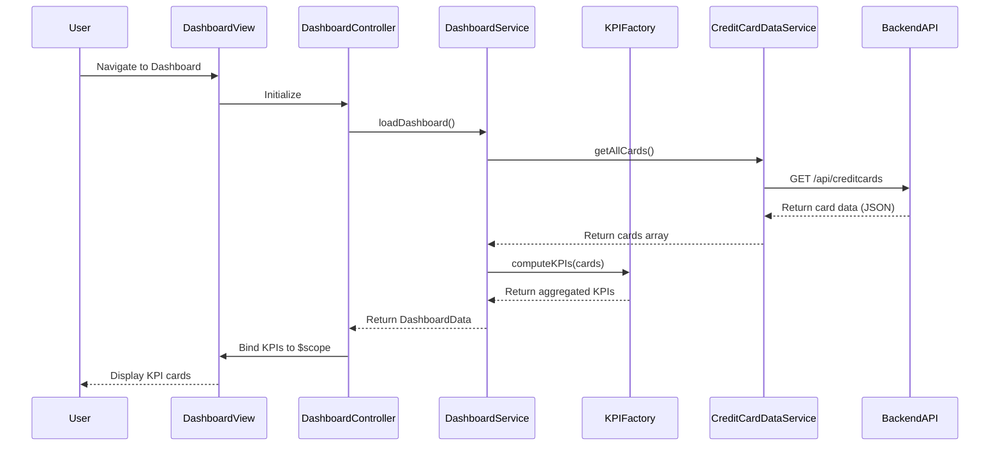

# Low-Level Design: QE-7627 - Credit Card Dashboard and KPI Monitoring

## a. Architecture Mapping

**HLD Component → AngularJS Artifact Mapping:**
- User Interface → Module: `dashboardModule` + Controller: `DashboardController` + View: `dashboard.html`
- Dashboard Service → Service: `DashboardService` (handles API calls and data aggregation)
- KPI Aggregation Engine → Factory: `KPIFactory` (computes and caches KPI metrics)
- Credit Card Data Source → Service: `CreditCardDataService` (REST API integration)
- User Authentication Service → Service: `AuthService` (token-based authentication)

**Recommended Folder Structure:**
```
app/
├── modules/
│   └── dashboard/
│       ├── dashboard.module.js
│       ├── dashboard.controller.js
│       ├── dashboard.service.js
│       └── views/
│           └── dashboard.html
├── shared/
│   ├── services/
│   │   ├── auth.service.js
│   │   └── creditcard-data.service.js
│   └── factories/
│       └── kpi.factory.js
└── assets/
    ├── css/
    └── js/
```

## b. Component Specifications

| Component Name | Artifact Type | Responsibility | Key Dependencies |
|----------------|---------------|----------------|------------------|
| dashboardModule | Module | Main module for dashboard feature | angular, ui.router |
| DashboardController | Controller | Manages dashboard view logic, binds KPI data to view | DashboardService, KPIFactory, $scope |
| DashboardService | Service | Fetches aggregated credit card data from backend API | $http, CreditCardDataService, AuthService |
| KPIFactory | Factory | Computes monthly spend, total limit, available credit, outstanding amount | - |
| CreditCardDataService | Service | REST API calls to credit card data source | $http, $q, AuthService |
| AuthService | Service | Manages user authentication and token injection | $http, $window |
| dashboard.html | View | Displays KPI cards with responsive Bootstrap layout | Bootstrap CSS, AngularJS directives |

## c. Data Model

```javascript
// CreditCard Model
const CreditCard = {
  cardId: String,
  cardNumber: String,
  cardType: String,
  creditLimit: Number,
  outstandingAmount: Number,
  availableCredit: Number
};

// KPI Model
const KPI = {
  monthlySpend: Number,
  totalCreditLimit: Number,
  totalAvailableCredit: Number,
  totalOutstanding: Number,
  lastUpdated: Date
};

// Dashboard Data Model
const DashboardData = {
  userId: String,
  cards: Array<CreditCard>,
  kpis: KPI
};
```

## d. Data Flow

User navigates to dashboard → `DashboardController` initializes and calls `DashboardService.loadDashboard()` → Service invokes `CreditCardDataService.getAllCards()` with auth token → Backend REST API returns card data (JSON) → `KPIFactory` aggregates metrics (monthly spend, total limit, available credit, outstanding) → Computed KPIs bound to `$scope` → View updates with KPI cards rendered via Bootstrap grid, displaying real-time financial health metrics.

## e. Primary Sequence Diagram



## f. Implementation Notes

- Use AngularJS 1.x module pattern with dependency injection for all services and controllers.
- Implement HTTP interceptor for auth token injection and error handling in all API calls.
- Leverage `$http` service with promise-based pattern (`$q`) for async REST API integration.
- Apply Bootstrap 3/4 responsive grid (col-md-3 for KPI cards) to ensure mobile/tablet/desktop compatibility.
- Cache KPI data in `KPIFactory` using `$cacheFactory` for 60 seconds to meet 2-second load time requirement.

## g. Error Handling

HTTP interceptor captures API errors (4xx/5xx), logs to console, and displays user-friendly toast notifications via a shared `NotificationService`.

## h. Security Notes

Requires token-based auth via existing SSO; AuthService injects JWT token in Authorization header for all API requests.