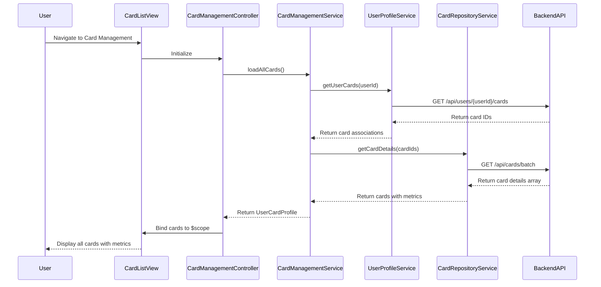

# Low-Level Design: QE-7628 - Multiple Credit Card Management

## a. Architecture Mapping

**HLD Component → AngularJS Artifact Mapping:**
- User Interface → Module: `cardManagementModule` + Controller: `CardManagementController` + View: `card-list.html`
- Card Management Service → Service: `CardManagementService` (fetches and manages card data)
- Card Repository → Service: `CardRepositoryService` (REST API integration for card details)
- User Profile Service → Service: `UserProfileService` (retrieves user-card associations)
- Dashboard KPI System → Factory: `KPIFactory` (shared with dashboard for consolidated metrics)

**Recommended Folder Structure:**
```
app/
├── modules/
│   └── card-management/
│       ├── card-management.module.js
│       ├── card-management.controller.js
│       ├── card-management.service.js
│       └── views/
│           └── card-list.html
├── shared/
│   ├── services/
│   │   ├── card-repository.service.js
│   │   └── user-profile.service.js
│   └── factories/
│       └── kpi.factory.js
└── assets/
    ├── css/
    └── js/
```

## b. Component Specifications

| Component Name | Artifact Type | Responsibility | Key Dependencies |
|----------------|---------------|----------------|------------------|
| cardManagementModule | Module | Main module for multiple card management | angular, ui.router |
| CardManagementController | Controller | Manages card list view, handles card selection and comparison | CardManagementService, $scope |
| CardManagementService | Service | Orchestrates card data retrieval and card-wise spend analysis | CardRepositoryService, UserProfileService, KPIFactory |
| CardRepositoryService | Service | REST API calls to fetch individual card details and transaction history | $http, $q, AuthService |
| UserProfileService | Service | Fetches user-specific card associations and preferences | $http, AuthService |
| KPIFactory | Factory | Computes card-specific and aggregated KPIs | - |
| card-list.html | View | Displays all cards in responsive grid with card-specific metrics | Bootstrap CSS, ng-repeat |

## c. Data Model

```javascript
// CreditCard Model (Extended)
const CreditCard = {
  cardId: String,
  cardNumber: String,
  cardType: String,
  cardName: String,
  creditLimit: Number,
  outstandingBalance: Number,
  availableCredit: Number,
  monthlySpend: Number,
  lastTransactionDate: Date
};

// UserCardProfile Model
const UserCardProfile = {
  userId: String,
  cards: Array<CreditCard>,
  totalCards: Number
};

// CardComparison Model
const CardComparison = {
  cardId: String,
  utilizationRate: Number,
  spendTrend: String
};
```

## d. Data Flow

User navigates to card management view → `CardManagementController` initializes and calls `CardManagementService.loadAllCards()` → Service invokes `UserProfileService.getUserCards()` to get card associations → Service calls `CardRepositoryService.getCardDetails(cardId)` in batch for all cards → Backend REST API returns card-specific data (limits, balances, transactions) → `KPIFactory` computes card-wise metrics → Controller binds card array to `$scope` → View renders cards using `ng-repeat` with Bootstrap card components, displaying individual card metrics and comparison capability.

## e. Primary Sequence Diagram



## f. Implementation Notes

- Use AngularJS `ng-repeat` with `track by cardId` for efficient rendering of multiple cards.
- Implement batch API call pattern in `CardRepositoryService` using `$q.all()` to fetch all card details in parallel within 1-second NFR.
- Cache card data client-side using `$cacheFactory` with 5-minute TTL to maintain responsiveness as card count increases.
- Apply Bootstrap card component with responsive grid (col-lg-4, col-md-6, col-sm-12) for scalable UI across devices.
- Implement card comparison logic in controller using client-side sorting and filtering on cached data.

## g. Error Handling

HTTP interceptor handles API failures; partial card data displayed with error indicators for failed cards; retry mechanism for batch calls.

## h. Security Notes

Standard input validation and secure API calls assumed; JWT token authentication enforced via AuthService for all card data requests.