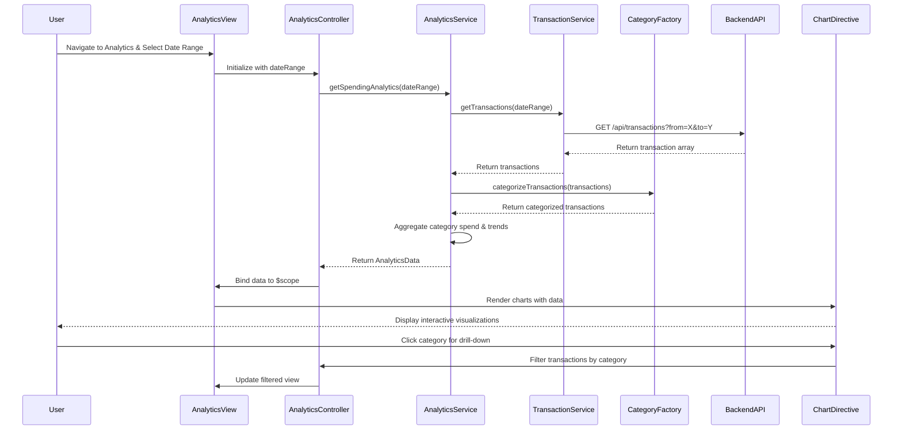

# Low-Level Design: QE-7629 - Spending Analytics and Visualization

## a. Architecture Mapping

**HLD Component → AngularJS Artifact Mapping:**
- User Interface → Module: `analyticsModule` + Controller: `AnalyticsController` + View: `analytics.html`
- Analytics Service → Service: `AnalyticsService` (fetches and processes transaction data)
- Category Classification Engine → Factory: `CategoryFactory` (categorizes transactions into 9 categories)
- Transaction Data Service → Service: `TransactionService` (REST API integration for transaction history)
- Visualization Renderer → Directive: `spendingChartDirective` (renders interactive charts using Chart.js/D3.js)
- Dashboard KPI System → Factory: `KPIFactory` (provides monthly spend context)

**Recommended Folder Structure:**
```
app/
├── modules/
│   └── analytics/
│       ├── analytics.module.js
│       ├── analytics.controller.js
│       ├── analytics.service.js
│       ├── directives/
│       │   └── spending-chart.directive.js
│       └── views/
│           └── analytics.html
├── shared/
│   ├── services/
│   │   └── transaction.service.js
│   └── factories/
│       ├── category.factory.js
│       └── kpi.factory.js
└── assets/
    ├── css/
    └── js/
```

## b. Component Specifications

| Component Name | Artifact Type | Responsibility | Key Dependencies |
|----------------|---------------|----------------|------------------|
| analyticsModule | Module | Main module for spending analytics feature | angular, ui.router, chart.js |
| AnalyticsController | Controller | Manages analytics view, handles date range selection and drill-down | AnalyticsService, $scope, $filter |
| AnalyticsService | Service | Orchestrates transaction data retrieval, categorization, and aggregation | TransactionService, CategoryFactory, KPIFactory |
| TransactionService | Service | REST API calls to fetch transaction history (up to 12 months) | $http, $q, AuthService |
| CategoryFactory | Factory | Categorizes transactions into 9 predefined categories using merchant data | - |
| spendingChartDirective | Directive | Renders interactive category-wise and trend charts using Chart.js | Chart.js library |
| KPIFactory | Factory | Provides monthly spend totals for visualization context | - |
| analytics.html | View | Displays category filters, date pickers, and chart containers | Bootstrap CSS, AngularJS directives |

## c. Data Model

```javascript
// Transaction Model
const Transaction = {
  transactionId: String,
  cardId: String,
  amount: Number,
  merchantName: String,
  merchantCode: String,
  category: String,
  transactionDate: Date,
  description: String
};

// CategorySpend Model
const CategorySpend = {
  category: String,
  totalSpend: Number,
  transactionCount: Number,
  percentage: Number
};

// MonthlyTrend Model
const MonthlyTrend = {
  month: String,
  totalSpend: Number,
  categoryBreakdown: Array<CategorySpend>
};

// AnalyticsData Model
const AnalyticsData = {
  userId: String,
  dateRange: { startDate: Date, endDate: Date },
  categories: Array<CategorySpend>,
  monthlyTrends: Array<MonthlyTrend>,
  transactions: Array<Transaction>
};
```

## d. Data Flow

User navigates to analytics view and selects date range → `AnalyticsController` calls `AnalyticsService.getSpendingAnalytics(dateRange)` → Service invokes `TransactionService.getTransactions(dateRange)` → Backend REST API returns transaction history (JSON) → `CategoryFactory` categorizes each transaction into one of 9 categories using merchant codes → Service aggregates category-wise spend and monthly trends → Controller binds analytics data to `$scope` → `spendingChartDirective` renders interactive charts (pie chart for categories, line chart for trends) → User interacts with charts to drill down into specific categories/months.

## e. Primary Sequence Diagram



## f. Implementation Notes

- Use Chart.js library integrated via custom AngularJS directive (`spendingChartDirective`) for responsive, interactive charts.
- Implement date range picker using Bootstrap Datepicker or Angular UI Bootstrap for user-friendly date selection.
- Pre-aggregate transaction data daily on backend and cache using `$cacheFactory` with 1-hour TTL to meet 3-second rendering NFR.
- Use AngularJS `$filter` service for client-side drill-down filtering by category/month without re-fetching data.
- Apply lazy-loading pattern for 12-month transaction data: load current month on init, fetch older months on-demand when user selects extended date range.

## g. Error Handling

HTTP interceptor captures API errors; display fallback message if transaction data unavailable; retry mechanism for failed API calls with exponential backoff.

## h. Security Notes

Standard input validation and secure API calls assumed; date range inputs sanitized to prevent injection attacks; JWT authentication enforced for transaction API access.