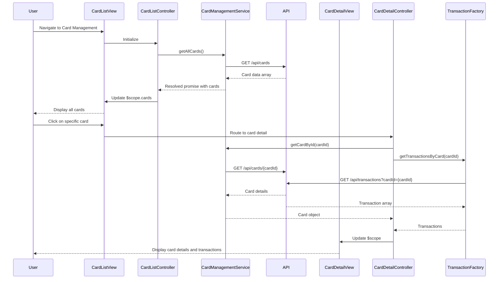

# Low-Level Design: QE-7630 - Credit Card Management and Tracking

## a. Architecture Mapping

**Component to Artifact Mapping:**
- User Interface → AngularJS Module (`creditCardManagementModule`) + Controller (`CardListController`, `CardDetailController`)
- Card Management API → AngularJS Service (`CardManagementService`) for REST API communication
- Credit Card Data Repository → Backend REST endpoints consumed via `$http` service
- Transaction Processing Service → AngularJS Factory (`TransactionFactory`) for card-specific transaction data
- Card Comparison Module → AngularJS Controller (`CardComparisonController`) + Custom Directive (`cardComparison`)

**Recommended Folder Structure:**
```
app/
├── modules/
│   └── card-management/
│       ├── controllers/
│       │   ├── card-list.controller.js
│       │   ├── card-detail.controller.js
│       │   └── card-comparison.controller.js
│       ├── services/
│       │   └── card-management.service.js
│       ├── factories/
│       │   └── transaction.factory.js
│       ├── directives/
│       │   └── card-comparison.directive.js
│       ├── views/
│       │   ├── card-list.html
│       │   ├── card-detail.html
│       │   └── card-comparison.html
│       └── card-management.module.js
```

## b. Component Specifications

| Component Name | Artifact Type | Responsibility | Key Dependencies |
|----------------|---------------|----------------|------------------|
| creditCardManagementModule | Module | Root module for card management features | ngRoute, ngResource |
| CardListController | Controller | Display list of all user credit cards with summary info | CardManagementService, $scope |
| CardDetailController | Controller | Show detailed view of single card with spending, limits, balance | CardManagementService, TransactionFactory, $routeParams |
| CardComparisonController | Controller | Enable side-by-side comparison of multiple cards | CardManagementService, $scope |
| CardManagementService | Service | Handle all CRUD operations and API calls for card data | $http, $q, API_CONFIG |
| TransactionFactory | Factory | Fetch and cache card-specific transaction history | $resource, API_ENDPOINTS |
| cardComparison | Directive | Reusable UI component for card comparison visualization | CardManagementService |

## c. Data Model

**CreditCard Model:**
```javascript
{
  cardId: String,
  cardNumber: String (masked),
  cardType: String,
  issuer: String,
  creditLimit: Number,
  availableCredit: Number,
  outstandingBalance: Number,
  currentSpend: Number,
  status: String (enum: 'active', 'inactive', 'blocked'),
  rewardProgram: String,
  expiryDate: Date,
  lastUpdated: Date
}
```

**CardTransaction Model:**
```javascript
{
  transactionId: String,
  cardId: String,
  amount: Number,
  category: String,
  merchant: String,
  transactionDate: Date,
  description: String,
  status: String
}
```

## d. Data Flow

User navigates to card management view → CardListController initializes and calls CardManagementService.getAllCards() → Service makes GET request to `/api/cards` endpoint → Response data is bound to $scope.cards and rendered in card-list.html → User clicks on specific card → CardDetailController loads using $routeParams.cardId → Controller calls CardManagementService.getCardById() and TransactionFactory.getTransactionsByCard() in parallel → Both API responses populate $scope.selectedCard and $scope.transactions → View updates with detailed card info and transaction history → User actions (comparison, filtering) trigger controller methods that update scope and refresh UI.

## e. Primary Sequence Diagram



## f. Implementation Notes

- Use AngularJS 1.x module pattern with dependency injection for all services, controllers, and factories
- Implement $http interceptor for authentication token injection and error handling across all API calls
- Leverage $q promises for parallel API calls (card details + transactions) to optimize load time
- Use ng-repeat with track by cardId for efficient list rendering of up to 20 cards
- Implement ES6 arrow functions and const/let for cleaner, more maintainable controller and service code

## g. Error Handling

HTTP interceptor-based error handling with user-friendly notifications via toastr or custom alert service for API failures.

## h. Security Notes

Requires token-based authentication via existing SSO; card numbers displayed in masked format (last 4 digits only).