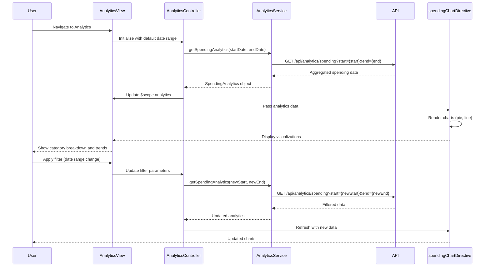

# Low-Level Design: QE-7631 - Spending Analytics and Insights

## a. Architecture Mapping

**Component to Artifact Mapping:**
- User Interface → AngularJS Module (`spendingAnalyticsModule`) + Controller (`AnalyticsController`)
- Analytics API → AngularJS Service (`AnalyticsService`) for REST API integration
- Transaction Data Service → Backend REST endpoints consumed via `$resource`
- Categorization Engine → Backend service; AngularJS Factory (`CategoryFactory`) for category metadata
- Visualization Library → Custom Directive (`spendingChart`) wrapping Chart.js or D3.js
- Transaction Repository → Backend data store accessed via AnalyticsService

**Recommended Folder Structure:**
```
app/
├── modules/
│   └── analytics/
│       ├── controllers/
│       │   └── analytics.controller.js
│       ├── services/
│       │   └── analytics.service.js
│       ├── factories/
│       │   └── category.factory.js
│       ├── directives/
│       │   └── spending-chart.directive.js
│       ├── views/
│       │   └── analytics.html
│       └── analytics.module.js
```

## b. Component Specifications

| Component Name | Artifact Type | Responsibility | Key Dependencies |
|----------------|---------------|----------------|------------------|
| spendingAnalyticsModule | Module | Root module for analytics and visualization features | ngRoute, chart.js |
| AnalyticsController | Controller | Manage analytics view, handle filters, date range selection | AnalyticsService, CategoryFactory, $scope |
| AnalyticsService | Service | Fetch aggregated spending data, monthly trends, category breakdowns | $http, $q, API_CONFIG |
| CategoryFactory | Factory | Provide category metadata and mapping for 9 predefined categories | $resource |
| spendingChart | Directive | Render interactive charts (pie, bar, line) for spending visualization | Chart.js, $timeout |

## c. Data Model

**SpendingAnalytics Model:**
```javascript
{
  userId: String,
  periodStart: Date,
  periodEnd: Date,
  totalSpend: Number,
  categoryBreakdown: Array<CategorySpend>,
  monthlyTrends: Array<MonthlySpend>
}
```

**CategorySpend Model:**
```javascript
{
  category: String (enum: 'Food & Dining', 'Fuel', 'Shopping', 'Travel', 'Entertainment', 'Utilities', 'Healthcare', 'Education', 'Miscellaneous'),
  amount: Number,
  transactionCount: Number,
  percentage: Number
}
```

**MonthlySpend Model:**
```javascript
{
  month: String (YYYY-MM),
  totalAmount: Number,
  categoryBreakdown: Array<CategorySpend>
}
```

## d. Data Flow

User navigates to analytics view → AnalyticsController initializes with default date range (last 6 months) → Controller calls AnalyticsService.getSpendingAnalytics(startDate, endDate) → Service makes GET request to `/api/analytics/spending?start={start}&end={end}` → Backend aggregates transaction data by category and month → Response data bound to $scope.analytics → spendingChart directive watches $scope.analytics and renders category pie chart and monthly trend line chart → User applies filters (date range, specific category) → Controller updates parameters and re-calls AnalyticsService → Charts re-render with filtered data.

## e. Primary Sequence Diagram



## f. Implementation Notes

- Use AngularJS $resource for RESTful API consumption with caching enabled for repeated queries
- Implement custom directive wrapping Chart.js for reusable, data-driven chart components with two-way binding
- Leverage ES6 template literals for dynamic API endpoint construction with date parameters
- Use $scope.$watch on filter parameters to trigger automatic data refresh and chart re-rendering
- Implement debounce on date range picker to avoid excessive API calls during user interaction

## g. Error Handling

Try/catch blocks in service methods with fallback to cached data if available; user notification via alert service on API failures.

## h. Security Notes

Standard input validation and secure API calls assumed; analytics data scoped to authenticated user only.