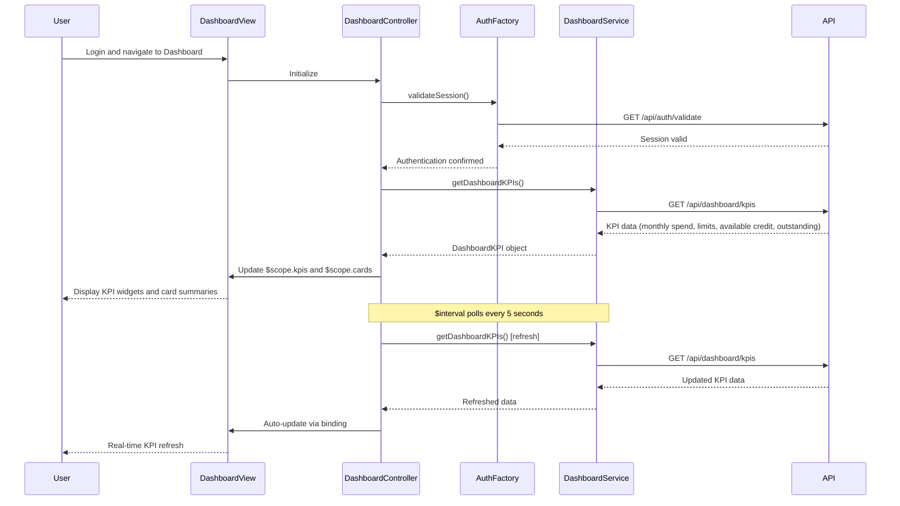

# Low-Level Design: QE-7632 - Credit Card Dashboard and KPI Overview

## a. Architecture Mapping

**Component to Artifact Mapping:**
- Dashboard UI Layer → AngularJS Module (`dashboardModule`) + Controller (`DashboardController`)
- API Gateway → AngularJS Service (`DashboardService`) for aggregated API calls
- User Authentication Service → AngularJS Factory (`AuthFactory`) for session and token management
- Credit Card Data Service → Backend REST endpoints consumed via `$http`
- KPI Aggregation Engine → Backend service; AngularJS Filter (`currencyFormat`) for display formatting
- Data Repository → Backend data store accessed via DashboardService

**Recommended Folder Structure:**
```
app/
├── modules/
│   └── dashboard/
│       ├── controllers/
│       │   └── dashboard.controller.js
│       ├── services/
│       │   └── dashboard.service.js
│       ├── factories/
│       │   └── auth.factory.js
│       ├── filters/
│       │   └── currency-format.filter.js
│       ├── views/
│       │   └── dashboard.html
│       └── dashboard.module.js
```

## b. Component Specifications

| Component Name | Artifact Type | Responsibility | Key Dependencies |
|----------------|---------------|----------------|------------------|
| dashboardModule | Module | Root module for dashboard and KPI display | ngRoute, ngAnimate |
| DashboardController | Controller | Manage dashboard state, fetch and display KPIs for all cards | DashboardService, AuthFactory, $scope, $interval |
| DashboardService | Service | Aggregate API calls for card data, calculate KPIs (monthly spend, limits, available credit, outstanding) | $http, $q, API_CONFIG |
| AuthFactory | Factory | Handle user authentication, session validation, token refresh | $http, $window, AUTH_CONFIG |
| currencyFormat | Filter | Format numeric KPI values as currency with proper symbols and decimals | None |

## c. Data Model

**DashboardKPI Model:**
```javascript
{
  userId: String,
  monthlySpend: Number,
  totalCreditLimit: Number,
  availableCredit: Number,
  outstandingAmount: Number,
  cardCount: Number,
  lastUpdated: Date
}
```

**CardSummary Model:**
```javascript
{
  cardId: String,
  cardName: String,
  cardNumber: String (masked),
  creditLimit: Number,
  availableCredit: Number,
  currentBalance: Number,
  monthlySpend: Number
}
```

## d. Data Flow

User logs in and navigates to dashboard → DashboardController initializes and calls AuthFactory.validateSession() → Upon successful authentication, controller invokes DashboardService.getDashboardKPIs() → Service makes GET request to `/api/dashboard/kpis` which aggregates data from multiple cards → Response containing KPIs and card summaries is bound to $scope.kpis and $scope.cards → Dashboard view renders KPI widgets and card list using ng-repeat → $interval service polls DashboardService every 5 seconds for real-time updates → On data change, $scope updates trigger automatic UI refresh via AngularJS two-way binding.

## e. Primary Sequence Diagram



## f. Implementation Notes

- Use AngularJS $interval service for real-time KPI polling every 5 seconds with automatic cleanup on scope destruction
- Implement DashboardService with promise-based API calls using $q for parallel data fetching and aggregation
- Leverage Bootstrap grid system (col-md-3 for KPI cards) for responsive layout across desktop, tablet, mobile
- Use ng-if and ng-show directives for conditional rendering based on data availability and loading states
- Apply ES6 const/let and arrow functions in controllers and services for modern JavaScript practices

## g. Error Handling

HTTP interceptor captures API errors and displays user-friendly messages via toastr; retry logic on session timeout.

## h. Security Notes

Requires token-based auth via existing SSO; all API calls include Authorization header with JWT token.