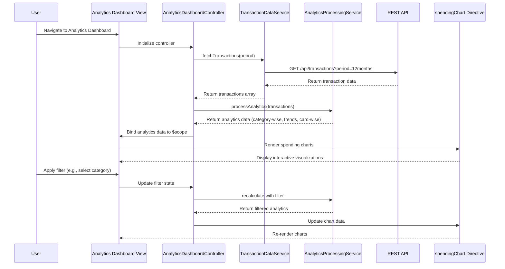

# Low-Level Design: Spending Analytics and Transaction Insights
**Epic ID:** QE-7645  
**Application:** Credit Card Analysis Dashboard  
**Technology Stack:** AngularJS 1.x, JavaScript ES6, HTML5, CSS3, Bootstrap, REST APIs, MVC Architecture

---

## a. Architecture Mapping

**HLD to AngularJS Artifact Mapping:**
- Analytics Dashboard UI → AngularJS Module (`spendingAnalyticsModule`) + Controller (`AnalyticsDashboardController`) + View Template
- Analytics Controller → AngularJS Controller (`AnalyticsDashboardController`) with $scope management
- Transaction Data Service → AngularJS Service (`TransactionDataService`) for REST API calls
- Categorization Engine → AngularJS Factory (`CategoryFactory`) for transaction classification logic
- Analytics Processing Service → AngularJS Service (`AnalyticsProcessingService`) for trend calculations and aggregations
- Interactive Visualizations → AngularJS Directive (`spendingChart`) wrapping charting library (Chart.js/D3.js)

**Recommended Folder Structure:**
```
app/
├── modules/
│   └── spending-analytics/
│       ├── controllers/
│       │   └── analytics-dashboard.controller.js
│       ├── services/
│       │   ├── transaction-data.service.js
│       │   └── analytics-processing.service.js
│       ├── factories/
│       │   └── category.factory.js
│       ├── directives/
│       │   └── spending-chart.directive.js
│       ├── views/
│       │   └── analytics-dashboard.html
│       └── spending-analytics.module.js
```

---

## b. Component Specifications

| Component Name | Artifact Type | Responsibility | Key Dependencies |
|---|---|---|---|
| `spendingAnalyticsModule` | Module | Root module for spending analytics feature | `ngRoute`, `ui.bootstrap`, `chart.js` |
| `AnalyticsDashboardController` | Controller | Manages analytics dashboard state, user interactions, and data binding | `TransactionDataService`, `AnalyticsProcessingService`, `CategoryFactory`, `$scope` |
| `TransactionDataService` | Service | Fetches transaction history from REST API | `$http`, `$q` |
| `AnalyticsProcessingService` | Service | Performs trend calculations, aggregations, and monthly spend analysis | `CategoryFactory`, `$filter` |
| `CategoryFactory` | Factory | Classifies transactions into predefined spending categories | None |
| `spendingChart` | Directive | Renders interactive charts for category-wise and card-wise spending | Chart.js library, `$timeout` |

---

## c. Data Model

**Transaction Model:**
```javascript
{
  transactionId: String,
  cardId: String,
  amount: Number,
  category: String, // Food & Dining, Fuel, Shopping, Travel, Entertainment, Utilities, Healthcare, Education, Miscellaneous
  transactionDate: Date,
  merchantName: String,
  description: String
}
```

**SpendingAnalytics Model:**
```javascript
{
  categoryWiseSpend: Array<{ category: String, totalAmount: Number, percentage: Number }>,
  monthlyTrend: Array<{ month: String, totalSpend: Number }>,
  cardWiseSpend: Array<{ cardId: String, cardName: String, totalSpend: Number }>,
  totalSpend: Number,
  periodStart: Date,
  periodEnd: Date
}
```

---

## d. Data Flow

User navigates to the Analytics Dashboard view, triggering `AnalyticsDashboardController` initialization. The controller invokes `TransactionDataService` to fetch transaction history via REST API (`GET /api/transactions?period=12months`). Retrieved transactions are passed to `CategoryFactory` for classification and then to `AnalyticsProcessingService` for aggregation (category-wise, monthly trends, card-wise). Processed analytics data is bound to `$scope` and rendered via `spendingChart` directive, which generates interactive visualizations. User interactions (filtering, drill-down) update controller state, triggering re-calculation and chart re-rendering.

---

## e. Primary Sequence Diagram



---

## f. Implementation Notes

- Use AngularJS Dependency Injection for all services, factories, and controllers to ensure testability and modularity.
- Implement ES6 classes for services and factories; transpile using Babel if needed for browser compatibility.
- Leverage `$http` service with promise-based API calls; handle responses using `.then()` and `.catch()` for async flow.
- Integrate Chart.js via custom AngularJS directive; use `$timeout` for digest cycle synchronization during chart updates.
- Apply Bootstrap grid system and responsive utilities for mobile-first, device-agnostic UI layout.

---

## g. Error Handling

Client-side error handling via `$http` interceptor for API failures, with user-friendly notifications using Bootstrap alerts and fallback to cached data when available.

---

## h. Security Notes

Requires token-based authentication via existing SSO; all API calls include Authorization header with JWT token for secure transaction data access.