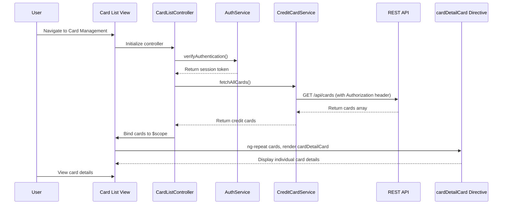

# Low-Level Design: Multiple Credit Card Management
**Epic ID:** QE-7646  
**Application:** Credit Card Analysis Dashboard  
**Technology Stack:** AngularJS 1.x, JavaScript ES6, HTML5, CSS3, Bootstrap, REST APIs, MVC Architecture

---

## a. Architecture Mapping

**HLD to AngularJS Artifact Mapping:**
- Card List View UI → AngularJS Module (`cardManagementModule`) + Controller (`CardListController`) + View Template
- Card Management Controller → AngularJS Controller (`CardListController`) managing card portfolio state
- User Authentication Service → AngularJS Service (`AuthService`) for session and token management
- Credit Card Data Service → AngularJS Service (`CreditCardService`) for REST API calls to fetch card data
- Card Details Display → AngularJS Directive (`cardDetailCard`) for individual card rendering

**Recommended Folder Structure:**
```
app/
├── modules/
│   └── card-management/
│       ├── controllers/
│       │   └── card-list.controller.js
│       ├── services/
│       │   ├── credit-card.service.js
│       │   └── auth.service.js
│       ├── directives/
│       │   └── card-detail-card.directive.js
│       ├── views/
│       │   └── card-list.html
│       └── card-management.module.js
```

---

## b. Component Specifications

| Component Name | Artifact Type | Responsibility | Key Dependencies |
|---|---|---|---|
| `cardManagementModule` | Module | Root module for credit card management feature | `ngRoute`, `ui.bootstrap` |
| `CardListController` | Controller | Manages card list state, retrieves and displays multiple credit cards | `CreditCardService`, `AuthService`, `$scope` |
| `CreditCardService` | Service | Fetches credit card data (details, limits, balances) from REST API | `$http`, `$q` |
| `AuthService` | Service | Manages user authentication, session tokens, and secure API access | `$http`, `$window` (localStorage) |
| `cardDetailCard` | Directive | Renders individual credit card with details, limit, and balance | None |

---

## c. Data Model

**CreditCard Model:**
```javascript
{
  cardId: String,
  cardNumber: String, // masked format (e.g., **** **** **** 1234)
  cardHolderName: String,
  cardType: String, // Visa, MasterCard, Amex, etc.
  creditLimit: Number,
  availableCredit: Number,
  outstandingBalance: Number,
  expiryDate: String, // MM/YY format
  status: String // Active, Blocked, Expired
}
```

**CardPortfolio Model:**
```javascript
{
  userId: String,
  cards: Array<CreditCard>,
  totalCreditLimit: Number,
  totalAvailableCredit: Number,
  totalOutstanding: Number
}
```

---

## d. Data Flow

User navigates to the Card Management view, triggering `CardListController` initialization. The controller verifies authentication status via `AuthService` and retrieves the session token. `CreditCardService` is invoked to fetch all credit cards for the authenticated user via REST API (`GET /api/cards`). The service returns an array of credit card objects, which the controller binds to `$scope.cards`. The view iterates over the cards array using `ng-repeat`, rendering each card via the `cardDetailCard` directive. User can view individual card details (limit, balance, status) in a responsive grid layout. Any card selection or interaction updates the controller state for further actions.

---

## e. Primary Sequence Diagram



---

## f. Implementation Notes

- Use AngularJS Dependency Injection for all services and controllers to enable unit testing and loose coupling.
- Implement `CreditCardService` with promise-based `$http` calls; cache card data using `$cacheFactory` to minimize API calls.
- Store authentication token securely in `localStorage` via `AuthService`; include token in all API request headers.
- Use Bootstrap card components and grid system for responsive, mobile-friendly card layout (supports 10+ cards).
- Apply `ng-repeat` with `track by cardId` for optimized DOM rendering and performance.

---

## g. Error Handling

Client-side error handling via `$http` interceptor for API failures; display user-friendly error messages using Bootstrap modals and retry mechanism for transient failures.

---

## h. Security Notes

Requires token-based authentication via existing SSO; all API calls include Authorization header with JWT token for secure card data access and session validation.