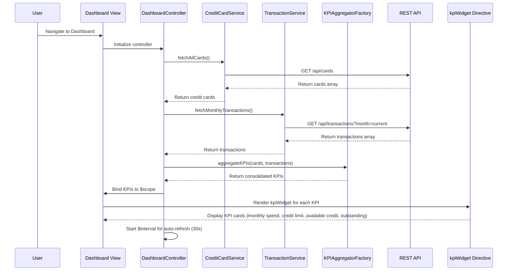

# Low-Level Design: Credit Card Dashboard and KPI Overview
**Epic ID:** QE-7647  
**Application:** Credit Card Analysis Dashboard  
**Technology Stack:** AngularJS 1.x, JavaScript ES6, HTML5, CSS3, Bootstrap, REST APIs, MVC Architecture

---

## a. Architecture Mapping

**HLD to AngularJS Artifact Mapping:**
- Dashboard UI → AngularJS Module (`dashboardModule`) + Controller (`DashboardController`) + View Template
- Dashboard Controller → AngularJS Controller (`DashboardController`) managing KPI state and data binding
- Credit Card Data Service → AngularJS Service (`CreditCardService`) for fetching card details and balances via REST API
- Transaction Processing Service → AngularJS Service (`TransactionService`) for calculating monthly spend
- Data Aggregation Layer → AngularJS Factory (`KPIAggregatorFactory`) for consolidating multi-card KPIs
- KPI Display Widgets → AngularJS Directive (`kpiWidget`) for rendering individual KPI cards

**Recommended Folder Structure:**
```
app/
├── modules/
│   └── dashboard/
│       ├── controllers/
│       │   └── dashboard.controller.js
│       ├── services/
│       │   ├── credit-card.service.js
│       │   └── transaction.service.js
│       ├── factories/
│       │   └── kpi-aggregator.factory.js
│       ├── directives/
│       │   └── kpi-widget.directive.js
│       ├── views/
│       │   └── dashboard.html
│       └── dashboard.module.js
```

---

## b. Component Specifications

| Component Name | Artifact Type | Responsibility | Key Dependencies |
|---|---|---|---|
| `dashboardModule` | Module | Root module for dashboard feature | `ngRoute`, `ui.bootstrap` |
| `DashboardController` | Controller | Manages dashboard state, orchestrates KPI data retrieval and aggregation | `CreditCardService`, `TransactionService`, `KPIAggregatorFactory`, `$scope`, `$interval` |
| `CreditCardService` | Service | Fetches credit card details, limits, and balances from REST API | `$http`, `$q` |
| `TransactionService` | Service | Fetches transaction data and calculates monthly spend | `$http`, `$q` |
| `KPIAggregatorFactory` | Factory | Aggregates data from multiple cards to compute consolidated KPIs | None |
| `kpiWidget` | Directive | Renders individual KPI metric (monthly spend, credit limit, available credit, outstanding) | None |

---

## c. Data Model

**KPI Model:**
```javascript
{
  monthlySpend: Number,
  totalCreditLimit: Number,
  availableCredit: Number,
  outstandingAmount: Number,
  lastUpdated: Date
}
```

**CreditCard Model:**
```javascript
{
  cardId: String,
  cardNumber: String,
  creditLimit: Number,
  availableCredit: Number,
  outstandingBalance: Number
}
```

**Transaction Model:**
```javascript
{
  transactionId: String,
  cardId: String,
  amount: Number,
  transactionDate: Date
}
```

---

## d. Data Flow

User navigates to the Dashboard view, triggering `DashboardController` initialization. The controller invokes `CreditCardService` to fetch all credit cards via REST API (`GET /api/cards`) and `TransactionService` to fetch current month's transactions (`GET /api/transactions?month=current`). Retrieved data is passed to `KPIAggregatorFactory`, which calculates consolidated KPIs: total credit limit (sum of all card limits), available credit (sum of available credit across cards), outstanding amount (sum of outstanding balances), and monthly spend (sum of current month transaction amounts). Aggregated KPIs are bound to `$scope.kpis` and rendered via `kpiWidget` directives in a responsive grid. `$interval` service refreshes KPI data every 30 seconds for near real-time updates.

---

## e. Primary Sequence Diagram



---

## f. Implementation Notes

- Use AngularJS Dependency Injection for all services, factories, and controllers to ensure modularity and testability.
- Implement `KPIAggregatorFactory` using ES6 class with pure functions for KPI calculation logic.
- Leverage `$http` service with promise chaining (`.then()`) for sequential API calls; use `$q.all()` for parallel data fetching.
- Apply `$interval` service for periodic KPI refresh; ensure proper cleanup on controller `$destroy` event to prevent memory leaks.
- Use Bootstrap grid and card components for responsive, mobile-first dashboard layout meeting 2-second load time requirement.

---

## g. Error Handling

Client-side error handling via `$http` interceptor for API failures; display user-friendly error notifications using Bootstrap toasts and graceful degradation with cached KPI data.

---

## h. Security Notes

Requires token-based authentication via existing SSO; all API calls include Authorization header with JWT token for secure access to card and transaction data.