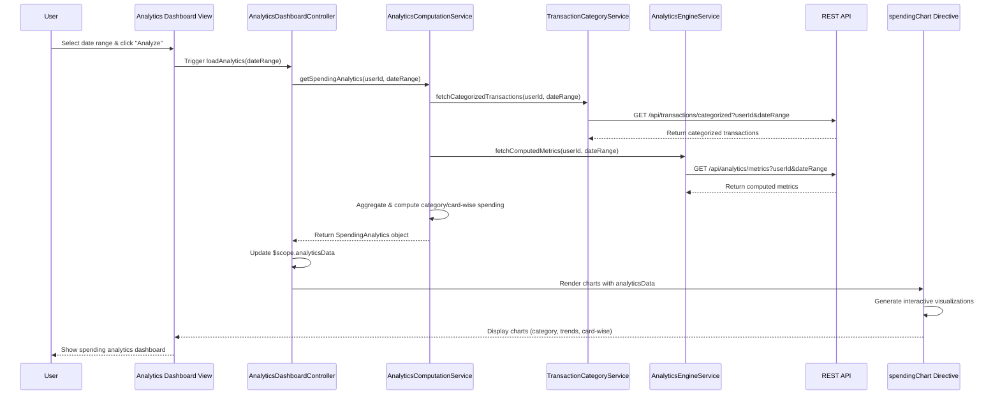

# Low-Level Design: QE-7648 - Spending Analytics and Insights

## a. Architecture Mapping

**HLD Component → AngularJS Artifact Mapping:**

- Analytics Dashboard UI → AngularJS Module (`app.analytics`) + Controller (`AnalyticsDashboardController`)
- Visualization Engine → Directive (`spendingChart`) + Factory (`ChartFactory`) for chart rendering logic
- Analytics Computation Module → Service (`AnalyticsComputationService`) for data aggregation and calculations
- Transaction Categorization Service → Service (`TransactionCategoryService`) for API calls to categorization endpoint
- Analytics Engine → Service (`AnalyticsEngineService`) for metric computation API integration
- Dashboard Service → Service (`DashboardDataService`) for data presentation API calls
- Historical Data Store → Backend REST API endpoints consumed by services

**Recommended Folder Structure:**
```
app/
├── modules/
│   └── analytics/
│       ├── analytics.module.js
│       ├── controllers/
│       │   └── analyticsDashboard.controller.js
│       ├── services/
│       │   ├── analyticsComputation.service.js
│       │   ├── transactionCategory.service.js
│       │   ├── analyticsEngine.service.js
│       │   └── dashboardData.service.js
│       ├── directives/
│       │   └── spendingChart.directive.js
│       ├── factories/
│       │   └── chart.factory.js
│       └── views/
│           └── analytics-dashboard.html
├── models/
│   └── spendingAnalytics.model.js
└── assets/
    ├── css/
    │   └── analytics.css
    └── js/
        └── chart-config.js
```

## b. Component Specifications

| Component Name | Artifact Type | Responsibility | Key Dependencies |
|----------------|---------------|----------------|------------------|
| `app.analytics` | Module | Root module for analytics feature, declares all analytics-related components | `ngRoute`, `chart.js`, `app.core` |
| `AnalyticsDashboardController` | Controller | Manages analytics dashboard state, user interactions, and orchestrates data flow between services and view | `AnalyticsComputationService`, `TransactionCategoryService`, `$scope`, `$filter` |
| `AnalyticsComputationService` | Service | Aggregates transaction data, computes category-wise and card-wise spending metrics | `$http`, `$q`, `AnalyticsEngineService`, `CacheService` |
| `TransactionCategoryService` | Service | Fetches categorized transaction data from REST API, handles category mapping | `$http`, `$q`, `API_CONFIG` |
| `AnalyticsEngineService` | Service | Retrieves computed spending metrics and historical data from analytics backend | `$http`, `$q`, `API_CONFIG` |
| `DashboardDataService` | Service | Provides formatted data for visualization components, handles data transformation | `$http`, `$q`, `AnalyticsComputationService` |
| `spendingChart` | Directive | Renders interactive spending charts (category-wise, monthly trends, card-wise) using Chart.js | `ChartFactory`, `$timeout`, `$window` |
| `ChartFactory` | Factory | Encapsulates Chart.js configuration and provides reusable chart creation methods | `Chart.js library` |

## c. Data Model

```javascript
// SpendingAnalytics Model
const SpendingAnalytics = {
  userId: String,
  dateRange: {
    startDate: Date,
    endDate: Date
  },
  categorySpending: [
    {
      categoryId: String,
      categoryName: String, // 'Food & Dining', 'Fuel', 'Shopping', 'Travel', 'Entertainment', 'Utilities', 'Healthcare', 'Education', 'Miscellaneous'
      totalAmount: Number,
      transactionCount: Number,
      percentage: Number
    }
  ],
  monthlyTrends: [
    {
      month: String, // 'YYYY-MM'
      totalSpend: Number,
      categoryBreakdown: Object // { categoryName: amount }
    }
  ],
  cardWiseSpending: [
    {
      cardId: String,
      cardName: String,
      totalSpend: Number,
      percentage: Number
    }
  ],
  totalSpending: Number,
  averageMonthlySpend: Number,
  topCategory: String,
  lastUpdated: Date
};

// Transaction Model (for categorization)
const Transaction = {
  transactionId: String,
  cardId: String,
  amount: Number,
  date: Date,
  categoryId: String,
  categoryName: String,
  merchantName: String,
  description: String
};
```

## d. Data Flow

User selects date range and filter options on the Analytics Dashboard view, triggering `AnalyticsDashboardController` to invoke `AnalyticsComputationService`. The service calls `TransactionCategoryService` and `AnalyticsEngineService` to fetch categorized transactions and pre-computed metrics via REST APIs from the Historical Data Store. Retrieved data is aggregated, transformed, and cached. `DashboardDataService` formats the data for visualization. The controller updates `$scope` with the processed analytics data, and the `spendingChart` directive renders interactive charts using `ChartFactory` and Chart.js. User interactions (filtering, drill-down) trigger scope updates without page reload, re-invoking services to refresh data asynchronously.

## e. Primary Sequence Diagram



## f. Implementation Notes

- Use AngularJS 1.x module pattern with dependency injection for all services, controllers, and directives; organize by feature (analytics module).
- Implement ES6 classes for services and controllers where possible; use arrow functions for callbacks to maintain lexical `this` context.
- Integrate Chart.js library via `ChartFactory` for reusable chart configurations (pie, bar, line charts); bind chart updates to `$scope.$watch` for reactive rendering.
- Use `$http` service with interceptors for REST API calls; implement promise chaining with `$q` for sequential data fetching and error propagation.
- Cache analytics data using `CacheService` (sessionStorage/localStorage) to optimize repeat queries and meet 3-second rendering NFR; invalidate cache on date range change.

## g. Error Handling

HTTP interceptor-based error handling with user-friendly notifications via toast/modal for API failures; graceful degradation with cached data when available.

## h. Security Notes

Requires token-based authentication via existing SSO; all API calls include auth token in headers; input validation for date ranges to prevent injection attacks.