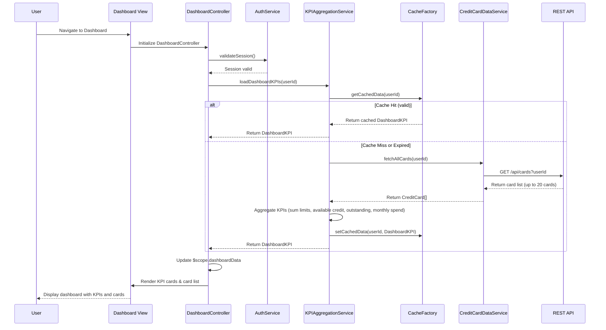

# Low-Level Design: QE-7649 - Credit Card Portfolio and KPI Dashboard

## a. Architecture Mapping

**HLD Component → AngularJS Artifact Mapping:**

- Web/Mobile Client → AngularJS Module (`app.dashboard`) + HTML5/CSS3/Bootstrap responsive views
- Dashboard Controller → Controller (`DashboardController`) for orchestrating dashboard logic and KPI display
- KPI Aggregation Engine → Service (`KPIAggregationService`) for computing and aggregating KPIs across multiple cards
- Credit Card Data Service → Service (`CreditCardDataService`) for REST API calls to retrieve card details and balances
- User Authentication Service → Service (`AuthService`) for session management and secure access control
- Data Cache Layer → Factory (`CacheFactory`) for client-side caching using sessionStorage/localStorage

**Recommended Folder Structure:**
```
app/
├── modules/
│   └── dashboard/
│       ├── dashboard.module.js
│       ├── controllers/
│       │   └── dashboard.controller.js
│       ├── services/
│       │   ├── kpiAggregation.service.js
│       │   ├── creditCardData.service.js
│       │   └── auth.service.js
│       ├── factories/
│       │   └── cache.factory.js
│       └── views/
│           └── dashboard.html
├── models/
│   └── creditCard.model.js
└── assets/
    ├── css/
    │   └── dashboard.css
    └── js/
        └── dashboard-utils.js
```

## b. Component Specifications

| Component Name | Artifact Type | Responsibility | Key Dependencies |
|----------------|---------------|----------------|------------------|
| `app.dashboard` | Module | Root module for dashboard feature, declares dashboard components and routing | `ngRoute`, `app.core`, `app.auth` |
| `DashboardController` | Controller | Manages dashboard state, loads KPIs, handles user interactions, and coordinates data refresh | `KPIAggregationService`, `CreditCardDataService`, `AuthService`, `$scope`, `$interval` |
| `KPIAggregationService` | Service | Aggregates KPIs (monthly spend, total credit limit, available credit, outstanding amount) across up to 20 cards | `CreditCardDataService`, `$q`, `CacheFactory` |
| `CreditCardDataService` | Service | Fetches credit card details, balances, and transaction summaries from REST API | `$http`, `$q`, `API_CONFIG`, `AuthService` |
| `AuthService` | Service | Manages user authentication, session tokens, and secure API request headers | `$http`, `$window`, `$q` |
| `CacheFactory` | Factory | Provides caching mechanism for dashboard data to meet 2-second load time requirement | `$window.sessionStorage` |

## c. Data Model

```javascript
// CreditCard Model
const CreditCard = {
  cardId: String,
  cardNumber: String, // Masked, e.g., "**** **** **** 1234"
  cardType: String, // 'Visa', 'MasterCard', 'Amex', etc.
  cardHolderName: String,
  creditLimit: Number,
  availableCredit: Number,
  outstandingAmount: Number,
  currentMonthSpend: Number,
  dueDate: Date,
  status: String, // 'Active', 'Blocked', 'Expired'
  lastUpdated: Date
};

// DashboardKPI Model
const DashboardKPI = {
  userId: String,
  totalCards: Number,
  totalCreditLimit: Number,
  totalAvailableCredit: Number,
  totalOutstandingAmount: Number,
  currentMonthTotalSpend: Number,
  creditUtilizationPercentage: Number,
  cards: [CreditCard],
  lastRefreshed: Date
};
```

## d. Data Flow

User accesses the dashboard view, triggering `DashboardController` initialization. The controller invokes `AuthService` to validate the user session. Upon successful authentication, `KPIAggregationService` is called to load dashboard KPIs. The service first checks `CacheFactory` for cached data; if valid cache exists and is within refresh interval, cached data is returned immediately. Otherwise, `CreditCardDataService` makes REST API calls to fetch card details and balances for all registered cards (up to 20). Retrieved data is aggregated to compute total credit limit, available credit, outstanding amount, and monthly spend. Aggregated KPIs are stored in cache and returned to the controller. The controller updates `$scope.dashboardData`, and the view renders KPI cards and credit card list using Bootstrap responsive layout. An `$interval` service triggers periodic refresh every 5 minutes to update KPIs without user interaction.

## e. Primary Sequence Diagram



## f. Implementation Notes

- Use AngularJS 1.x module and controller pattern with dependency injection; organize dashboard feature as a separate module (`app.dashboard`).
- Implement responsive layout using Bootstrap grid system (col-xs, col-sm, col-md, col-lg) to support mobile and desktop devices per NFR.
- Use `$interval` service for periodic data refresh (every 5 minutes) to simulate real-time updates; cancel interval on scope destroy to prevent memory leaks.
- Implement `CacheFactory` using sessionStorage with TTL (time-to-live) logic to ensure 2-second load time for repeat visits; cache key format: `dashboard_kpi_{userId}`.
- Use `$http` interceptors in `AuthService` to attach authentication tokens to all API requests; handle 401 responses by redirecting to login.

## g. Error Handling

HTTP interceptor-based error handling with try/catch blocks in services; display user-friendly error messages via Bootstrap alerts for API failures or network issues.

## h. Security Notes

Requires token-based authentication via existing SSO; all API calls include JWT token in Authorization header; mask sensitive card numbers in UI.