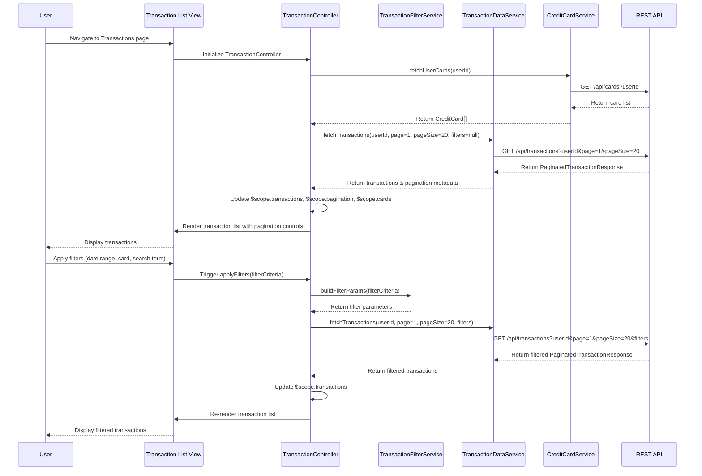

# Low-Level Design: QE-7650 - Transaction Management and Viewing

## a. Architecture Mapping

**HLD Component → AngularJS Artifact Mapping:**

- User Interface → AngularJS Module (`app.transactions`) + HTML5/CSS3/Bootstrap views for transaction list and details
- Transaction Management Module → Controller (`TransactionController`) for managing transaction display and user interactions
- Search and Filter Engine → Service (`TransactionFilterService`) for implementing search, filter, and date range logic
- Transaction Data Service → Service (`TransactionDataService`) for REST API calls to retrieve transaction history
- Credit Card Service → Service (`CreditCardService`) for mapping transactions to specific cards
- Database → Backend REST API endpoints consumed by services

**Recommended Folder Structure:**
```
app/
├── modules/
│   └── transactions/
│       ├── transactions.module.js
│       ├── controllers/
│       │   └── transaction.controller.js
│       ├── services/
│       │   ├── transactionData.service.js
│       │   ├── transactionFilter.service.js
│       │   └── creditCard.service.js
│       ├── directives/
│       │   └── transactionList.directive.js
│       └── views/
│           ├── transaction-list.html
│           └── transaction-detail.html
├── models/
│   └── transaction.model.js
└── assets/
    ├── css/
    │   └── transactions.css
    └── js/
        └── pagination-utils.js
```

## b. Component Specifications

| Component Name | Artifact Type | Responsibility | Key Dependencies |
|----------------|---------------|----------------|------------------|
| `app.transactions` | Module | Root module for transaction management feature, declares transaction components and routing | `ngRoute`, `app.core`, `ui.bootstrap.pagination` |
| `TransactionController` | Controller | Manages transaction list state, pagination, search/filter inputs, and transaction detail display | `TransactionDataService`, `TransactionFilterService`, `CreditCardService`, `$scope`, `$routeParams` |
| `TransactionDataService` | Service | Fetches transaction history from REST API with pagination support (up to 10,000 transactions per user) | `$http`, `$q`, `API_CONFIG` |
| `TransactionFilterService` | Service | Implements client-side and server-side filtering logic for search, date range, card selection, and category filters | `$filter`, `$q` |
| `CreditCardService` | Service | Retrieves credit card list and maps transactions to specific cards for multi-card aggregation | `$http`, `$q`, `API_CONFIG` |
| `transactionList` | Directive | Renders paginated transaction list with search/filter controls and handles user interactions | `TransactionController`, `$compile` |

## c. Data Model

```javascript
// Transaction Model
const Transaction = {
  transactionId: String,
  cardId: String,
  cardName: String, // e.g., "Visa **** 1234"
  amount: Number,
  currency: String, // 'USD', 'EUR', etc.
  transactionDate: Date,
  postingDate: Date,
  merchantName: String,
  merchantCategory: String, // 'Food & Dining', 'Fuel', etc.
  description: String,
  transactionType: String, // 'Purchase', 'Refund', 'Payment', etc.
  status: String, // 'Posted', 'Pending', 'Declined'
  referenceNumber: String
};

// TransactionFilter Model
const TransactionFilter = {
  cardId: String, // null for all cards
  searchTerm: String,
  dateRange: {
    startDate: Date,
    endDate: Date
  },
  category: String, // null for all categories
  transactionType: String, // null for all types
  minAmount: Number,
  maxAmount: Number
};

// PaginatedTransactionResponse Model
const PaginatedTransactionResponse = {
  transactions: [Transaction],
  totalCount: Number,
  pageNumber: Number,
  pageSize: Number,
  totalPages: Number
};
```

## d. Data Flow

User navigates to the transaction list view, triggering `TransactionController` initialization. The controller invokes `CreditCardService` to fetch the user's card list for the card filter dropdown. Simultaneously, `TransactionDataService` is called with default pagination parameters (page 1, page size 20) to retrieve the initial transaction set via REST API. The API returns a `PaginatedTransactionResponse` with transactions and pagination metadata. The controller updates `$scope.transactions` and `$scope.pagination`. User applies search/filter criteria (search term, date range, card selection) via the view, triggering `TransactionFilterService` to construct filter parameters. The controller invokes `TransactionDataService` again with updated filter and pagination parameters. The service makes a GET request to `/api/transactions` with query parameters. Retrieved filtered transactions are displayed in the view using the `transactionList` directive. User clicks on a transaction row to view details, triggering navigation to transaction detail view with `transactionId` as route parameter. The controller fetches detailed transaction data and displays it.

## e. Primary Sequence Diagram



## f. Implementation Notes

- Use AngularJS 1.x module pattern with dependency injection; organize transaction feature as a separate module (`app.transactions`).
- Implement server-side pagination to handle up to 10,000 transactions per user per NFR; use query parameters (page, pageSize, filters) in REST API calls.
- Use AngularJS `$filter` service for client-side search on current page data; delegate complex filtering to backend API to meet sub-500ms latency NFR.
- Implement date range picker using Bootstrap Datepicker or ui-bootstrap-datepicker directive for user-friendly date selection.
- Use `$routeParams` to pass `transactionId` for transaction detail view; fetch detailed transaction data via `TransactionDataService.getTransactionById(transactionId)`.

## g. Error Handling

HTTP interceptor-based error handling with try/catch in services; display user-friendly error notifications via Bootstrap alerts for API failures or timeout errors.

## h. Security Notes

Requires token-based authentication via existing SSO; all API calls include auth token in headers; input validation for search terms and date ranges to prevent injection attacks.