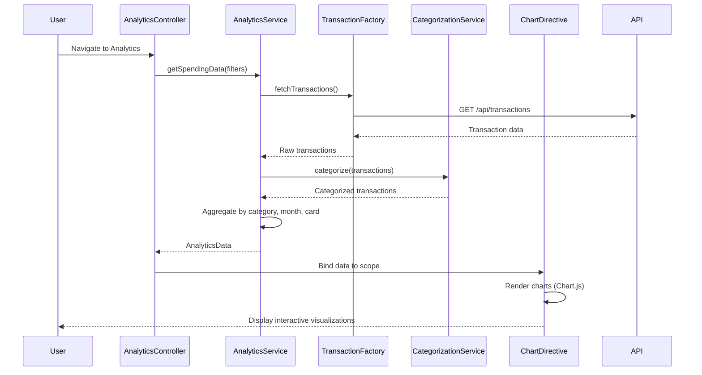

# Low-Level Design: QE-7657 - Spending Analytics and Insights

## a. Architecture Mapping

- **Analytics Module** → AngularJS Module (`app.analytics`)
- **Analytics Controller** → AngularJS Controller (`AnalyticsController`) - Manages UI state and user interactions
- **Analytics Service** → AngularJS Service (`AnalyticsService`) - Orchestrates data retrieval and processing
- **Transaction Service** → AngularJS Factory (`TransactionFactory`) - Fetches transaction data via REST API
- **Categorization Service** → AngularJS Service (`CategorizationService`) - Categorizes transactions
- **Chart Directive** → AngularJS Directive (`spendingChart`) - Renders interactive visualizations

**Folder Structure:**
```
/app
  /analytics
    analytics.module.js
    analytics.controller.js
    analytics.service.js
    analytics.html
  /shared
    /services
      transaction.factory.js
      categorization.service.js
    /directives
      spending-chart.directive.js
```

## b. Component Specifications

| Name | Artifact Type | Responsibility | Key Dependencies |
|------|---------------|----------------|------------------|
| AnalyticsModule | Module | Registers analytics feature components | angular, ui.router, chart.js |
| AnalyticsController | Controller | Manages analytics view state, handles user filter/drill-down actions | AnalyticsService, $scope |
| AnalyticsService | Service | Aggregates transaction data, calculates category/card/time-based metrics | TransactionFactory, CategorizationService |
| TransactionFactory | Factory | Fetches raw transaction data from REST API | $http, $q |
| CategorizationService | Service | Maps transactions to predefined categories (Food, Fuel, Shopping, Travel, Entertainment, Utilities, Healthcare, Education, Misc) | None |
| spendingChartDirective | Directive | Renders responsive charts (monthly trends, category breakdown, card-wise) using Chart.js | Chart.js library |

## c. Data Model

**Transaction Model:**
```javascript
{
  id: String,
  cardId: String,
  amount: Number,
  date: Date,
  merchantName: String,
  category: String, // Food & Dining, Fuel, Shopping, Travel, Entertainment, Utilities, Healthcare, Education, Miscellaneous
  description: String
}
```

**AnalyticsData Model:**
```javascript
{
  categorySpend: Object, // { "Food & Dining": 1500, "Fuel": 800, ... }
  monthlyTrends: Array, // [{ month: "Jan", spend: 5000 }, ...]
  cardWiseSpend: Object, // { "Card-1234": 3000, "Card-5678": 2000 }
  totalSpend: Number
}
```

## d. Data Flow

User navigates to analytics view → AnalyticsController initializes and calls AnalyticsService.getSpendingData() → AnalyticsService requests transactions via TransactionFactory ($http GET /api/transactions) → CategorizationService categorizes each transaction → AnalyticsService aggregates data by category, month, and card → Processed AnalyticsData is bound to $scope → spendingChartDirective watches data and renders Chart.js visualizations → User applies filters (date range, card, category) → Controller updates service parameters → Service re-aggregates and updates $scope → Charts re-render dynamically.

## e. Primary Sequence Diagram



## f. Implementation Notes

- Use AngularJS DI to inject services into controllers; follow strict-DI annotation pattern (`['$scope', 'AnalyticsService', function(...) {}]`)
- Leverage ES6 classes for services and factories; transpile with Babel if needed
- Integrate Chart.js via custom directive with isolated scope; watch data changes for re-rendering
- Use $http interceptors for API authentication (token-based) and error handling
- Implement client-side caching in AnalyticsService using $cacheFactory to reduce redundant API calls

## g. Error Handling

HTTP interceptor captures API errors; display user-friendly messages via toaster notification service; fallback to cached data if available.

## h. Security Notes

Requires token-based auth via existing SSO; all API calls include Authorization header.