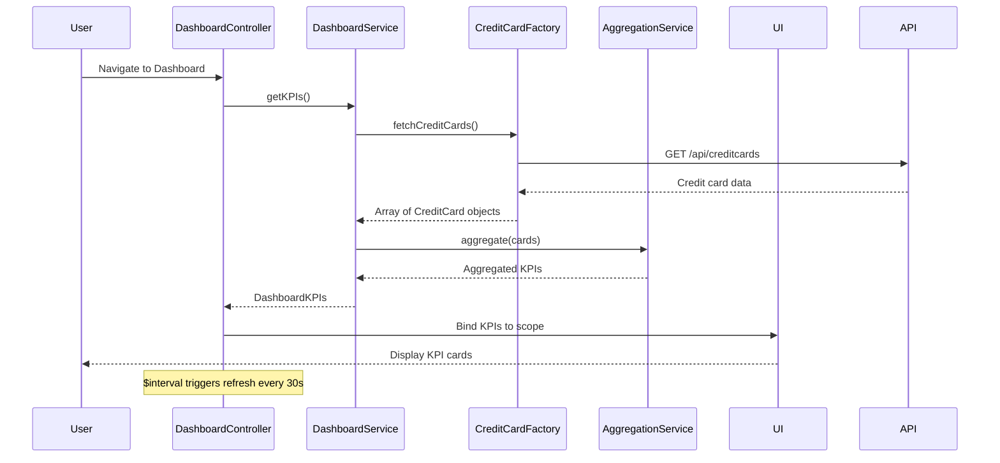

# Low-Level Design: QE-7658 - Dashboard KPIs and Credit Card Overview

## a. Architecture Mapping

- **Dashboard Module** → AngularJS Module (`app.dashboard`)
- **Dashboard Controller** → AngularJS Controller (`DashboardController`) - Manages KPI display and refresh
- **Dashboard Service** → AngularJS Service (`DashboardService`) - Orchestrates KPI calculation
- **Credit Card Service** → AngularJS Factory (`CreditCardFactory`) - Fetches credit card data via REST API
- **Aggregation Service** → AngularJS Service (`AggregationService`) - Consolidates multi-card data
- **KPI Card Directive** → AngularJS Directive (`kpiCard`) - Displays individual KPI metrics

**Folder Structure:**
```
/app
  /dashboard
    dashboard.module.js
    dashboard.controller.js
    dashboard.service.js
    dashboard.html
  /shared
    /services
      credit-card.factory.js
      aggregation.service.js
    /directives
      kpi-card.directive.js
```

## b. Component Specifications

| Name | Artifact Type | Responsibility | Key Dependencies |
|------|---------------|----------------|------------------|
| DashboardModule | Module | Registers dashboard feature components | angular, ui.router |
| DashboardController | Controller | Manages dashboard view state, triggers real-time refresh | DashboardService, $scope, $interval |
| DashboardService | Service | Calculates KPIs (monthly spend, total limit, available credit, outstanding) | CreditCardFactory, AggregationService |
| CreditCardFactory | Factory | Fetches user's credit card portfolio from REST API | $http, $q |
| AggregationService | Service | Consolidates data from multiple cards into single KPI values | None |
| kpiCardDirective | Directive | Renders individual KPI with label, value, and icon | None |

## c. Data Model

**CreditCard Model:**
```javascript
{
  cardId: String,
  cardNumber: String,
  cardType: String,
  creditLimit: Number,
  availableCredit: Number,
  outstandingAmount: Number,
  monthlySpend: Number
}
```

**DashboardKPIs Model:**
```javascript
{
  totalCreditLimit: Number,
  totalAvailableCredit: Number,
  totalOutstanding: Number,
  totalMonthlySpend: Number,
  cards: Array // Array of CreditCard objects
}
```

## d. Data Flow

User logs in and navigates to dashboard → DashboardController calls DashboardService.getKPIs() → DashboardService requests credit card portfolio via CreditCardFactory ($http GET /api/creditcards) → AggregationService sums credit limits, available credit, outstanding amounts, and monthly spend across all cards → DashboardService returns DashboardKPIs object → Controller binds to $scope → kpiCardDirective renders each KPI → $interval triggers periodic refresh (every 30s) → Service re-fetches data and updates $scope → UI updates automatically via two-way binding.

## e. Primary Sequence Diagram



## f. Implementation Notes

- Use AngularJS DI with strict annotation; inject $interval for auto-refresh functionality
- Implement responsive grid layout using Bootstrap classes (col-xs-12, col-md-6, col-lg-3) for KPI cards
- Use ES6 arrow functions in service methods for cleaner syntax
- Cache API responses in CreditCardFactory using $cacheFactory with TTL to meet 2-second load requirement
- Leverage $http interceptors for token injection and global error handling

## g. Error Handling

$http interceptor catches errors; display error banner via directive; retry logic in service with exponential backoff.

## h. Security Notes

Requires token-based auth via existing SSO; validate user session before API calls.