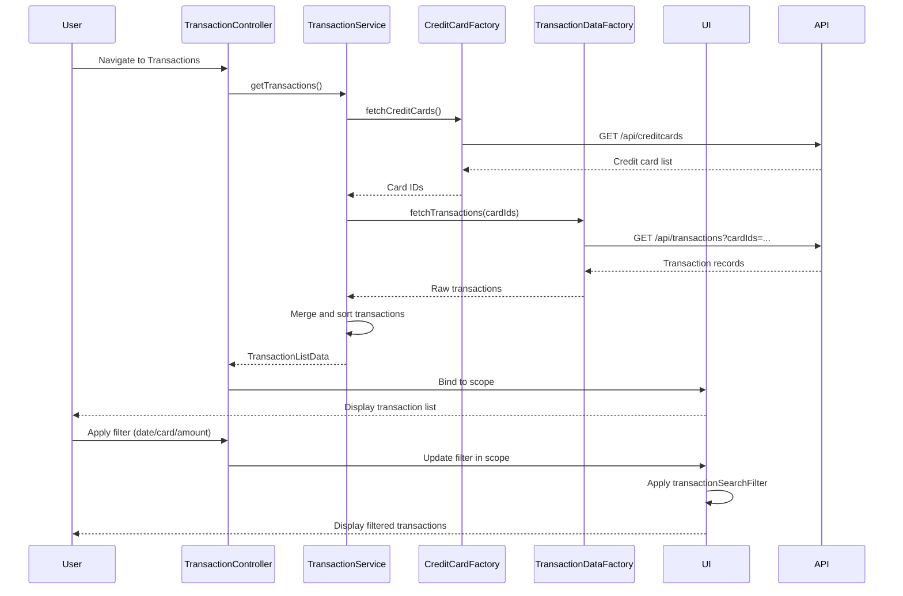

# Low-Level Design: QE-7659 - Transaction Management and Monitoring

## a. Architecture Mapping

- **Transaction Module** → AngularJS Module (`app.transactions`)
- **Transaction Controller** → AngularJS Controller (`TransactionController`) - Manages transaction list and filters
- **Transaction Service** → AngularJS Service (`TransactionService`) - Orchestrates transaction retrieval and filtering
- **Transaction Data Factory** → AngularJS Factory (`TransactionDataFactory`) - Fetches transaction data via REST API
- **Credit Card Service** → AngularJS Factory (`CreditCardFactory`) - Fetches card details
- **Search Filter** → AngularJS Filter (`transactionSearch`) - Client-side search/filter logic

**Folder Structure:**
```
/app
  /transactions
    transactions.module.js
    transactions.controller.js
    transactions.service.js
    transactions.html
  /shared
    /services
      transaction-data.factory.js
      credit-card.factory.js
    /filters
      transaction-search.filter.js
```

## b. Component Specifications

| Name | Artifact Type | Responsibility | Key Dependencies |
|------|---------------|----------------|------------------|
| TransactionModule | Module | Registers transaction management components | angular, ui.router, angular-filter |
| TransactionController | Controller | Manages transaction list view, handles search/filter UI interactions | TransactionService, $scope |
| TransactionService | Service | Aggregates transactions from multiple cards, applies filters | TransactionDataFactory, CreditCardFactory |
| TransactionDataFactory | Factory | Fetches transaction records from REST API | $http, $q |
| CreditCardFactory | Factory | Fetches user's credit card details | $http, $q |
| transactionSearchFilter | Filter | Filters transactions by date, amount, merchant, card | None |

## c. Data Model

**Transaction Model:**
```javascript
{
  transactionId: String,
  cardId: String,
  cardNumber: String,
  amount: Number,
  transactionDate: Date,
  merchantName: String,
  category: String,
  status: String, // Posted, Pending
  description: String
}
```

**TransactionListData Model:**
```javascript
{
  transactions: Array, // Array of Transaction objects
  totalCount: Number,
  filters: Object // { cardId, dateRange, minAmount, maxAmount, searchText }
}
```

## d. Data Flow

User navigates to transaction view → TransactionController calls TransactionService.getTransactions() → TransactionService fetches user's cards via CreditCardFactory ($http GET /api/creditcards) → Service fetches transactions for all cards via TransactionDataFactory ($http GET /api/transactions?cardIds=...) → Service merges and sorts transactions by date → TransactionListData bound to $scope → User applies search/filter (date range, card, amount) → Controller updates filter parameters → transactionSearchFilter applies client-side filtering → Filtered list updates in view → User clicks transaction → Controller navigates to detail view with transaction ID.

## e. Primary Sequence Diagram



## f. Implementation Notes

- Use AngularJS DI with array notation for minification safety
- Implement pagination using ui-bootstrap pagination directive for handling high transaction volumes
- Use ES6 template literals for building dynamic API URLs with query parameters
- Leverage AngularJS custom filters for client-side search to reduce server load
- Implement lazy loading for transaction details using ui-router resolve to fetch data before view transition

## g. Error Handling

$http interceptor handles API errors; display inline error messages in transaction list; provide retry button for failed requests.

## h. Security Notes

Standard input validation and secure API calls assumed; token-based authentication enforced via interceptor.