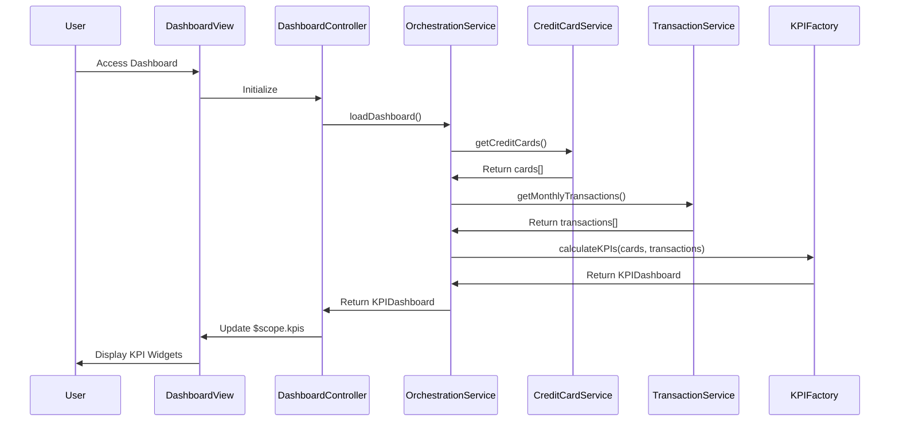

# Low-Level Design: Dashboard and KPI Management
**Epic ID:** QE-7660  
**Tech Stack:** AngularJS 1.x, JavaScript ES6, HTML5, CSS3, Bootstrap, REST APIs, MVC

---

## a. Architecture Mapping

- **Dashboard Module** → AngularJS Module (`dashboard.module.js`)
- **Dashboard Controller** → AngularJS Controller (`dashboardController.js`) - manages KPI display and user interactions
- **Dashboard Orchestration Service** → AngularJS Service (`dashboardOrchestrationService.js`) - coordinates data retrieval
- **KPI Calculation Service** → AngularJS Factory (`kpiCalculationFactory.js`) - performs financial calculations
- **Credit Card Data Service** → AngularJS Service (`creditCardDataService.js`) - fetches card data via REST API
- **Transaction Service** → AngularJS Service (`transactionService.js`) - retrieves transaction data via REST API
- **Dashboard Directive** → AngularJS Directive (`kpiWidget.directive.js`) - reusable KPI widget component

**Folder Structure:**
```
/app
  /modules
    /dashboard
      dashboard.module.js
      /controllers
        dashboardController.js
      /services
        dashboardOrchestrationService.js
        creditCardDataService.js
        transactionService.js
      /factories
        kpiCalculationFactory.js
      /directives
        kpiWidget.directive.js
      /views
        dashboard.html
      /styles
        dashboard.css
```

---

## b. Component Specifications

| Component Name | Artifact Type | Responsibility | Key Dependencies |
|----------------|---------------|----------------|------------------|
| dashboard.module | Module | Defines dashboard module and dependencies | ngRoute, ngResource |
| dashboardController | Controller | Manages dashboard state, triggers data refresh, handles user interactions | dashboardOrchestrationService, $scope, $interval |
| dashboardOrchestrationService | Service | Coordinates calls to Credit Card and Transaction services, aggregates data | creditCardDataService, transactionService, $q |
| kpiCalculationFactory | Factory | Calculates total credit limit, available credit, outstanding amount, monthly spend | None (pure calculation logic) |
| creditCardDataService | Service | Fetches card balances and limits from REST API endpoint `/api/creditcards` | $http, $q |
| transactionService | Service | Retrieves monthly transactions and outstanding amounts from `/api/transactions` | $http, $q |
| kpiWidget | Directive | Renders individual KPI widget with value, label, and icon | None |

---

## c. Data Model

**KPIDashboard (JS Object):**
```javascript
{
  monthlySpend: Number,        // Total spend in current calendar month
  totalCreditLimit: Number,    // Sum of all card limits
  availableCredit: Number,     // Total limit - total outstanding
  outstandingAmount: Number,   // Sum of all card balances
  lastUpdated: Date            // Timestamp of last data refresh
}
```

**CreditCard (JS Object):**
```javascript
{
  cardId: String,
  cardNumber: String,          // Masked format
  creditLimit: Number,
  currentBalance: Number
}
```

**Transaction (JS Object):**
```javascript
{
  transactionId: String,
  amount: Number,
  transactionDate: Date,
  cardId: String
}
```

---

## d. Data Flow

User accesses dashboard → dashboardController initializes and calls dashboardOrchestrationService.loadDashboard() → Service fetches all user credit cards via creditCardDataService ($http GET to `/api/creditcards`) and current month transactions via transactionService ($http GET to `/api/transactions?month=current`) → Responses are passed to kpiCalculationFactory which computes totalCreditLimit (sum of card limits), availableCredit (limit - balances), outstandingAmount (sum of balances), and monthlySpend (sum of transaction amounts) → Calculated KPIs are bound to $scope in dashboardController → View renders KPI widgets using kpiWidget directive with Bootstrap responsive grid → Auto-refresh via $interval triggers orchestration service every 5 minutes to update KPIs.

---

## e. Primary Sequence Diagram



---

## f. Implementation Notes

- Use AngularJS Dependency Injection for all services and factories; register via module.service() and module.factory()
- Implement $http interceptor for authentication token attachment to all REST API calls
- Use $q.all() in orchestration service to parallelize credit card and transaction API calls for faster load time
- Apply Bootstrap grid (col-md-3, col-sm-6, col-xs-12) for responsive KPI widget layout
- Implement $interval for auto-refresh with configurable interval; clear interval on $scope.$on('$destroy')

---

## g. Error Handling

HTTP interceptor captures API errors; display user-friendly error messages via Bootstrap alert component; retry logic with exponential backoff for transient failures.

---

## h. Security Notes

Requires token-based auth via existing SSO; token attached to all API requests via $http interceptor; card data masked on backend before transmission.

---