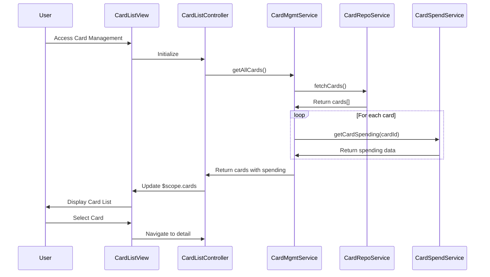

# Low-Level Design: Multi-Card Management and Monitoring
**Epic ID:** QE-7661  
**Tech Stack:** AngularJS 1.x, JavaScript ES6, HTML5, CSS3, Bootstrap, REST APIs, MVC

---

## a. Architecture Mapping

- **Card Management Module** → AngularJS Module (`cardManagement.module.js`)
- **Card List Controller** → AngularJS Controller (`cardListController.js`) - manages card list display and filtering
- **Card Detail Controller** → AngularJS Controller (`cardDetailController.js`) - manages individual card view
- **Card Management Service** → AngularJS Service (`cardManagementService.js`) - orchestrates card data retrieval
- **Card Repository Service** → AngularJS Service (`cardRepositoryService.js`) - fetches card data from REST API
- **Card Spend Service** → AngularJS Service (`cardSpendService.js`) - retrieves card-specific spending data
- **Card Filter** → AngularJS Filter (`cardFilter.js`) - filters cards by criteria

**Folder Structure:**
```
/app
  /modules
    /cardManagement
      cardManagement.module.js
      /controllers
        cardListController.js
        cardDetailController.js
      /services
        cardManagementService.js
        cardRepositoryService.js
        cardSpendService.js
      /filters
        cardFilter.js
      /views
        cardList.html
        cardDetail.html
      /styles
        cardManagement.css
```

---

## b. Component Specifications

| Component Name | Artifact Type | Responsibility | Key Dependencies |
|----------------|---------------|----------------|------------------|
| cardManagement.module | Module | Defines card management module and routing | ngRoute, ngResource |
| cardListController | Controller | Manages card list display, filtering, selection | cardManagementService, $scope, cardFilter |
| cardDetailController | Controller | Displays individual card details and spend breakdown | cardManagementService, $routeParams, $scope |
| cardManagementService | Service | Orchestrates card data retrieval and aggregation from repository and spend services | cardRepositoryService, cardSpendService, $q |
| cardRepositoryService | Service | Fetches card information from REST API `/api/cards` with secure storage | $http, $q |
| cardSpendService | Service | Retrieves card-specific spending data from `/api/cards/{cardId}/spending` | $http, $q |
| cardFilter | Filter | Filters card list by card type, balance range, or search term | None |

---

## c. Data Model

**CreditCard (JS Object):**
```javascript
{
  cardId: String,
  cardNumber: String,          // Masked: XXXX-XXXX-XXXX-1234
  cardType: String,            // Visa, MasterCard, etc.
  creditLimit: Number,
  currentBalance: Number,
  availableCredit: Number,
  cardHolderName: String
}
```

**CardSpending (JS Object):**
```javascript
{
  cardId: String,
  monthlySpend: Number,
  totalTransactions: Number,
  lastTransactionDate: Date,
  categoryBreakdown: Array     // [{category: String, amount: Number}]
}
```

---

## d. Data Flow

User navigates to card management view → cardListController calls cardManagementService.getAllCards() → Service fetches all user cards via cardRepositoryService ($http GET to `/api/cards`) → For each card, cardSpendService is called ($http GET to `/api/cards/{cardId}/spending`) to retrieve spending data → cardManagementService aggregates card details with spending data and masks card numbers → Data is bound to $scope.cards in controller → View renders card list using ng-repeat with Bootstrap card components → User applies filter via cardFilter to narrow list → User selects card → cardDetailController loads detailed view with full spending breakdown.

---

## e. Primary Sequence Diagram



---

## f. Implementation Notes

- Use AngularJS $routeProvider to define routes: `/cards` for list view and `/cards/:cardId` for detail view
- Implement cardManagementService using $q.all() to parallelize multiple cardSpendService calls for performance
- Apply Bootstrap card component (card, card-body, card-title) for consistent card display
- Use ng-repeat with track by cardId for efficient list rendering; apply cardFilter via pipe in ng-repeat
- Store masked card numbers in service; never expose full card numbers in client-side code

---

## g. Error Handling

$http interceptor captures API errors; display error alerts using Bootstrap alert component; implement try/catch in service methods with user notification.

---

## h. Security Notes

Requires token-based auth via existing SSO; card numbers masked on backend (XXXX-XXXX-XXXX-1234 format); secure HTTPS transmission for all API calls.

---