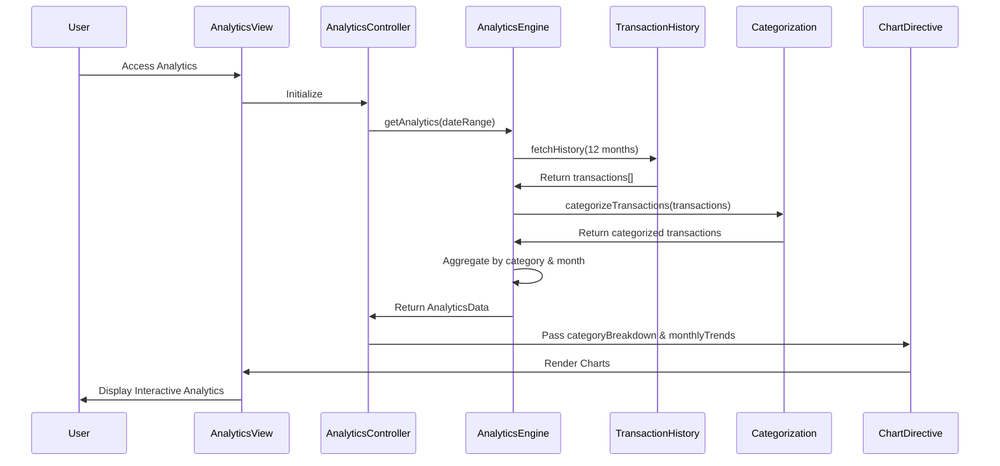

# Low-Level Design: Spending Analytics and Category Insights
**Epic ID:** QE-7662  
**Tech Stack:** AngularJS 1.x, JavaScript ES6, HTML5, CSS3, Bootstrap, REST APIs, MVC

---

## a. Architecture Mapping

- **Analytics Module** → AngularJS Module (`analytics.module.js`)
- **Analytics Controller** → AngularJS Controller (`analyticsController.js`) - manages analytics view and interactions
- **Analytics Engine Service** → AngularJS Service (`analyticsEngineService.js`) - processes and aggregates transaction data
- **Transaction History Service** → AngularJS Service (`transactionHistoryService.js`) - fetches historical transactions via REST API
- **Categorization Service** → AngularJS Service (`categorizationService.js`) - classifies transactions into categories
- **Chart Directive** → AngularJS Directive (`spendingChart.directive.js`) - renders interactive charts using Chart.js or D3.js

**Folder Structure:**
```
/app
  /modules
    /analytics
      analytics.module.js
      /controllers
        analyticsController.js
      /services
        analyticsEngineService.js
        transactionHistoryService.js
        categorizationService.js
      /directives
        spendingChart.directive.js
      /views
        analytics.html
      /styles
        analytics.css
```

---

## b. Component Specifications

| Component Name | Artifact Type | Responsibility | Key Dependencies |
|----------------|---------------|----------------|------------------|
| analytics.module | Module | Defines analytics module and dependencies | ngRoute, chart.js or angular-chart.js |
| analyticsController | Controller | Manages analytics view state, date range selection, category filtering | analyticsEngineService, $scope, $filter |
| analyticsEngineService | Service | Aggregates spending by category and time period, generates trend data | transactionHistoryService, categorizationService, $q |
| transactionHistoryService | Service | Fetches up to 12 months of transaction history from `/api/transactions/history` | $http, $q |
| categorizationService | Service | Classifies transactions into 9 predefined categories via `/api/transactions/categorize` | $http, $q |
| spendingChart | Directive | Renders category-wise and monthly trend charts with interactive drill-down | Chart.js library |

---

## c. Data Model

**AnalyticsData (JS Object):**
```javascript
{
  categoryBreakdown: Array,    // [{category: String, amount: Number, percentage: Number}]
  monthlyTrends: Array,        // [{month: String, totalSpend: Number}]
  dateRange: Object,           // {startDate: Date, endDate: Date}
  totalSpend: Number
}
```

**Transaction (JS Object):**
```javascript
{
  transactionId: String,
  amount: Number,
  transactionDate: Date,
  category: String,            // One of 9 predefined categories
  merchantName: String,
  cardId: String
}
```

**SpendingCategory (Enum):**
```javascript
['Food & Dining', 'Fuel', 'Shopping', 'Travel', 'Entertainment', 'Utilities', 'Healthcare', 'Education', 'Miscellaneous']
```

---

## d. Data Flow

User accesses analytics dashboard → analyticsController calls analyticsEngineService.getAnalytics(dateRange) → Service fetches transaction history via transactionHistoryService ($http GET to `/api/transactions/history?months=12`) → Transactions are passed to categorizationService for classification into 9 categories (if not pre-categorized) → analyticsEngineService aggregates spending by category (sum amounts per category, calculate percentages) and by month (sum amounts per month for trends) → Processed AnalyticsData object is returned to controller and bound to $scope → View renders category breakdown using spendingChart directive (pie/donut chart) and monthly trends using line chart → User can filter by date range or drill down into specific category for detailed transactions.

---

## e. Primary Sequence Diagram



---

## f. Implementation Notes

- Use Chart.js library integrated via angular-chart.js directive for rendering pie, donut, and line charts
- Implement caching in analyticsEngineService using $cacheFactory to store processed analytics data and reduce API calls
- Apply AngularJS $filter for date range filtering and category filtering in controller
- Use ng-click on chart segments for drill-down functionality to show category-specific transactions
- Ensure chart rendering performance by limiting data points and using chart animation options (duration: 750ms)

---

## g. Error Handling

$http interceptor handles API failures; display error messages via Bootstrap alert; implement fallback to cached data if available when API call fails.

---

## h. Security Notes

Standard input validation and secure API calls assumed; token-based authentication via SSO for all transaction data access.

---