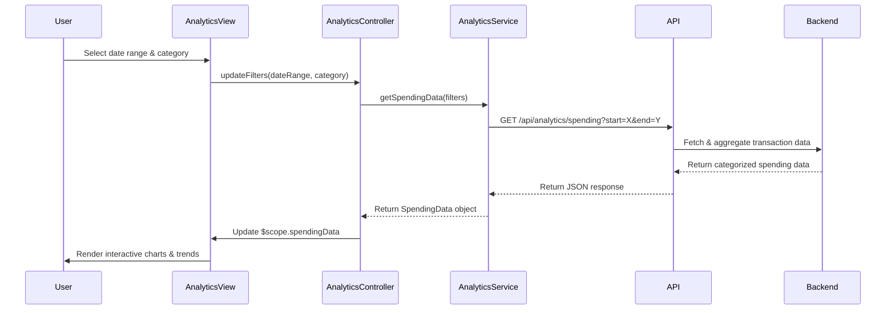

# Low-Level Design: QE-7663 - Analytics and Spending Insights

## a. Architecture Mapping

- **Analytics UI Module** → AngularJS Module (`app.analytics`)
- **Analytics Controller** → AngularJS Controller (`AnalyticsController`)
- **Analytics Service** → AngularJS Service (`AnalyticsService`)
- **Chart Directive** → AngularJS Directive (`spendingChart`)
- **Category Filter** → AngularJS Filter (`categoryFilter`)

**Folder Structure:**
```
/app
  /modules
    /analytics
      analytics.module.js
      analytics.controller.js
      analytics.service.js
      analytics.html
  /directives
    spending-chart.directive.js
  /filters
    category.filter.js
  /services
    api.service.js
```

## b. Component Specifications

| Name | Artifact Type | Responsibility | Key Dependencies |
|------|---------------|----------------|------------------|
| AnalyticsModule | Module | Defines analytics feature module and routing | ui.router, ngAnimate |
| AnalyticsController | Controller | Manages analytics view state, user interactions, date range selection | AnalyticsService, $scope |
| AnalyticsService | Service | Fetches transaction data, aggregates spending by category and month | $http, ApiService |
| SpendingChartDirective | Directive | Renders interactive charts (pie, bar, line) for spending visualization | Chart.js, $timeout |
| CategoryFilter | Filter | Filters transactions by selected spending category | None |
| ApiService | Factory | Handles REST API calls to backend services | $http, $q |

## c. Data Model

**SpendingData Object:**
```javascript
{
  userId: String,
  timeRange: { startDate: Date, endDate: Date },
  categories: [
    {
      name: String, // e.g., "Food & Dining"
      amount: Number,
      percentage: Number,
      transactionCount: Number
    }
  ],
  monthlyTrends: [
    {
      month: String, // e.g., "2026-01"
      totalSpend: Number,
      categoryBreakdown: Object
    }
  ]
}
```

## d. Data Flow

User selects time range and category filters in the Analytics View. AnalyticsController invokes AnalyticsService.getSpendingData(), which calls the REST API via ApiService to fetch transaction history. The backend Analytics Processing Service retrieves transactions from Transaction Service, applies Categorization Engine rules, and aggregates data via Data Aggregation Layer. Aggregated spending data (category totals, monthly trends) is returned to the controller, which updates $scope model. SpendingChartDirective watches model changes and re-renders interactive charts. User can drill down into categories to view detailed transaction lists.

## e. Primary Sequence Diagram



## f. Implementation Notes

- Use AngularJS 1.x with ES6 classes for controllers and services via `$inject` for dependency injection
- Integrate Chart.js library via custom directive for rendering pie charts (category breakdown) and line charts (monthly trends)
- Implement REST API calls using `$http` service with promise-based error handling and loading states
- Use `ng-repeat` with `track by` for efficient rendering of large transaction lists
- Apply Bootstrap grid system for responsive layout across desktop and mobile devices

## g. Error Handling

HTTP interceptor captures API errors (4xx, 5xx), displays user-friendly notifications via toastr, and logs errors to console for debugging.

## h. Security Notes

Standard input validation and secure API calls assumed; requires token-based authentication via existing SSO for API access.