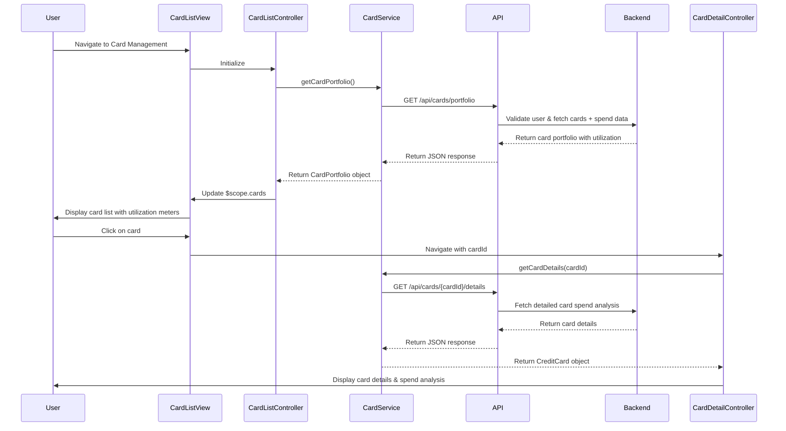

# Low-Level Design: QE-7664 - Credit Card Management and Tracking

## a. Architecture Mapping

- **Card Management Module** → AngularJS Module (`app.cardManagement`)
- **Card List Controller** → AngularJS Controller (`CardListController`)
- **Card Detail Controller** → AngularJS Controller (`CardDetailController`)
- **Card Service** → AngularJS Service (`CardService`)
- **Card Utilization Directive** → AngularJS Directive (`cardUtilization`)

**Folder Structure:**
```
/app
  /modules
    /card-management
      card-management.module.js
      card-list.controller.js
      card-detail.controller.js
      card.service.js
      card-list.html
      card-detail.html
  /directives
    card-utilization.directive.js
  /services
    api.service.js
```

## b. Component Specifications

| Name | Artifact Type | Responsibility | Key Dependencies |
|------|---------------|----------------|------------------|
| CardManagementModule | Module | Defines card management feature module and routing | ui.router |
| CardListController | Controller | Manages card portfolio view, filtering, and selection | CardService, $scope |
| CardDetailController | Controller | Manages individual card detail view and card-wise spend analysis | CardService, $stateParams |
| CardService | Service | Fetches card portfolio, individual card details, and spend data | $http, ApiService |
| CardUtilizationDirective | Directive | Renders visual utilization meter (progress bar) for each card | None |
| ApiService | Factory | Handles REST API calls to Card Management Service and Transaction Service | $http, $q |

## c. Data Model

**CreditCard Object:**
```javascript
{
  cardId: String,
  userId: String,
  cardNumber: String, // masked, e.g., "**** 1234"
  cardType: String, // e.g., "Visa", "Mastercard"
  creditLimit: Number,
  currentBalance: Number,
  availableCredit: Number,
  utilizationPercentage: Number,
  monthlySpend: Number,
  issuer: String
}
```

**CardPortfolio Object:**
```javascript
{
  userId: String,
  cards: [CreditCard],
  totalCreditLimit: Number,
  totalUtilization: Number
}
```

## d. Data Flow

User navigates to Card Management View. CardListController invokes CardService.getCardPortfolio(), which calls REST API via ApiService to fetch all user cards. Card Management Service validates user ownership via User Service, retrieves cards from Card Data Repository, and fetches monthly spend per card from Transaction Service. Aggregated card portfolio data is returned to controller and displayed in a list view with utilization indicators. User clicks on a card to view details; CardDetailController loads card-specific data via CardService.getCardDetails(cardId), which fetches detailed spend analysis and transaction history. UI updates with card details and spend breakdown.

## e. Primary Sequence Diagram



## f. Implementation Notes

- Use AngularJS ui-router for state management with nested views (card list → card detail)
- Implement CardService as singleton using `service()` method with ES6 class syntax and `$inject` annotation
- Use Bootstrap cards and progress bars for card display and utilization visualization
- Implement client-side filtering and sorting using AngularJS filters (`orderBy`, custom filters)
- Cache card portfolio data in CardService to minimize API calls; refresh on user-triggered actions

## g. Error Handling

HTTP interceptor-based error handling with try/catch blocks in service methods; user notifications via Bootstrap alerts for failed API calls.

## h. Security Notes

Requires token-based auth via existing SSO; card data transmitted over HTTPS with encrypted storage; card numbers masked in UI.