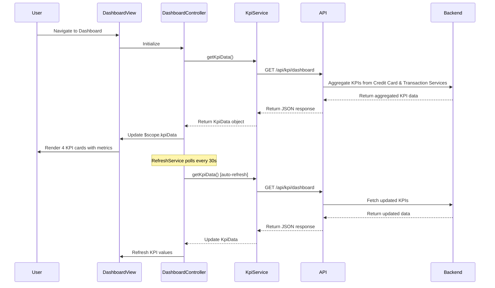

# Low-Level Design: QE-7665 - Dashboard and KPI Management

## a. Architecture Mapping

- **Dashboard Module** → AngularJS Module (`app.dashboard`)
- **Dashboard Controller** → AngularJS Controller (`DashboardController`)
- **KPI Service** → AngularJS Service (`KpiService`)
- **KPI Card Directive** → AngularJS Directive (`kpiCard`)
- **Refresh Service** → AngularJS Factory (`RefreshService`)

**Folder Structure:**
```
/app
  /modules
    /dashboard
      dashboard.module.js
      dashboard.controller.js
      kpi.service.js
      dashboard.html
  /directives
    kpi-card.directive.js
  /services
    refresh.service.js
    api.service.js
```

## b. Component Specifications

| Name | Artifact Type | Responsibility | Key Dependencies |
|------|---------------|----------------|------------------|
| DashboardModule | Module | Defines dashboard feature module and routing | ui.router |
| DashboardController | Controller | Manages dashboard state, KPI display, and refresh triggers | KpiService, RefreshService, $scope |
| KpiService | Service | Fetches aggregated KPI data (monthly spend, credit limit, available credit, outstanding) | $http, ApiService |
| KpiCardDirective | Directive | Renders individual KPI card with icon, label, and value | None |
| RefreshService | Factory | Manages periodic data refresh using $interval with configurable polling | $interval |
| ApiService | Factory | Handles REST API calls to KPI Aggregation Service | $http, $q |

## c. Data Model

**KpiData Object:**
```javascript
{
  userId: String,
  monthlySpend: Number,
  totalCreditLimit: Number,
  availableCredit: Number,
  outstandingAmount: Number,
  lastUpdated: Date
}
```

## d. Data Flow

User authenticates and navigates to Dashboard View. DashboardController initializes and invokes KpiService.getKpiData(), which calls REST API via ApiService to fetch KPI metrics. API Gateway routes request to KPI Aggregation Service, which fetches card balances and limits from Credit Card Data Service and monthly spend from Transaction Service. Aggregated KPIs are calculated and returned to controller. DashboardController updates $scope.kpiData, triggering KpiCardDirective to render four KPI cards (monthly spend, total credit limit, available credit, outstanding amount). RefreshService polls API every 30 seconds to update KPIs in real-time without full page reload.

## e. Primary Sequence Diagram



## f. Implementation Notes

- Use AngularJS 1.x with Bootstrap grid for responsive layout (col-md-3 for 4 KPI cards on desktop, col-xs-12 for mobile)
- Implement KpiService using ES6 class with `$inject` for DI; cache KPI data with timestamp to avoid redundant API calls
- Use $interval in RefreshService for 30-second polling; cancel interval on $scope.$destroy to prevent memory leaks
- Apply CSS3 transitions for smooth KPI value updates and loading states
- Use ng-if and ng-show for conditional rendering based on data availability and loading states

## g. Error Handling

Interceptor-based error handling with try/catch in service methods; display error notifications using toastr or Bootstrap alerts.

## h. Security Notes

Requires token-based auth via existing SSO; all API calls over HTTPS with JWT tokens in Authorization headers.