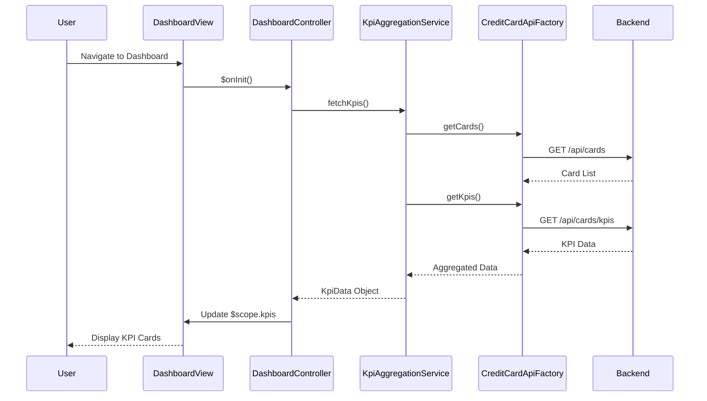

# Low-Level Design: Credit Card Dashboard and KPI Management
**Epic ID:** QE-7666

## a. Architecture Mapping

- **Dashboard UI** → AngularJS Module (`creditCardDashboard`) + Controller (`DashboardController`)
- **KPI Aggregation Engine** → AngularJS Service (`KpiAggregationService`)
- **Real-time Data Refresh Module** → AngularJS Service (`DataRefreshService`) with $interval
- **Credit Card Data Service Integration** → AngularJS Factory (`CreditCardApiFactory`) for REST API calls
- **User Authentication** → AngularJS Service (`AuthService`) integrated via HTTP interceptor

**Recommended Folder Structure:**
```
app/
├── modules/dashboard/
│   ├── dashboard.module.js
│   ├── controllers/dashboard.controller.js
│   ├── services/kpi-aggregation.service.js
│   ├── services/data-refresh.service.js
│   ├── views/dashboard.html
│   └── styles/dashboard.css
├── shared/
│   ├── factories/credit-card-api.factory.js
│   └── services/auth.service.js
```

## b. Component Specifications

| Component Name | Artifact Type | Responsibility | Key Dependencies |
|----------------|---------------|----------------|------------------|
| creditCardDashboard | Module | Root module for dashboard feature | ngRoute, shared services |
| DashboardController | Controller | Manages dashboard state, triggers KPI refresh, handles user interactions | KpiAggregationService, DataRefreshService, $scope |
| KpiAggregationService | Service | Aggregates monthly spend, total credit limit, available credit, outstanding amount from multiple cards | CreditCardApiFactory, $q |
| DataRefreshService | Service | Polls backend every 30 seconds for real-time data updates | $interval, KpiAggregationService |
| CreditCardApiFactory | Factory | Handles REST API calls to credit card data service (GET /api/cards, GET /api/cards/kpis) | $http, AuthService |
| AuthService | Service | Manages authentication tokens and session validation | $http, $window |
| dashboardView | HTML Template | Renders KPI cards (monthly spend, credit limit, available credit, outstanding) with Bootstrap grid | Bootstrap 3.x, AngularJS directives |

## c. Data Model

**KpiData (JavaScript Object)**
```javascript
{
  monthlySpend: Number,        // Total spend for current month across all cards
  totalCreditLimit: Number,    // Sum of credit limits of all cards
  availableCredit: Number,     // totalCreditLimit - outstandingAmount
  outstandingAmount: Number,   // Total unpaid balance across all cards
  lastUpdated: Date            // Timestamp of last data refresh
}
```

**CreditCard (JavaScript Object)**
```javascript
{
  cardId: String,
  cardNumber: String,          // Masked (e.g., "**** **** **** 1234")
  cardType: String,            // "Visa", "MasterCard", etc.
  creditLimit: Number,
  currentBalance: Number,
  availableCredit: Number
}
```

## d. Data Flow

User navigates to dashboard → DashboardController initializes and calls KpiAggregationService.fetchKpis() → Service invokes CreditCardApiFactory.getCards() and CreditCardApiFactory.getKpis() via REST APIs → API responses are aggregated (monthly spend, total limit, available credit, outstanding) → Aggregated KpiData is bound to $scope → View updates KPI cards using Bootstrap grid and AngularJS data binding → DataRefreshService polls every 30 seconds, triggering the same flow to update KPIs in real-time.

## e. Primary Sequence Diagram



## f. Implementation Notes

- Use AngularJS 1.x module pattern with explicit dependency injection (`$inject` annotation) for minification safety.
- Implement KPI aggregation logic in service layer; controller remains thin and delegates business logic.
- Use `$http` with promise chaining ($q.all) to parallelize API calls for cards and KPIs to meet 2-second load requirement.
- Apply Bootstrap responsive grid (col-xs, col-sm, col-md) for KPI cards to ensure mobile, tablet, and desktop compatibility.
- Leverage `$interval` in DataRefreshService for polling; cancel interval on $scope.$destroy to prevent memory leaks.

## g. Error Handling

HTTP interceptor captures API errors (4xx/5xx), logs to console, and displays user-friendly toast notifications using a shared NotificationService.

## h. Security Notes

Requires token-based authentication via existing SSO; AuthService injects JWT token in Authorization header for all API requests.