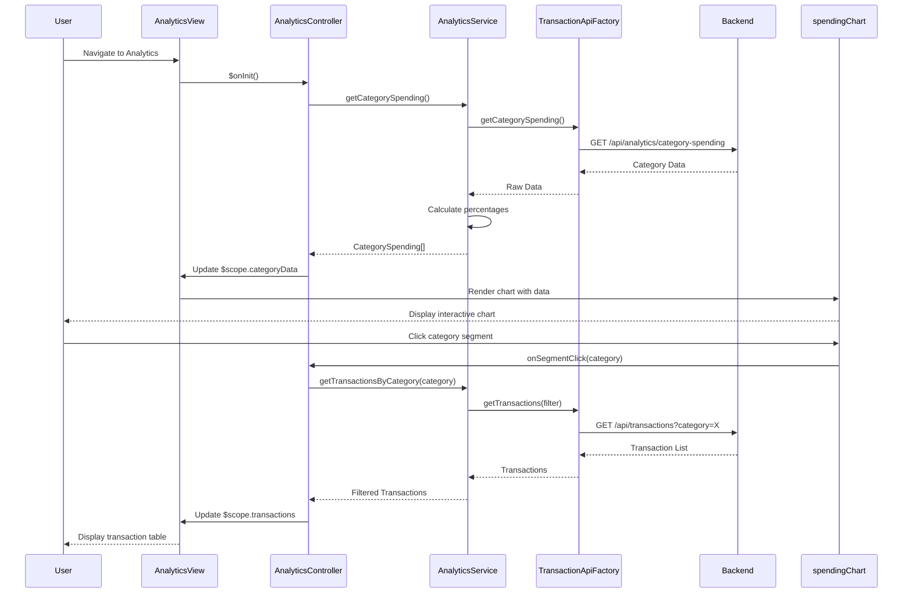

# Low-Level Design: Transaction Analytics and Category-wise Spending Insights
**Epic ID:** QE-7667

## a. Architecture Mapping

- **User Interface** → AngularJS Module (`transactionAnalytics`) + Controller (`AnalyticsController`)
- **Analytics Module** → AngularJS Service (`AnalyticsService`) for data processing and trend calculation
- **Visualization Engine** → AngularJS Directive (`spendingChart`) wrapping Chart.js for interactive charts
- **Transaction Data Service Integration** → AngularJS Factory (`TransactionApiFactory`) for REST API calls
- **Data Categorization Engine** → Backend service; client consumes categorized data via API
- **Analytics Processing Service** → Backend service; client invokes via REST endpoints

**Recommended Folder Structure:**
```
app/
├── modules/analytics/
│   ├── analytics.module.js
│   ├── controllers/analytics.controller.js
│   ├── services/analytics.service.js
│   ├── directives/spending-chart.directive.js
│   ├── views/analytics.html
│   └── styles/analytics.css
├── shared/
│   └── factories/transaction-api.factory.js
```

## b. Component Specifications

| Component Name | Artifact Type | Responsibility | Key Dependencies |
|----------------|---------------|----------------|------------------|
| transactionAnalytics | Module | Root module for analytics feature | ngRoute, Chart.js |
| AnalyticsController | Controller | Manages analytics view state, handles category filter selection, triggers data fetch | AnalyticsService, $scope, $filter |
| AnalyticsService | Service | Fetches transaction data, processes category-wise spending, calculates monthly trends | TransactionApiFactory, $q |
| spendingChart | Directive | Renders interactive pie/bar charts for category-wise spending using Chart.js | Chart.js library, $timeout |
| TransactionApiFactory | Factory | Handles REST API calls (GET /api/transactions, GET /api/analytics/category-spending) | $http, AuthService |
| categoryFilter | Filter | Filters transactions by selected categories (Food, Fuel, Shopping, etc.) | None |
| analyticsView | HTML Template | Displays category filters, spending charts, and monthly trend tables | Bootstrap 3.x, AngularJS directives |

## c. Data Model

**CategorySpending (JavaScript Object)**
```javascript
{
  category: String,            // "Food & Dining", "Fuel", "Shopping", etc.
  totalAmount: Number,         // Total spent in this category
  transactionCount: Number,    // Number of transactions
  percentage: Number           // Percentage of total spending
}
```

**MonthlyTrend (JavaScript Object)**
```javascript
{
  month: String,               // "2024-01", "2024-02", etc.
  categoryBreakdown: [         // Array of CategorySpending objects
    { category: String, amount: Number }
  ],
  totalSpend: Number
}
```

**Transaction (JavaScript Object)**
```javascript
{
  transactionId: String,
  cardId: String,
  amount: Number,
  category: String,
  merchantName: String,
  transactionDate: Date,
  description: String
}
```

## d. Data Flow

User navigates to analytics page → AnalyticsController initializes and calls AnalyticsService.getCategorySpending() → Service invokes TransactionApiFactory.getCategorySpending() via REST API (GET /api/analytics/category-spending) → Backend returns categorized spending data → AnalyticsService processes data and calculates percentages → Data is bound to $scope → spendingChart directive renders interactive pie chart using Chart.js → User selects category filter → categoryFilter updates view to show filtered transactions → User clicks on chart segment → Controller fetches detailed transactions for that category and updates table view.

## e. Primary Sequence Diagram



## f. Implementation Notes

- Use AngularJS directive to wrap Chart.js for reusable, interactive chart components; pass data via isolated scope binding.
- Implement AngularJS custom filter (`categoryFilter`) for client-side transaction filtering by multiple categories.
- Use `$q.all` to parallelize API calls for category spending and monthly trends to meet 3-second rendering requirement.
- Apply lazy loading for transaction details (fetch only when user clicks on category) to optimize initial page load.
- Leverage Chart.js responsive configuration and Bootstrap grid for cross-device chart rendering.

## g. Error Handling

HTTP interceptor captures API errors; fallback displays cached data if available, otherwise shows user-friendly error message via toast notification.

## h. Security Notes

Standard input validation and secure API calls assumed; JWT token authentication enforced via HTTP interceptor.