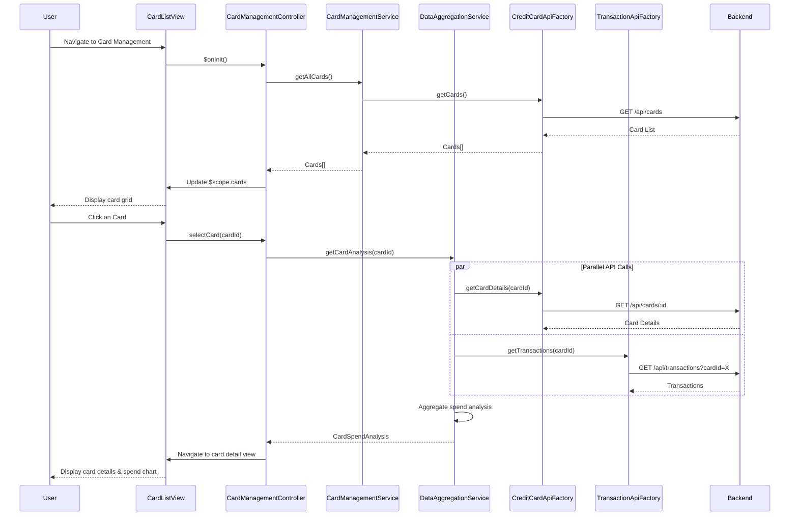

# Low-Level Design: Multi-Card Management and Viewing
**Epic ID:** QE-7668

## a. Architecture Mapping

- **User Interface** → AngularJS Module (`cardManagement`) + Controller (`CardManagementController`)
- **Card Management Module** → AngularJS Service (`CardManagementService`) for business logic
- **Data Aggregation Layer** → AngularJS Service (`DataAggregationService`) to consolidate card and transaction data
- **Credit Card Data Service Integration** → AngularJS Factory (`CreditCardApiFactory`) for REST API calls
- **Transaction Processing Service Integration** → AngularJS Factory (`TransactionApiFactory`) for transaction history

**Recommended Folder Structure:**
```
app/
├── modules/card-management/
│   ├── card-management.module.js
│   ├── controllers/card-management.controller.js
│   ├── services/card-management.service.js
│   ├── services/data-aggregation.service.js
│   ├── views/card-list.html
│   ├── views/card-detail.html
│   └── styles/card-management.css
├── shared/
│   ├── factories/credit-card-api.factory.js
│   └── factories/transaction-api.factory.js
```

## b. Component Specifications

| Component Name | Artifact Type | Responsibility | Key Dependencies |
|----------------|---------------|----------------|------------------|
| cardManagement | Module | Root module for multi-card management feature | ngRoute, shared services |
| CardManagementController | Controller | Manages card list/detail views, handles card selection, triggers spend analysis | CardManagementService, DataAggregationService, $scope, $routeParams |
| CardManagementService | Service | Provides card CRUD operations (read-only in this scope), card selection logic | CreditCardApiFactory, $q |
| DataAggregationService | Service | Aggregates card data with transaction history for card-wise spend analysis | CreditCardApiFactory, TransactionApiFactory, $q |
| CreditCardApiFactory | Factory | Handles REST API calls for card data (GET /api/cards, GET /api/cards/:id) | $http, AuthService |
| TransactionApiFactory | Factory | Handles REST API calls for transaction history (GET /api/transactions?cardId=X) | $http, AuthService |
| cardListView | HTML Template | Displays all user cards in grid/list format with summary metrics | Bootstrap 3.x, ng-repeat |
| cardDetailView | HTML Template | Shows detailed card information, monthly spend trends, and transaction history | Bootstrap 3.x, Chart.js |

## c. Data Model

**CreditCard (JavaScript Object)**
```javascript
{
  cardId: String,
  cardNumber: String,          // Masked (e.g., "**** **** **** 1234")
  cardType: String,            // "Visa", "MasterCard", "Amex"
  cardHolderName: String,
  creditLimit: Number,
  currentBalance: Number,
  availableCredit: Number,
  dueDate: Date,
  minimumDue: Number,
  status: String               // "Active", "Blocked", "Expired"
}
```

**CardSpendAnalysis (JavaScript Object)**
```javascript
{
  cardId: String,
  monthlySpend: Number,        // Current month spend for this card
  lastMonthSpend: Number,
  spendTrend: String,          // "up", "down", "stable"
  topCategory: String,         // Category with highest spend
  transactionCount: Number
}
```

**MonthlySpendTrend (JavaScript Object)**
```javascript
{
  month: String,               // "2024-01", "2024-02", etc.
  totalSpend: Number
}
```

## d. Data Flow

User navigates to card management page → CardManagementController calls CardManagementService.getAllCards() → Service invokes CreditCardApiFactory.getCards() via REST API → API returns list of user's credit cards → Cards are displayed in grid view → User selects a card → Controller navigates to card detail view with cardId parameter → Controller calls DataAggregationService.getCardAnalysis(cardId) → Service fetches card details (CreditCardApiFactory) and transaction history (TransactionApiFactory) in parallel → Service aggregates monthly spend trends and calculates spend analysis → Aggregated data is bound to $scope → View renders card details, spend chart, and transaction table.

## e. Primary Sequence Diagram



## f. Implementation Notes

- Use AngularJS `$routeParams` to pass cardId between list and detail views; implement client-side routing with ngRoute.
- Implement card selection state management in CardManagementService to maintain selected card across view transitions.
- Use `$q.all` in DataAggregationService to parallelize card details and transaction API calls to meet 1-second retrieval NFR.
- Apply ng-repeat with track by cardId for efficient card list rendering; support up to 10+ cards without performance degradation.
- Use Chart.js line chart in card detail view to visualize monthly spend trends; integrate via AngularJS directive.

## g. Error Handling

HTTP interceptor-based error handling with try/catch in service layer; user notified via toast for API failures or empty card list.

## h. Security Notes

Requires token-based auth via existing SSO; sensitive card data (full card number) never exposed to client, only masked values displayed.