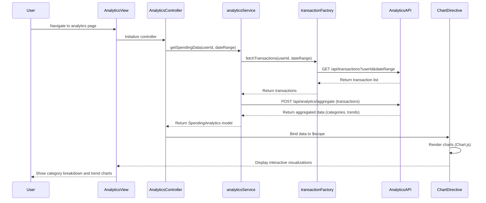

# Low-Level Design: Spending Analytics and Trend Visualization
**Epic ID:** QE-7669  
**Tech Stack:** AngularJS 1.x, JavaScript ES6, HTML5, CSS3, Bootstrap, REST APIs, MVC

---

## a. Architecture Mapping

- **User Interface** → AngularJS View (HTML5 template with Bootstrap grid and chart containers)
- **Analytics Service** → AngularJS Service (handles API calls and data transformation)
- **Transaction Data Service** → REST API endpoint consumed by AngularJS Factory
- **Analytics Engine** → Backend REST API for aggregation (consumed via AngularJS $http)
- **Charting Library** → AngularJS Directive wrapping Chart.js or D3.js

**Folder Structure:**
```
/app
  /modules
    /analytics
      analytics.module.js
      analytics.controller.js
      analytics.service.js
      analytics.factory.js
      analytics.directive.js
      analytics.view.html
  /shared
    /services
    /directives
  /assets
    /css
    /js
```

---

## b. Component Specifications

| Name | Artifact Type | Responsibility | Key Dependencies |
|------|---------------|----------------|------------------|
| analyticsModule | Module | Register analytics feature components and routes | ngRoute, ngResource |
| AnalyticsController | Controller | Manage view state, user interactions, and data binding for analytics dashboard | analyticsService, $scope |
| analyticsService | Service | Fetch transaction data, invoke analytics API, transform data for charts | transactionFactory, $http, $q |
| transactionFactory | Factory | REST API wrapper for transaction data service endpoints | $resource |
| spendingChartDirective | Directive | Render interactive category-wise and trend charts using Chart.js | Chart.js library |

---

## c. Data Model

**SpendingAnalytics (JS Object):**
```javascript
{
  userId: String,
  period: String,  // e.g., "2024-01"
  categoryBreakdown: [
    { category: String, amount: Number }  // e.g., { category: "Food & Dining", amount: 1250.50 }
  ],
  monthlyTrends: [
    { month: String, totalSpend: Number }  // e.g., { month: "2024-01", totalSpend: 5400.00 }
  ],
  totalTransactions: Number
}
```

**Transaction (JS Object):**
```javascript
{
  transactionId: String,
  date: Date,
  amount: Number,
  category: String,
  description: String
}
```

---

## d. Data Flow

User navigates to analytics view → AnalyticsController initializes and calls analyticsService.getSpendingData(userId, dateRange) → analyticsService invokes transactionFactory to fetch categorized transactions from REST API → Transaction data is retrieved and passed to backend analytics engine via $http POST for aggregation → Analytics engine returns category-wise totals and monthly trends → analyticsService transforms response into SpendingAnalytics model → Controller binds data to $scope → spendingChartDirective watches $scope changes and renders interactive charts using Chart.js → User interacts with touch-enabled charts to explore spending patterns.

---

## e. Primary Sequence Diagram



---

## f. Implementation Notes

- Use AngularJS $resource for RESTful transaction API calls with caching enabled to reduce latency
- Implement Chart.js via custom directive with isolated scope and two-way binding for responsive, touch-enabled charts
- Apply ES6 arrow functions and const/let in service layer for cleaner async handling with $q promises
- Leverage AngularJS dependency injection for analyticsService, transactionFactory, and $http throughout the module
- Pre-aggregate data on backend and cache results; use AngularJS $interval for optional auto-refresh every 5 minutes

---

## g. Error Handling

HTTP interceptor captures API errors (4xx/5xx), displays Bootstrap modal with user-friendly messages, and logs errors to console.

---

## h. Security Notes

Standard input validation and secure API calls assumed; token-based auth via existing SSO for API requests.

---