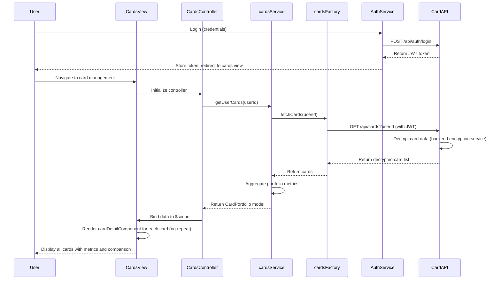

# Low-Level Design: Multiple Credit Card Management
**Epic ID:** QE-7670  
**Tech Stack:** AngularJS 1.x, JavaScript ES6, HTML5, CSS3, Bootstrap, REST APIs, MVC

---

## a. Architecture Mapping

- **User Interface** → AngularJS View (HTML5 template with Bootstrap cards for multi-card display)
- **Card Management Service** → AngularJS Service (orchestrates card data retrieval and aggregation)
- **User Authentication Service** → AngularJS Factory wrapping authentication REST API
- **Credit Card Data Repository** → REST API consumed via AngularJS $http
- **Encryption Service** → Backend service; AngularJS consumes decrypted data via secure API

**Folder Structure:**
```
/app
  /modules
    /cards
      cards.module.js
      cards.controller.js
      cards.service.js
      cards.factory.js
      cards.view.html
      card-detail.component.js
  /shared
    /auth
      auth.service.js
    /services
  /assets
    /css
    /js
```

---

## b. Component Specifications

| Name | Artifact Type | Responsibility | Key Dependencies |
|------|---------------|----------------|------------------|
| cardsModule | Module | Register card management components, routes, and authentication guards | ngRoute, authService |
| CardsController | Controller | Manage card list display, user interactions, and card comparison logic | cardsService, authService, $scope |
| cardsService | Service | Fetch user's card portfolio, aggregate card-specific metrics (spend, limits, balances) | cardsFactory, $http, $q |
| cardsFactory | Factory | REST API wrapper for credit card data repository endpoints | $resource |
| authService | Service | Handle user authentication, token management, and secure API calls | $http, $window (localStorage) |
| cardDetailComponent | Component | Reusable component to display individual card details (spend, limit, available credit, outstanding) | None (isolated) |

---

## c. Data Model

**CreditCard (JS Object):**
```javascript
{
  cardId: String,
  userId: String,
  cardNumber: String,  // Masked, e.g., "****1234"
  cardType: String,  // e.g., "Visa", "Mastercard"
  creditLimit: Number,
  availableCredit: Number,
  outstandingBalance: Number,
  monthlySpend: Number,
  issuer: String
}
```

**CardPortfolio (JS Object):**
```javascript
{
  userId: String,
  cards: [CreditCard],  // Array of CreditCard objects
  totalCards: Number,
  totalCreditLimit: Number,
  totalOutstanding: Number
}
```

---

## d. Data Flow

User logs in → authService validates credentials and stores JWT token → User navigates to card management view → CardsController calls cardsService.getUserCards(userId) → cardsService invokes cardsFactory to fetch card list from REST API /api/cards?userId → API retrieves encrypted card data from repository, decrypts via backend encryption service, and returns card details → cardsService aggregates portfolio-level metrics (total cards, total credit limit, total outstanding) → Controller binds CardPortfolio model to $scope → View renders multiple cardDetailComponent instances for each card using ng-repeat → User views all cards with individual metrics and comparison capability.

---

## e. Primary Sequence Diagram



---

## f. Implementation Notes

- Use AngularJS $resource with custom actions for card CRUD operations; enable response caching to meet <500ms latency
- Implement authService with JWT token stored in localStorage; attach token to all API requests via $http interceptor
- Create cardDetailComponent as reusable AngularJS 1.5+ component with bindings for card data and isolated scope
- Apply ES6 classes for service layer and use $q.all() for parallel card data fetching if multiple API calls needed
- Use Bootstrap grid (col-md-4) for responsive card layout; implement ng-repeat with track by cardId for performance

---

## g. Error Handling

$http interceptor catches 401 (redirect to login), 403 (show access denied), and 500 errors (display user notification via Bootstrap alert).

---

## h. Security Notes

Requires token-based auth via existing SSO; JWT token attached to all API calls; card data encrypted at rest and in transit (HTTPS).

---