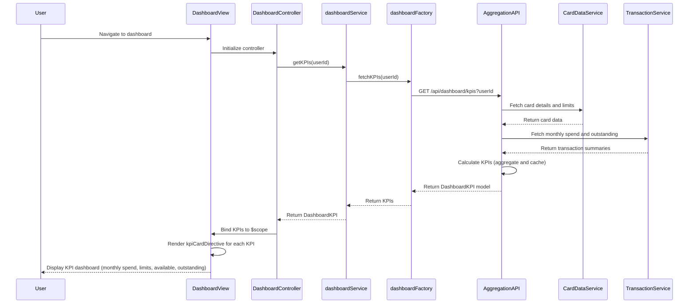

# Low-Level Design: Credit Card Dashboard and KPI Monitoring
**Epic ID:** QE-7671  
**Tech Stack:** AngularJS 1.x, JavaScript ES6, HTML5, CSS3, Bootstrap, REST APIs, MVC

---

## a. Architecture Mapping

- **User Interface** → AngularJS View (HTML5 template with Bootstrap panels for KPI cards)
- **Dashboard Service** → AngularJS Service (orchestrates KPI data retrieval and aggregation)
- **Credit Card Data Service** → REST API consumed via AngularJS Factory
- **Transaction Processing Service** → REST API consumed via AngularJS Factory
- **Data Aggregation Layer** → Backend API; AngularJS service consumes aggregated endpoint

**Folder Structure:**
```
/app
  /modules
    /dashboard
      dashboard.module.js
      dashboard.controller.js
      dashboard.service.js
      dashboard.factory.js
      dashboard.view.html
      kpi-card.directive.js
  /shared
    /services
    /directives
  /assets
    /css
    /js
```

---

## b. Component Specifications

| Name | Artifact Type | Responsibility | Key Dependencies |
|------|---------------|----------------|------------------|
| dashboardModule | Module | Register dashboard components, routes, and configure module dependencies | ngRoute, ngResource |
| DashboardController | Controller | Manage dashboard state, trigger KPI data load, handle refresh actions | dashboardService, $scope, $interval |
| dashboardService | Service | Fetch aggregated KPI data (monthly spend, credit limit, available credit, outstanding) from backend | dashboardFactory, $http, $q |
| dashboardFactory | Factory | REST API wrapper for data aggregation layer endpoint /api/dashboard/kpis | $resource |
| kpiCardDirective | Directive | Render individual KPI card with icon, label, value, and responsive styling | None (isolated) |

---

## c. Data Model

**DashboardKPI (JS Object):**
```javascript
{
  userId: String,
  monthlySpend: Number,
  totalCreditLimit: Number,
  availableCredit: Number,
  outstandingAmount: Number,
  lastUpdated: Date
}
```

---

## d. Data Flow

User navigates to dashboard → DashboardController initializes and calls dashboardService.getKPIs(userId) → dashboardService invokes dashboardFactory to call REST API /api/dashboard/kpis?userId → Backend data aggregation layer queries credit card data service for card details/limits and transaction processing service for monthly spend/outstanding amounts → Aggregation layer calculates KPIs (monthly spend, total credit limit, available credit, outstanding) with caching for performance → API returns DashboardKPI model → dashboardService receives data and resolves promise → Controller binds KPIs to $scope → View renders four kpiCardDirective instances (one per KPI) using ng-repeat or explicit bindings → User views real-time consolidated KPI dashboard with responsive layout.

---

## e. Primary Sequence Diagram



---

## f. Implementation Notes

- Use AngularJS $resource for /api/dashboard/kpis with response caching (5-minute TTL) to meet <2s page load requirement
- Implement kpiCardDirective with isolated scope accepting kpiLabel, kpiValue, kpiIcon as bindings for reusability
- Apply ES6 const/let and arrow functions in dashboardService; use $q promises for async KPI data handling
- Leverage AngularJS $interval to auto-refresh dashboard every 60 seconds for real-time updates
- Use Bootstrap grid (col-sm-6 col-md-3) for responsive KPI card layout across mobile, tablet, and desktop

---

## g. Error Handling

$http interceptor captures API failures, displays Bootstrap alert with retry option, and logs errors for debugging.

---

## h. Security Notes

Standard input validation and secure API calls assumed; token-based auth via existing SSO for API requests.

---