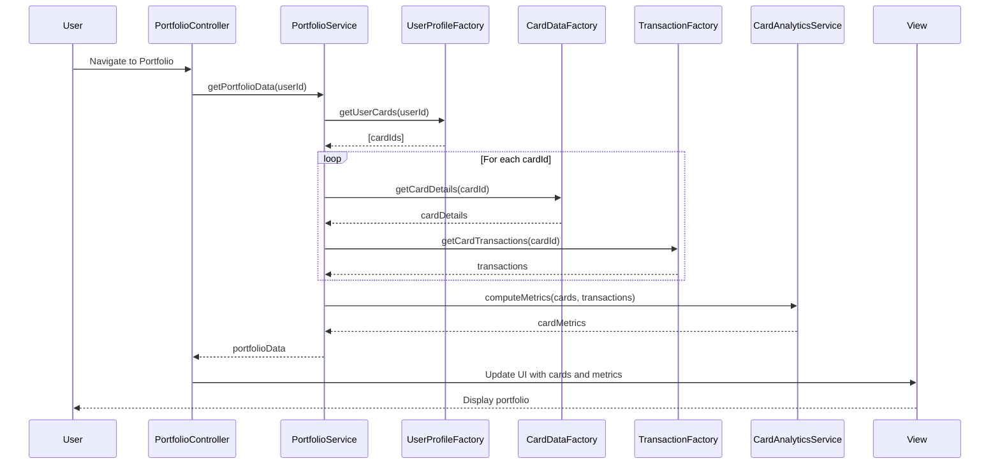

# Low-Level Design: Credit Card Portfolio Management
**Epic ID:** QE-7672

## a. Architecture Mapping

- **User Interface** → AngularJS Module (`creditCardPortfolio`) + Controller (`PortfolioController`) + Directive (`cardListDirective`)
- **Portfolio Management Service** → AngularJS Service (`PortfolioService`) for orchestrating card data retrieval and analytics
- **Credit Card Data Repository** → REST API integration via Factory (`CardDataFactory`)
- **User Profile Service** → REST API integration via Factory (`UserProfileFactory`)
- **Transaction Service** → REST API integration via Factory (`TransactionFactory`)
- **Card Analytics Engine** → AngularJS Service (`CardAnalyticsService`) for client-side metric computation

**Folder Structure:**
```
/app
  /modules
    /portfolio
      portfolio.module.js
      portfolio.controller.js
      portfolio.service.js
      /directives
        card-list.directive.js
      /factories
        card-data.factory.js
        user-profile.factory.js
        transaction.factory.js
      /services
        card-analytics.service.js
      /views
        portfolio.html
  /assets
    /css
      portfolio.css
```

## b. Component Specifications

| Component Name | Artifact Type | Responsibility | Key Dependencies |
|----------------|---------------|----------------|------------------|
| creditCardPortfolio | Module | Root module for portfolio management feature | ngRoute, ngResource |
| PortfolioController | Controller | Manages portfolio view state, card selection, and navigation | PortfolioService, CardAnalyticsService, $scope |
| PortfolioService | Service | Orchestrates card data retrieval and coordinates between factories | CardDataFactory, UserProfileFactory, TransactionFactory, $q |
| cardListDirective | Directive | Renders card list with navigation and card-specific metrics | PortfolioController, $compile |
| CardDataFactory | Factory | REST API calls to fetch card details, limits, and balances | $resource, API_ENDPOINTS |
| UserProfileFactory | Factory | REST API calls to retrieve user-card ownership mappings | $resource, API_ENDPOINTS |
| TransactionFactory | Factory | REST API calls to fetch card-specific transaction data | $resource, API_ENDPOINTS |
| CardAnalyticsService | Service | Computes card utilization metrics and spending patterns | None (pure computation) |

## c. Data Model

**Card Object:**
```javascript
{
  cardId: String,
  userId: String,
  cardType: String,        // e.g., "Visa", "Mastercard"
  cardNumber: String,      // masked, e.g., "**** **** **** 1234"
  creditLimit: Number,
  currentBalance: Number,
  availableCredit: Number,
  cardStatus: String       // e.g., "Active", "Blocked"
}
```

**CardMetrics Object:**
```javascript
{
  cardId: String,
  totalSpend: Number,
  utilizationRate: Number, // percentage
  transactionCount: Number,
  avgTransactionAmount: Number
}
```

## d. Data Flow

User accesses the portfolio view, triggering PortfolioController to call PortfolioService, which retrieves user-card mappings via UserProfileFactory. For each card, CardDataFactory fetches card details and TransactionFactory retrieves spending data. CardAnalyticsService computes utilization metrics and spending patterns from the aggregated data. The controller updates $scope with card list and metrics, and cardListDirective renders the navigable card interface with drill-down capabilities for individual card performance.

## e. Primary Sequence Diagram



## f. Implementation Notes

- Use AngularJS Dependency Injection for all services, factories, and controllers to ensure testability and modularity.
- Implement $resource for REST API integration with proper error handling and promise-based async flow using $q.
- Use ng-repeat with track by cardId in cardListDirective for efficient DOM rendering with multiple cards.
- Apply Bootstrap grid system (col-md-4, col-sm-6, col-xs-12) for responsive card layout across devices.
- Leverage ES6 arrow functions, const/let, and template literals in service/factory implementations for cleaner code.

## g. Error Handling

HTTP interceptor captures API errors; user-facing notifications via toastr or custom modal service with retry option.

## h. Security Notes

Standard input validation and secure API calls assumed; card data transmission over HTTPS with token-based auth via existing SSO.